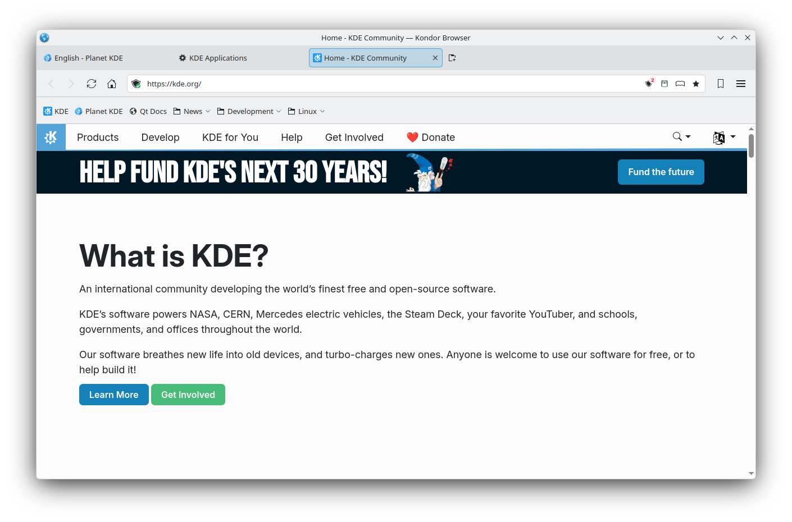
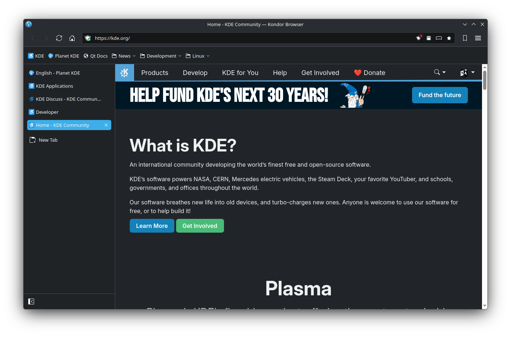

<p align="center">
  
</p>

<h1 align="center">Kondor Browser</h1>

<p align="center"><b>A fast, private web browser that feels at home on the KDE Plasma desktop.</b></p>

Kondor Browser runs the modern web on the same engine as Chrome, and it looks and feels like any other Plasma app.





## Highlights

- **Native on Plasma**: Breeze look, KDE dialogs, your color scheme
- **Private**: blocks ads and trackers out of the box; private tabs leave no trace
- **All built in**: passwords, reader mode, downloads and developer tools

## Download

**Flatpak** (recommended): open the [`.flatpakref`](https://lukasborges.github.io/kondor-browser/io.github.lukasborges.Kondor.flatpakref) link in Discover, or run:

```bash
flatpak install --user https://lukasborges.github.io/kondor-browser/io.github.lukasborges.Kondor.flatpakref
```

Updates arrive in Discover and through `flatpak update`.

**AppImage**: get it from the [latest release](https://github.com/lukasborges/kondor-browser/releases/latest), make it executable and run it.

**Known issue**: while Qt 6.11 is in use, Kondor runs through XWayland on a Wayland session, because `<select>` lists ignore mouse clicks on native Wayland ([QTBUG-147154](https://qt-project.atlassian.net/browse/QTBUG-147154)). Set `QT_QPA_PLATFORM=wayland` to force native Wayland.

See what's coming next on the [Roadmap](https://github.com/users/lukasborges/projects/1).

## Features

### Tabs and windows
- **Tidy tabs**: drag, pin, group, scroll, and search them across windows
- **Tab styles**: pick floating, below the address bar, side bar, or classic tabs
- **Collapsible side bar**: shrink the side bar to tab icons and expand it again
- **Mute tabs**: see which tab plays sound and silence it with a click or Ctrl+M
- **Sleeping tabs**: idle tabs free their memory and reload when selected
- **Reopen closed tabs** with Ctrl+Shift+T
- **Multiple windows**, with your session restored on startup
- **Profiles**: keep work and personal browsing apart, and start one with `--profile <name>`

### Search and address bar
- **One bar** for addresses and searches
- **Smart suggestions** from your bookmarks and history
- **New Tab page** with your most visited sites

### Privacy and security
- **Ad and tracker blocking** built in
- **Private tabs and windows** that leave no trace
- **Passwords** saved in KWallet, filled in for you, searchable and importable
- **Password generator**: strong passwords suggested on sign-up forms, saved automatically
- **Extensions** from the Kondor catalog or a file, pinnable to the toolbar
- **User scripts** from `.user.js` pages or files, managed with extensions
- **Site permissions**: sites ask before using the camera, microphone or location
- **Pop-up blocker** with per-site exceptions
- **Browser identity per site**: appear as Firefox, Chrome or a custom browser on one site
- **Security padlock** and warnings for unsafe sites
- **HTTPS-only mode**: always try the secure site, warn before plain HTTP
- **Crash reports**: after a crash, send a prefilled GitHub issue you review first

### Reading
- **Reader mode** for clutter-free articles
- **PDF viewer**: read PDFs, also those embedded in pages
- **Find in page**, **zoom per site** and **spell checking**
- **Print**, **save as PDF**, **save the page** or **take a screenshot**
- **Full screen** for videos and windows, and hide the toolbars to show only the page

### Library
- **Bookmarks** with a panel, a drag-and-drop toolbar, folders and Firefox/Chrome import
- **Searchable history** grouped by day
- **Downloads** with pause, resume and notifications

### Made for KDE
- **Breeze look** that follows your color scheme
- **KDE settings window**, dialogs and notifications
- **KRunner search**: find open tabs, bookmarks and history with Alt+Space
- **Media controls**: play, pause and skip from Plasma, the lock screen and the media keys
- **Available in 19 languages**
- **Translate pages** on your computer, offline after a one-time download per language

### For developers
- **Developer tools** (F12) and **view source**
- **Responsive design mode** previews a page on Chrome's phone and tablet list, with pixel ratio
- **Remote control** lets AI agents work in marked tabs of their own through a built-in MCP server (off by default)
- **Load unpacked extensions** with `--load-extension <dir>` (experimental, needs `--new-instance`)

## Keyboard shortcuts

| Shortcut | Action |
| --- | --- |
| `Ctrl+T` | New tab |
| `Ctrl+Shift+N` | New private tab |
| `Ctrl+N` | New window |
| `Ctrl+Shift+P` | New private window |
| `Ctrl+W` | Close tab (closes the window if it is the last one; the app quits when the last window closes) |
| `Ctrl+Shift+W` | Close window |
| `Ctrl+Shift+A` | Search tabs |
| `Ctrl+Shift+T` | Reopen closed tab |
| `Ctrl+Tab` / `Ctrl+PgDown` | Next tab |
| `Ctrl+Shift+Tab` / `Ctrl+PgUp` | Previous tab |
| `Ctrl+1` … `Ctrl+8` | Go to tab N |
| `Ctrl+9` | Go to the last tab |
| `Ctrl+Shift+PgUp` / `Ctrl+Shift+PgDown` | Move the current tab left / right |
| `Ctrl+H` | Browsing history |
| `Ctrl+D` | Bookmark this page (edit name and folder) |
| `Ctrl+B` | Show or hide the bookmarks panel |
| `Ctrl+Shift+B` | Show or hide the bookmarks toolbar |
| `Ctrl+Shift+O` | Manage bookmarks |
| `Ctrl+,` / `Ctrl+Shift+,` | Configure Kondor Browser (settings) |
| `Ctrl+L` | Focus the address bar |
| `Ctrl+M` | Mute or unmute the current tab |
| `Ctrl+F` | Find in page |
| `Ctrl+P` | Print (opens a PDF in the viewer) |
| `Ctrl+Shift+M` | Toggle responsive design mode |
| `Ctrl+Shift+S` | Take Screenshot (visible area or full page) |
| `Ctrl+S` | Save page as… |
| `F12` / `Ctrl+Shift+I` | Toggle developer tools |
| `Ctrl+Alt+R` | Toggle reader mode (article pages) |
| `Ctrl+F` (Configure window) | Filter the settings pages |
| `F3` / `Shift+F3` | Next / previous match (find bar open) |
| `Esc` | Close the find bar; leave page full screen |
| `Shift+F10` / `Menu` | Open the page context menu |
| `F11` | Toggle window full screen (hides the toolbars) |
| `Ctrl+Shift+F` | Hide or show the toolbars |
| `Ctrl+R` / `F5` | Reload |
| `Ctrl+Shift+R` / `Shift+F5` / `Ctrl+F5` | Reload, bypassing the cache |
| `Alt+←` / `Alt+→` | Back / forward |
| `Ctrl++` / `Ctrl+-` | Zoom in / out |
| `Ctrl+0` | Reset zoom (also by clicking the zoom level in the address bar) |

## Set as default browser

Install Kondor, then open **System Settings → Default Applications → Web browser** and choose
**Kondor Browser**. From a terminal the same is done with:

```bash
xdg-settings set default-web-browser io.github.lukasborges.Kondor.desktop   # Flatpak
xdg-settings set default-web-browser kondor.desktop                         # installed from source
```

Kondor then opens links clicked in other applications. The desktop entry also provides a
**New Private Window** action (`kondor --private`).

## Importing passwords

In **Settings → Passwords**, **Import…** reads the CSV file another browser or password manager
exports and saves its logins to KWallet. Where to export it:

- **Chrome, Chromium, Edge, Brave, Vivaldi, Opera**: Settings → Passwords (Password Manager) →
  Settings → Export passwords
- **Firefox, LibreWolf, Waterfox**: Passwords (`about:logins`) → ⋯ → Export passwords
- **Bitwarden**: File/Vault → Export vault → `.csv`
- **1Password 8**: ⋯ at the top of the sidebar → Export → CSV

Any other CSV with website, username and password columns (KeePassXC, LastPass…) works too. The
file holds your passwords unencrypted, so Kondor offers to move it to the trash afterwards.

## Extensions

**Settings → Extensions** lists the extensions you have installed. **Get New Extensions…** installs
one from the community catalog (built from
[`lukasborges/kondor-extensions`](https://github.com/lukasborges/kondor-extensions), where anyone can
propose an extension by pull request), and **Install from File…** installs a `.kondorext` file from
your computer; opening one in the file manager does the same. A `.user.js` page offers to install
the user script, which is then listed and managed like an extension (`GM.*` values, styles and
notifications are supported). Extensions are off in private windows
unless you allow them. Authors: see [`docs/extensions/api.md`](docs/extensions/api.md).

## Remote control

AI agents and automation tools can read and control the pages of normal windows, with the agent's
pointer shown on the page. Agents work only in tabs they open, which are marked, or in tabs you
hand over with **Allow Agent Access**. Turn it on in **Settings → Privacy → Remote control** and click **Restart Now**,
or start it once with `kondor --remote-control 9222`.

Kondor has a built-in [MCP](https://modelcontextprotocol.io) server, so any MCP client needs no
extra tools: add the command shown under **MCP server** in the same settings page. For example,
with Claude Code:

```bash
claude mcp add kondor -- flatpak run io.github.lukasborges.Kondor --mcp
```

Other clients take the same command in their configuration:

```json
{ "mcpServers": { "kondor": { "command": "kondor", "args": ["--mcp"] } } }
```

The agent can list, open and navigate tabs, read a page, click, type, scroll and take screenshots.
If Kondor is closed, the first call starts it. A toolbar icon shows while an agent is connected,
and its popup can disconnect it. Any tool that speaks the Chrome DevTools protocol also works, for
example `npx chrome-devtools-mcp@latest --browserUrl http://127.0.0.1:9222`.

Private browsing is unavailable while remote control is on, and only programs on this computer can
connect.

## Stack

- **Python 3.13+** and **PySide6 6.8+** (tested with **6.11.2**), over Qt `Core`, `DBus`, `Gui`, `Qml`, `Quick`, `QuickControls2`, `Sql`, `WebChannel`, `WebEngineCore`, `WebEngineQuick`, `WebSockets`, `Widgets`
- **Qt Quick Controls 2** with the **`org.kde.desktop`** (Breeze) style
- **Kirigami** for theming (`Kirigami.Theme`)

## Requirements

- Python 3.13+ and PySide6 6.8+ (**including Qt WebEngine**)
- **`jeepney`** (pure Python D-Bus library, used to answer KRunner)
- **`langdetect`** (pure Python language detection, used when translating pages without a `lang` attribute)
- The **`org.kde.desktop`** (QQC2 Desktop Style) and **Kirigami** packages available at runtime

On **Fedora** (the original development environment):

```bash
sudo dnf install python3 python3-pyside6 python3-jeepney python3-langdetect pyside6-tools kf6-kirigami kf6-qqc2-desktop-style \
    qt6-qtwebengine hunspell-en-US hunspell-pt-BR
sudo dnf install python3-pytest python3-pytest-qt python3-mypy ruff dbus-daemon   # development tools
```

The Hunspell dictionaries (`/usr/share/hunspell`) are converted to Qt WebEngine's
`.bdic` format when the build is staged, for spell checking; choose the languages with
`--spellcheck-languages en_US,pt_BR`.

> Package names vary across distributions. What matters is having PySide6 with
> WebEngine plus KDE's `qqc2-desktop-style`/Kirigami.

## Build and run

```bash
python3 scripts/build.py
PYTHONPATH=src python3 -m kondor
```

`python3 scripts/build.py --install <prefix>` also installs Kondor under `<prefix>`: the `kondor`
launcher in `<prefix>/bin`, the Python package and the QML module in `<prefix>/share/kondor`, and
the desktop file, icons and metadata.

### Tests

```bash
scripts/run-pytests.sh
```

It runs the tests offscreen, on a private D-Bus session and with temporary `XDG_*` folders. The
checks of the build scripts run with `python3 -m unittest discover -s scripts/tests`.

### Code quality

The code follows Clean Code limits in `src/kondor/`, `qml/` and `tests/`: functions of at most 10 lines, files of at most 200 lines, almost no comments, and folders of at most 10 files and two levels below a feature folder. `python3 scripts/check-code-quality.py` enforces them (`--changed origin/main` checks only your changes). The existing offenders are listed in `scripts/code-quality-baseline.json`, which can only shrink.

## Translations

English is the source language; every user-visible string is wrapped in `qsTr()`.
Kondor Browser ships translations for Catalan, Czech, Dutch, French, German, Italian,
Japanese, Korean, Polish, Portuguese (Brazil and Portugal), Russian, Spanish, Swedish,
Turkish, Ukrainian, and Chinese (Simplified and Traditional), in `i18n/kondor_<lang>.ts`.
The compiled `.qm` files are embedded in `kondor.rcc` under `:/i18n`. Kondor Browser loads
the translation that matches the system locale at startup (and Qt's own translations for
dialogs and context menus).

- **Update the `.ts` files** after changing strings: `python3 scripts/update-translations.py`.
  This runs `pyside6-lupdate` over `src/kondor/` and `qml/` with `-no-obsolete -locations none` (moving a line does not change the files) and writes the result to `i18n/`. `i18n/kondor_en.ts` holds only the English plural forms (`-pluralonly`): Qt needs it to show "15 minutes" instead of "15 minute(s)".
- **Add a language**: create `i18n/kondor_<lang>.ts` (the script updates every `i18n/kondor_*.ts`)
  and translate the messages with Qt Linguist (`linguist-qt6 i18n/kondor_<lang>.ts`).
- **Keep them complete**: a PR that adds or changes a user-visible string updates every
  `i18n/*.ts` file. The "Check translations" CI step runs `scripts/update-translations.py`, fails when the
  result differs from the committed files, and reports any `unfinished`, empty, or
  placeholder-mismatched message.

## Notes

- The `org.kde.desktop` style is applied at startup (`src/kondor/app/startup`); if it cannot be found, it falls back to `Fusion`.
- Colors come from the theme, so changing the KDE color scheme will not break the layout.

## Third-party code

- [Mozilla Readability](https://github.com/mozilla/readability) (Apache-2.0), vendored in `3rdparty/readability/` with its license, powers reader mode.
- [Mozilla Bergamot](https://github.com/mozilla/firefox-translations) translation engine (MPL-2.0), its glue code vendored in `3rdparty/bergamot/` with its license, and Mozilla's language models translate pages on your computer.

## License

Licensed under the **GNU General Public License v3.0 or later** (GPL-3.0-or-later). See [LICENSE](LICENSE).
