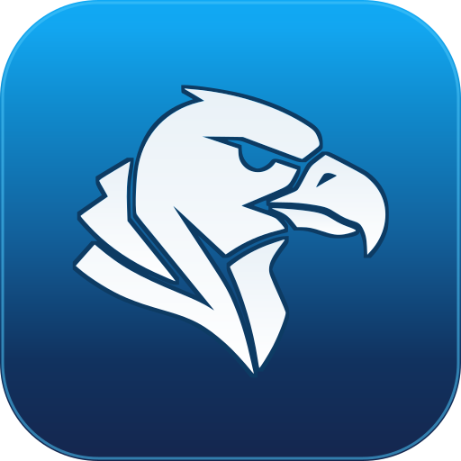
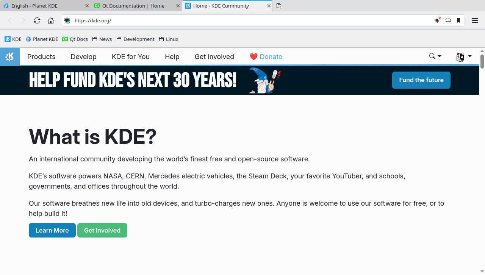

<p align="center">
  
</p>

# Kondor Browser

A native **Qt 6** browser (Qt Quick + Qt WebEngine) with the **KDE/Breeze** look and feel.

> Personal/experimental project. **Not an official KDE project.**



## Status

A working prototype with the core functionality in place: it actually browses, with tabs, a private mode, browsing history, bookmarks, settings and About windows and keyboard shortcuts.

## Features

### Implemented

- **Real tabs** with `Qt WebEngine` (one `WebEngineView` per tab, preserving state when switching)
- **Multiple windows**: Ctrl+N opens an independent window and Ctrl+Shift+P a private one where every tab, including new ones, is private (private browsing icon in the tab bar and a title suffix); each window has its own tabs, address bar and shortcuts, closing one leaves the others open, closing the last one quits, and "Move Tab to New Window" in the tab context menu moves a tab to a window of its own (the page reloads there). Shift+click on a link opens it in a new window
- **Tab management**: favicons and a loading indicator, drag to reorder, middle-click to close, pinned tabs, a tab context menu (reload, duplicate, pin, close others and tabs to the right), keyboard switching and overflow handling (tabs shrink, then the bar scrolls)
- **Unified address/search bar**: accepts a URL, a host (`example.com`, IP, `localhost`) or free text (searches with the configured engine); local hosts use `http://`, public hosts `https://`. While typing, a dropdown offers **Visit** and **Search with the configured engine** for the same text, then matching bookmarks and history entries (most visited first) and, when enabled in Settings, the search engine's suggestions; Up/Down select a row, Enter opens it, Esc restores the typed text, and clicking a row opens it in the current tab (middle click in a background tab). A host is completed inline from the history (`kd` → `kde.org`, with the added part selected), and Backspace just removes that completion
- **New Tab page**: new tabs show Kondor's own page with a search field and the eight sites visited most in the last 90 days (favicons, open in a new tab or private tab, remove a site); private tabs get a private variant without top sites. The home page is only used by the first tab at startup and by the Home button, and a blank home page (the default) means the New Tab page
- **Navigation**: back, forward, reload/stop, home
- **Page context menu**: right-click on a link, image, video or audio, selected text or an editable field for the matching actions (open in a new/private tab, copy or save, search the selection, spelling suggestions, undo/redo/cut/copy/paste); on the page itself it offers back, forward, reload and view source. `Shift+F10` or the `Menu` key opens it from the keyboard
- **Private mode**: off-the-record tabs and windows, isolated from the persistent profile
- **Browsing history**: records visited pages (persistent profile only), with a searchable history window (Ctrl+H) grouped by day and clear options (all or a time range)
- **Bookmarks**: star button in the address bar (Ctrl+D) with a name/folder editor, a bookmarks toolbar (Ctrl+Shift+B), a Bookmarks menu, and a manager window (Ctrl+Shift+O) with folders, rename, delete, reordering, drag and drop between folders, a "Move To" menu and import of Firefox/Chrome HTML exports. A new profile starts with a set of KDE and Linux bookmarks (KDE, Planet KDE, Qt Docs and the News, Development and Linux folders); they are added once, and an existing profile is never changed
- **Settings** (Ctrl+,): a KDE Configure window with a sidebar (searchable with Ctrl+F), page tabs and Defaults / OK / Apply / Cancel; options cover the home page (blank means the New Tab page), startup behavior, New Tab page top sites, search engine (including a custom URL and optional search suggestions in the address bar), download folder and privacy options (third-party cookies, clear data on exit, site permission management). Changes stay pending until OK or Apply, and are stored in `~/.config/KDE/Kondor.conf`
- **About window** (Menu → About Kondor Browser): app, Qt and Chromium versions, components and authors, with a viewer for the license text; links open in a new normal tab
- **Session restore**: optionally reopen the tabs of every window from the previous session on startup (General → Startup in the Configure window); private tabs are never saved. Ctrl+Shift+T reopens the last closed normal tabs, up to 20
- **Find in page** (Ctrl+F): incremental search with match counter, previous/next and match case
- **Full screen**: a video can take the whole screen (the toolbars hide and a hint says how to leave), while F11 toggles window full screen keeping the toolbars; leaving full screen returns the window to its previous size and state
- **Site permissions**: camera, microphone, screen sharing, location, notifications, clipboard, pointer lock and local fonts are requested in an inline bar with **Allow** / **Block**; the decision is remembered for the site (normal tabs only) and can be reviewed or revoked in Menu → **Site Permissions…** or Settings → Privacy
- **Security indicator**: the address bar shows a padlock for HTTPS, **Not Secure** for HTTP and a page icon for local files; clicking it opens a site information popup with the connection state and the permissions remembered for the site. Certificate errors show a "Your connection is not private" page with **Back to Safety** and, when the error allows it, an advanced **Continue Anyway (Unsafe)** option; an accepted certificate is remembered for that site in the profile and keeps showing the warning state
- **Crashed pages**: when a page's renderer process dies (crash, kill, out of memory), that tab shows a page with the reason, the exit code and **Reload** / **Close Tab** buttons; the tab keeps its place and the other tabs are not affected
- **Download manager**: downloads show live progress, speed and size in a toolbar popup; pause, resume, cancel, open the file or show it in its folder, desktop notification on completion/failure, optional "ask where to save", and a confirmation before quitting with active downloads
- **Command line**: `kondor URL…` opens the given URLs or local files in tabs of a new window (`--private` for a private window), and the app registers as a web browser so it can be the system default. A second launch reuses the running process: it opens the URLs as new tabs in the most recently active window and raises it, then exits; `--new-window` opens them in a new window and `--new-instance` starts a separate process (development)
- **Menu** and **keyboard shortcuts**
- **KDE look** via the `org.kde.desktop` (QQC2) style, with a `Fusion` fallback
- **Semantic colors** (`Kirigami.Theme`/`palette`): follows the system color scheme
- **Translations**: English source strings with translations for the main KDE languages, selected by the system locale

## Stack

- **Qt 6.8+** (tested with **6.11.2**): `Core`, `DBus`, `Gui`, `LinguistTools`, `Qml`, `Quick`, `QuickControls2`, `Sql`, `WebEngineCore`, `WebEngineQuick`, `Widgets`
- **Qt Quick Controls 2** with the **`org.kde.desktop`** (Breeze) style
- **Kirigami** for theming (`Kirigami.Theme`)
- **C++17** + **CMake 3.21+**
- C++ backend exposed to QML (`QML_ELEMENT` / `QML_SINGLETON`)

## Requirements

- Qt 6.8+ with the modules above (**including Qt WebEngine**)
- The **`org.kde.desktop`** (QQC2 Desktop Style) and **Kirigami** packages available at runtime
- A C++17-capable compiler and CMake 3.21+

On **Fedora** (the original development environment):

```bash
sudo dnf install cmake gcc-c++ \
    qt6-qtbase-devel qt6-qtdeclarative-devel qt6-qtwebengine-devel qt6-qttools-devel \
    kf6-qqc2-desktop-style kf6-kirigami
```

> Package names vary across distributions. What matters is having Qt 6 with
> WebEngine plus KDE's `qqc2-desktop-style`/Kirigami.

## Build and run

```bash
cmake -S . -B build -DCMAKE_BUILD_TYPE=Release
cmake --build build
./build/kondor
```

### Tests

The non-UI logic has Qt Test suites (`tst_addressresolver`, `tst_tabmodel`):

```bash
cmake --build build
ctest --test-dir build --output-on-failure
```

Pass `-DBUILD_TESTING=OFF` to configure without building them.

## Set as default browser

Install Kondor (or use the AppImage), then open **System Settings → Default Applications → Web
browser** and choose **Kondor Browser**. From a terminal the same is done with:

```bash
xdg-settings set default-web-browser kondor.desktop
```

Kondor then opens links clicked in other applications. The desktop entry also provides a
**New Private Window** action (`kondor --private`).

## Project structure

```
CMakeLists.txt
src/
  main.cpp            startup (command line, WebEngine, KDE style, QML engine)
  profilemanager.*    persistent/private profiles, address/search resolution
  addressresolver.*   pure address/search resolution (unit tested)
  startupargs.*       QML singleton: command-line URLs and private mode
  startupurl.*        command-line argument to URL conversion (unit tested)
  settings.*          QML singleton: user settings persisted with QSettings
  sessionmanager.*    QML singleton: save/restore the normal tabs of every window
  windowmanager.*     QML singleton: create the browser windows (normal and private)
  singleinstance.*    one process per session: later launches forward their URLs over a local socket
  tab.*               per-tab state (title, URL, icon, loading, history, pending permissions)
  tabmodel.*          tab model (QAbstractListModel)
  database.*          SQLite storage (schema + migrations)
  historymanager.*    QML singleton: write/query/clear browsing history
  historymodel.*      history list model (QAbstractListModel)
  bookmarkmanager.*   QML singleton: bookmark tree, folders, HTML import
  searchsuggestions.* QML singleton: search-engine autocomplete for the address bar
  bookmarkmodel.*     one folder's items as a list model (QAbstractListModel)
  faviconstore.*      QML singleton: one favicon per host (table `favicons`), filled by normal tabs only
  downloadmanager.*   QML singleton: downloads list model, actions and notifications
  notifier.*          QML singleton: desktop notifications over D-Bus
  aboutinfo.*         QML singleton: read-only version and license data for the About window
qml/
  BrowserWindow.qml   one browser window: tab bar, navigation bar, menu, shortcuts
  AddressSuggestions.qml  address bar dropdown (visit/search, bookmarks, history, suggestions)
  WebViewTab.qml      WebEngineView + bridge to the Tab object
  NewTabPage.qml      New Tab page (logo, search field, top sites)
  TabButtonDelegate.qml  one tab button (favicon, title, close, drag, pinned)
  TabContextMenu.qml  context menu for a tab in the tab bar
  InlineBar.qml       shared strip between the header and the page content
  FindBar.qml         find bar (Ctrl+F)
  PermissionBar.qml   inline site permission request with Allow and Block
  PermissionTypeInfo.qml  wording and Breeze icons for each permission type
  SitePermissionsDialog.qml  remembered site decisions, filter and Revoke
  DownloadsPopup.qml  download list popup with progress and actions
  HistoryWindow.qml   browsing history window (search, grouped by day, clear)
  SettingsWindow.qml  settings window (home page, new tabs, search, downloads, privacy)
  AboutWindow.qml     About Kondor Browser window with components, authors and license
  BookmarksBar.qml    bookmarks toolbar under the navigation bar
  BookmarkMenu.qml    folder menu (bar folders and the main menu submenu)
  BookmarksWindow.qml bookmark manager window (folders, reorder, drag and drop, import)
  SiteIcon.qml        favicon with a fallback icon (toolbar, manager, New Tab page)
```

## Keyboard shortcuts

| Shortcut | Action |
| --- | --- |
| `Ctrl+T` | New tab |
| `Ctrl+Shift+N` | New private tab |
| `Ctrl+N` | New window |
| `Ctrl+Shift+P` | New private window |
| `Ctrl+W` | Close tab (closes the window if it is the last one; the app quits when the last window closes) |
| `Ctrl+Shift+W` | Close window |
| `Ctrl+Shift+T` | Reopen closed tab |
| `Ctrl+Tab` / `Ctrl+PgDown` | Next tab |
| `Ctrl+Shift+Tab` / `Ctrl+PgUp` | Previous tab |
| `Ctrl+1` … `Ctrl+8` | Go to tab N |
| `Ctrl+9` | Go to the last tab |
| `Ctrl+Shift+PgUp` / `Ctrl+Shift+PgDown` | Move the current tab left / right |
| `Ctrl+H` | Browsing history |
| `Ctrl+D` | Bookmark this page (edit name and folder) |
| `Ctrl+Shift+B` | Show or hide the bookmarks toolbar |
| `Ctrl+Shift+O` | Manage bookmarks |
| `Ctrl+,` / `Ctrl+Shift+,` | Configure Kondor Browser (settings) |
| `Ctrl+L` | Focus the address bar |
| `Ctrl+F` | Find in page |
| `Ctrl+F` (Configure window) | Filter the settings pages |
| `F3` / `Shift+F3` | Next / previous match (find bar open) |
| `Esc` | Close the find bar; leave page full screen |
| `Shift+F10` / `Menu` | Open the page context menu |
| `F11` | Toggle window full screen |
| `Ctrl+R` / `F5` | Reload |
| `Alt+←` / `Alt+→` | Back / forward |
| `Ctrl++` / `Ctrl+-` | Zoom in / out |
| `Ctrl+0` | Reset zoom |

## Translations

English is the source language; every user-visible string is wrapped in `qsTr()`.
Kondor Browser ships translations for Catalan, Czech, Dutch, French, German, Italian,
Japanese, Korean, Polish, Portuguese (Brazil and Portugal), Russian, Spanish, Swedish,
Turkish, Ukrainian, and Chinese (Simplified and Traditional), in `i18n/kondor_<lang>.ts`.
The compiled `.qm` files are embedded in the binary under `:/i18n`. Kondor Browser loads
the translation that matches the system locale at startup (and Qt's own translations for
dialogs and context menus).

- **Update the `.ts` files** after changing strings: `cmake --build build --target update_translations`.
  This runs `lupdate` with `-no-obsolete` and writes the result to `i18n/`.
- **Add a language**: create `i18n/kondor_<lang>.ts` (the `update_translations` target creates it
  if it is listed in `TS_FILES`), add it to `TS_FILES` in `CMakeLists.txt`, and translate the
  messages with Qt Linguist (`linguist-qt6 i18n/kondor_<lang>.ts`).
- **Keep them complete**: a PR that adds or changes a user-visible string updates every
  `i18n/*.ts` file. The "Check translations" CI step runs `update_translations`, fails when the
  result differs from the committed files, and reports any `unfinished`, empty, or
  placeholder-mismatched message.

## Notes

- The `org.kde.desktop` style is applied in `main.cpp`; if it cannot be found, it falls back to `Fusion`.
- Colors come from the theme, so changing the KDE color scheme will not break the layout.

## License

Licensed under the **GNU General Public License v3.0 or later** (GPL-3.0-or-later). See [LICENSE](LICENSE).
