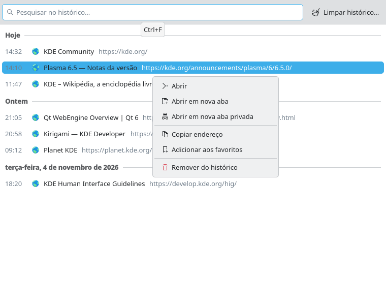

# Browsing history (#1)

> **Issue:** [#1](https://github.com/lukasborges/kondor/issues/1) · **Priority:** P1 (high) · **State:** see the issue's label (`to-spec` / `to-dev` / `in-review`).
> Read [`AGENTS.md`](../../AGENTS.md) first. This file is the source of truth for the issue; only the architect edits it.

## Objective

Record the pages visited in normal (non-private) tabs and let the user browse, search, reopen and clear them.

## Context

Nothing is stored. `qml/WebViewTab.qml` already reports `title`/`url` changes to the `Tab` object (`tab.setTitle`, `tab.setUrl`), and `onLoadingChanged` knows when a load finished (`WebEngineLoadingInfo.LoadSucceededStatus`).

## Design / behavior

1. **Create the shared `Database` block** described in `AGENTS.md` (`src/database.{h,cpp}`): opens `<AppDataLocation>/kondor.sqlite`, creates the directory with `QDir().mkpath()` if needed, runs migrations based on `PRAGMA user_version`. Add `Sql` to `find_package(Qt6 …)` and `Qt6::Sql` to `target_link_libraries`.
2. Migration v1 creates:
   ```sql
   CREATE TABLE history (
     id INTEGER PRIMARY KEY AUTOINCREMENT,
     url TEXT NOT NULL,
     title TEXT NOT NULL DEFAULT '',
     visited_at INTEGER NOT NULL          -- msecs since epoch (UTC)
   );
   CREATE INDEX history_visited_at ON history(visited_at DESC);
   CREATE INDEX history_url ON history(url);
   ```
3. **`src/historymanager.{h,cpp}`** — QML singleton `HistoryManager` (`QML_ELEMENT` + `QML_SINGLETON`, same `instance()`/`create()` pattern as `ProfileManager`):
   - `Q_INVOKABLE void addVisit(const QUrl &url, const QString &title)` — ignores empty URLs and schemes other than `http`/`https`/`file`; if the most recent row has the same URL and is less than 30 s old, only update its title instead of inserting.
   - `Q_INVOKABLE void updateTitle(const QUrl &url, const QString &title)` — updates the title of the latest row for that URL (titles often arrive after the load finishes).
   - `Q_INVOKABLE void removeEntry(qint64 id)`, `Q_INVOKABLE void clearAll()`, `Q_INVOKABLE void clearSince(qint64 msecsSinceEpoch)`.
   - `Q_PROPERTY(HistoryModel *model READ model CONSTANT)` where `HistoryModel` is a `QAbstractListModel` with roles `id`, `url`, `title`, `visitedAt` (as `QDateTime`), `dayLabel` (`"Today"`, `"Yesterday"` or a localized date via `QLocale().toString(date, QLocale::LongFormat)`) and a `Q_PROPERTY(QString filter …)` that re-queries with `WHERE url LIKE ? OR title LIKE ?` (escape `%`/`_`), newest first, `LIMIT 500`.
   - Emit/refresh the model after every write.
4. **Hook it up in `qml/WebViewTab.qml`**:
   ```qml
   onLoadingChanged: function(loadRequest) {
       ...existing code...
       if (loadRequest.status === WebEngineLoadingInfo.LoadSucceededStatus && !root.tab.isPrivate)
           HistoryManager.addVisit(webView.url, webView.title)
   }
   onTitleChanged: {
       root.tab.setTitle(title)
       if (!root.tab.isPrivate) HistoryManager.updateTitle(webView.url, title)
   }
   ```
5. **UI — `qml/HistoryWindow.qml`** (new file, add to `QML_FILES`): a QQC2 `ApplicationWindow` (≈ 700×600, title "History — Kondor") containing:
   - a search `TextField` at the top bound to `HistoryManager.model.filter` (debounce 200 ms with a `Timer`);
   - a `ListView` with `section.property: "dayLabel"` and `section.delegate` showing the day as a header; each row shows favicon-less `Kirigami.Icon { source: "internet-web-browser" }`, title (bold) and URL (dimmed, `Kirigami.Theme.disabledTextColor`), elided;
   - double-click/Enter opens the URL in a new tab of the main window (pass the `TabModel` in as a required property and call `tabModel.addTab(false, url)`); a context menu (right click) with "Open in New Tab", "Copy Address" (use a hidden `TextEdit` + `copy()` or `Clipboard` via C++ helper `QGuiApplication::clipboard()`), "Remove from History";
   - a "Clear History…" button opening a `Dialog` with a `ComboBox`: "Last hour", "Today", "Everything" → `clearSince()` / `clearAll()`.
6. In `Main.qml`: `Shortcut { sequence: "Ctrl+H"; onActivated: historyWindow.show() }`, a menu item "History" (`icon.name: "view-history"`) in `mainMenu`, and instantiate `HistoryWindow { id: historyWindow; tabModel: tabs }` lazily (`Loader` or `Component.createObject` on first use).
### Edge cases

- Private tabs: never call `HistoryManager` (check `tab.isPrivate`).
- Redirects produce several URL changes; only the final successful load is recorded.
- `about:blank`, `data:`, `chrome://`, `qrc:` and empty URLs are ignored.
- The database must open lazily and survive a missing/corrupted file: if `open()` fails, log `qWarning()` and keep the browser working without history.

## Acceptance criteria

- [ ] Visiting pages in normal tabs adds rows with the final URL and page title; private tabs add nothing.
- [ ] Ctrl+H and the menu open the history window grouped by day, newest first.
- [ ] Typing in the search field filters by title or URL.
- [ ] Double-click opens the entry in a new tab; context menu actions work.
- [ ] "Clear History" with each range removes the right rows.
- [ ] History survives an app restart.

## Manual test

1. Open 3 sites, close and reopen Kondor, press Ctrl+H: all 3 are listed under "Today".
2. Open a private tab (Ctrl+Shift+N), visit a site: it does not appear.
3. Search for part of a title; clear the last hour; verify the list.

## Out of scope

Address-bar suggestions (#11), syncing, importing history from other browsers.

## Dependencies

None. Creates the shared `Database` block used by #2, #11 and #21.

## Prototype

Visual target — match it (controls, Kirigami components, icon names, wording, placement). If it disagrees with this spec, the spec wins.

**History window with search, grouped by day, and context menu** — [`prototypes/01-history.qml`](../../prototypes/01-history.qml)



## Decisions

| Question | Decision |
| --- | --- |
| Section role name: `dayLabel` (spec) or `day` (prototype)? | `dayLabel`, as in the spec. |
| Title in bold although the prototype is regular weight? | Accepted (the spec asks for bold). |
| Context menu with 3 items instead of the prototype's 6? | Accepted: "Open in New Private Tab" and "Add to Bookmarks" come with #12/#2. |
| Extra `time` role for the time column? | Accepted. |
| Review of `6e443d7` (2026-11-08) | Changes requested — see https://github.com/lukasborges/kondor/issues/1#issuecomment-6728466097 (must fix: old-visit titles overwritten, Enter/keyboard activation, rebase onto `main`). |

