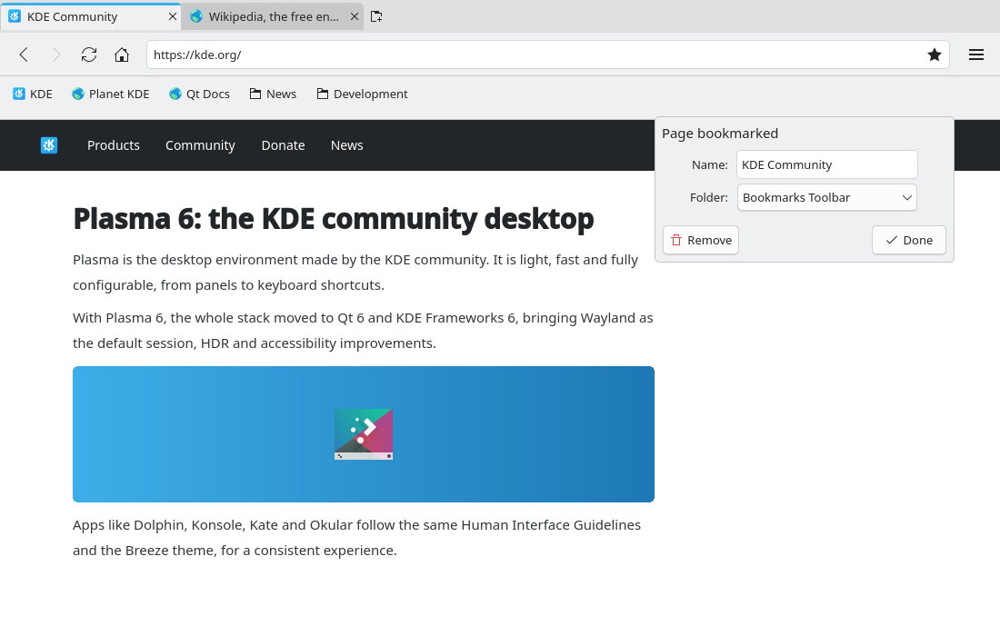
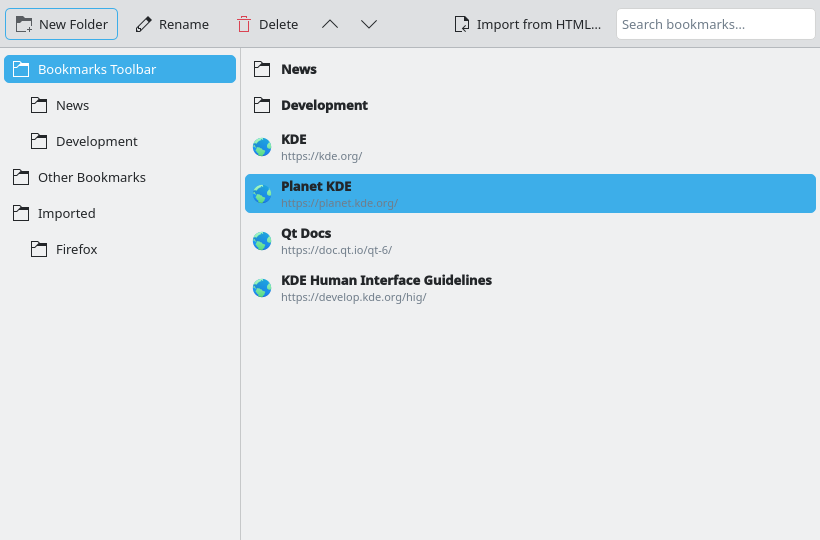

# Bookmarks (#2)

> **Issue:** [#2](https://github.com/lukasborges/kondor/issues/2) · **Priority:** P1 (high) · **State:** see the issue's label (`to-spec` / `to-dev` / `in-review`).
> Read [`AGENTS.md`](../../AGENTS.md) first. This file is the source of truth for the issue; only the architect edits it.

## Objective

Let the user bookmark pages, open them from a menu/bar, organize them in folders and import bookmarks from other browsers.

## Context

No bookmarks. Address bar is the `TextField { id: addressBar }` in `qml/Main.qml`; the main menu is `Menu { id: mainMenu }`.

## Design / behavior

1. Reuse the shared **`Database`** block (create it as described in `AGENTS.md`/#1 if it does not exist yet). Add a migration creating:
   ```sql
   CREATE TABLE bookmarks (
     id INTEGER PRIMARY KEY AUTOINCREMENT,
     parent_id INTEGER REFERENCES bookmarks(id) ON DELETE CASCADE,  -- NULL = root
     is_folder INTEGER NOT NULL DEFAULT 0,
     title TEXT NOT NULL DEFAULT '',
     url TEXT,                          -- NULL for folders
     position INTEGER NOT NULL DEFAULT 0,
     created_at INTEGER NOT NULL
   );
   ```
   Create two fixed root folders on first run: "Bookmarks Toolbar" (shown in the bookmarks bar) and "Other Bookmarks"; store their ids in the `Settings` block or look them up by a `special` column (`'toolbar'`, `'other'`).
2. **`src/bookmarkmanager.{h,cpp}`** — QML singleton `BookmarkManager`:
   - `Q_INVOKABLE bool isBookmarked(const QUrl &url) const`, `Q_INVOKABLE qint64 bookmarkIdFor(const QUrl &url) const`
   - `Q_INVOKABLE qint64 addBookmark(const QUrl &url, const QString &title, qint64 folderId)`; `addFolder(title, parentId)`; `rename(id, title)`; `setUrl(id, url)`; `move(id, newParentId, newPosition)`; `remove(id)`
   - `Q_INVOKABLE int importHtml(const QUrl &fileUrl)` — parses the **Netscape bookmark HTML** format exported by Firefox/Chrome (`<DL><DT><H3>Folder</H3><DL>…</DL><DT><A HREF="…">Title</A>`), returns the number of imported bookmarks, puts everything under a new folder "Imported".
   - A `BookmarkModel` (`QAbstractListModel`) for one folder (`Q_PROPERTY(qint64 folderId …)`) with roles `id`, `title`, `url`, `isFolder`; and `Q_PROPERTY(BookmarkModel *toolbarModel READ … CONSTANT)`.
   - Signal `bookmarksChanged()` emitted after every write; models refresh on it.
3. **Star button** inside the address bar (`addressBar.rightPadding` + a `ToolButton` anchored right inside it): `icon.name` = `bookmarks` when bookmarked else `bookmark-new`; hidden when `tabs.currentTab.url` is empty. Clicking it when not bookmarked adds to "Other Bookmarks" and opens an edit `Popup` (title field, folder `ComboBox`, "Remove" and "Done" buttons); when already bookmarked it opens the same popup.
4. **Ctrl+D** shortcut = click on the star.
5. **Bookmarks bar** (`qml/BookmarksBar.qml`): a thin `ToolBar` under the navigation bar, `Repeater` over `BookmarkManager.toolbarModel`, flat `ToolButton`s (icon `folder` for folders → open a `Menu` with the folder content, recursively one level is enough; otherwise favicon-less `text` + `ToolTip` with URL). Visibility controlled by `Settings.showBookmarksBar` (default `false`) and toggled with **Ctrl+Shift+B** and a checkable menu item.
6. **Bookmarks menu** in `mainMenu`: a sub-`Menu` "Bookmarks" with "Bookmark This Page" (Ctrl+D), "Manage Bookmarks…" (Ctrl+Shift+O), "Show Bookmarks Toolbar", then the items of the toolbar folder.
7. **Manager window** `qml/BookmarksWindow.qml`: left `ListView` of folders, right `ListView` of items in the selected folder, buttons "New Folder", "Rename", "Delete", drag-and-drop or up/down buttons to reorder, and "Import from HTML…" using `FileDialog` (`QtQuick.Dialogs`, `nameFilters: ["HTML (*.html *.htm)"]`).
8. Middle-click or Ctrl+click on any bookmark opens it in a background tab; normal click navigates the current tab.
### Edge cases

- Bookmarking from a private tab is allowed (explicit user action) but must not store anything else from that tab.
- Duplicate URLs are allowed in different folders; the star reflects "exists anywhere".
- Very long titles are elided in the bar; folders with many items scroll in the menu.
- Import must not freeze the UI for large files (thousands of entries): wrap inserts in one transaction.

## Acceptance criteria

- [ ] Star button and Ctrl+D add/edit/remove a bookmark for the current page; the icon updates when switching tabs or navigating.
- [ ] Bookmarks bar shows the "Bookmarks Toolbar" folder and can be toggled (Ctrl+Shift+B), state persisted.
- [ ] Bookmarks menu lists bookmarks; manager window supports folders, rename, delete, reorder.
- [ ] Importing a Firefox or Chrome HTML export creates the folder tree under "Imported".
- [ ] Everything persists across restarts.

## Manual test

Bookmark 3 pages into different folders, restart, open them from the bar and the menu; export bookmarks from Firefox (Library → Import and Backup → Export Bookmarks to HTML) and import the file.

## Out of scope

Sync, favicons cache (use generic icons), JSON import from Chrome profiles, keyword bookmarks.

## Dependencies

Uses `Database` (#1) and `Settings` (#3) blocks — create them following `AGENTS.md` if they do not exist yet.

## Prototype

Visual target — match it (controls, Kirigami components, icon names, wording, placement). If it disagrees with this spec, the spec wins.

**Star in the address bar, edit popup and bookmarks toolbar** — [`prototypes/02-bookmarks.qml`](../../prototypes/02-bookmarks.qml)



**Manage Bookmarks window** — [`prototypes/02b-bookmarks-manager.qml`](../../prototypes/02b-bookmarks-manager.qml)



## Decisions

_None yet._ Answers to developer questions (`question` label) are recorded here as `| Question | Decision |` rows.
