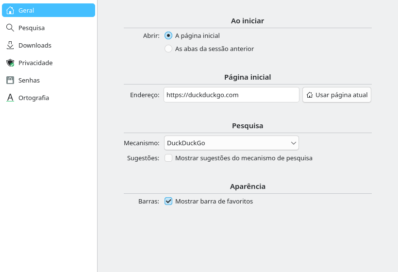

# Settings page (#3)

> **Issue:** [#3](https://github.com/lukasborges/kondor/issues/3) · **Priority:** P1 (high) · **State:** see the issue's label (`to-spec` / `to-dev` / `in-review`).
> Read [`AGENTS.md`](../../AGENTS.md) first. This file is the source of truth for the issue; only the architect edits it.

## Objective

A settings window where the user changes home page, search engine, download folder and privacy options, persisted and applied immediately.

## Context

Values are hardcoded in `src/profilemanager.h`: `m_homePage = "https://duckduckgo.com"`, `m_searchEngineUrl = "https://duckduckgo.com/?q=%1"`; downloads go to `QStandardPaths::DownloadLocation` in `ProfileManager::setupProfile()`. `QCoreApplication` organization is `KDE` and application `Kondor` (`src/main.cpp`).

## Design / behavior

1. **Create the shared `Settings` block** (`src/settings.{h,cpp}`, QML singleton) as described in `AGENTS.md`. Properties (READ/WRITE/NOTIFY, persisted on write with `QSettings::setValue` + `sync()`):
   | Property | Type | Default | Key |
   | --- | --- | --- | --- |
   | `homePage` | QString | `https://duckduckgo.com` | `General/HomePage` |
   | `searchEngine` | QString | `duckduckgo` | `Search/Engine` (`duckduckgo`, `google`, `startpage`, `brave`, `custom`) |
   | `customSearchUrl` | QString | `""` | `Search/CustomUrl` (must contain `%1`) |
   | `downloadDirectory` | QString | `QStandardPaths::DownloadLocation` | `Downloads/Directory` |
   | `askWhereToSave` | bool | `false` | `Downloads/AskWhereToSave` |
   | `startupBehavior` | QString | `homepage` | `General/Startup` (`homepage`, `restore`) — used by #6 |
   | `showBookmarksBar` | bool | `false` | `UI/ShowBookmarksBar` — used by #2 |
   | `clearDataOnExit` | bool | `false` | `Privacy/ClearOnExit` |
   | `blockThirdPartyCookies` | bool | `false` | `Privacy/BlockThirdPartyCookies` |
   Add `Q_INVOKABLE QString searchUrlTemplate() const` returning the URL for the selected engine (`https://www.google.com/search?q=%1`, `https://www.startpage.com/do/search?q=%1`, `https://search.brave.com/search?q=%1`, DuckDuckGo, or the custom one).
2. **Wire `ProfileManager` to `Settings`**: `homePage()` returns `Settings::instance()->homePage()`; `resolveAddress()` uses `searchUrlTemplate()`; change `Q_PROPERTY(QString homePage … CONSTANT)` to have a `NOTIFY` connected to `Settings::homePageChanged`. In `setupProfile()` set `profile->setDownloadPath(Settings::instance()->downloadDirectory())` and update it when the setting changes (for the default profile and the private ones that are alive).
3. **Third-party cookies**: on the default profile use `profile->cookieStore()` (C++ `QWebEngineCookieStore`) with `setCookieFilter({ return !r.thirdParty || !Settings::instance()->blockThirdPartyCookies(); })`.
4. **Clear on exit**: connect `QCoreApplication::aboutToQuit` → if `clearDataOnExit`: `defaultProfile()->clearHttpCache()`, `cookieStore()->deleteAllCookies()`, `HistoryManager::clearAll()` if #1 exists.
5. **UI `qml/SettingsWindow.qml`**: QQC2 `ApplicationWindow` (≈ 640×520, title "Configure — Kondor") with a `TabBar`/`StackLayout` of pages "General", "Search", "Downloads", "Privacy"; each page a `Kirigami.FormLayout`:
   - General: home page `TextField` + "Use Current Page" button; startup `ComboBox` ("Open the home page", "Restore the previous session").
   - Search: engine `ComboBox`; custom URL `TextField` enabled only for `custom`, with validation message if `%1` is missing (`Kirigami.InlineMessage`).
   - Downloads: folder path (read-only `TextField`) + "Choose…" (`FolderDialog` from `QtQuick.Dialogs`); `CheckBox` "Ask where to save each file".
   - Privacy: `CheckBox`es for third-party cookies and clear-on-exit; buttons "Clear Cookies and Cache Now" and "Manage Site Permissions…" (opens the dialog from #7 when it exists; hide otherwise).
   Changes apply immediately (no OK/Apply button), like KDE apps.
6. Open it with **Ctrl+,** and a menu item "Configure Kondor…" (`icon.name: "configure"`) in `mainMenu`.
### Edge cases

- Invalid home page text: run it through `ProfileManager.resolveAddress()` when saving so `example.com` becomes `https://example.com`.
- Download folder that no longer exists: fall back to the default and show a warning.
- Settings must be readable before the QML engine loads (e.g. by `TabModel::addTab` for the home page).

## Acceptance criteria

- [ ] `Settings` singleton exists with the properties above, persisted in `~/.config/KDE/Kondor.conf`.
- [ ] Home page, search engine (including custom) and download folder changes take effect without restart.
- [ ] Third-party cookie blocking and clear-on-exit work.
- [ ] Ctrl+, and the menu open the window; it follows the Breeze look.

## Manual test

Change the engine to Google and search from the address bar; set a custom engine `https://www.bing.com/search?q=%1`; change home page and press the Home button; change download folder and download a file; enable clear-on-exit, log into a site, restart, verify you are logged out.

## Out of scope

Per-site permissions UI (#7), password settings (#21), spell-check languages (#23), sync of settings.

## Dependencies

None. Creates the `Settings` block used by #2, #4, #6, #7, #11, #20, #23, #24.

## Prototype

Visual target — match it (controls, Kirigami components, icon names, wording, placement). If it disagrees with this spec, the spec wins.

**Settings window (General page)** — [`prototypes/03-settings.qml`](../../prototypes/03-settings.qml)

## Decisions

_None yet._ Answers to developer questions (`question` label) are recorded here as `| Question | Decision |` rows.
