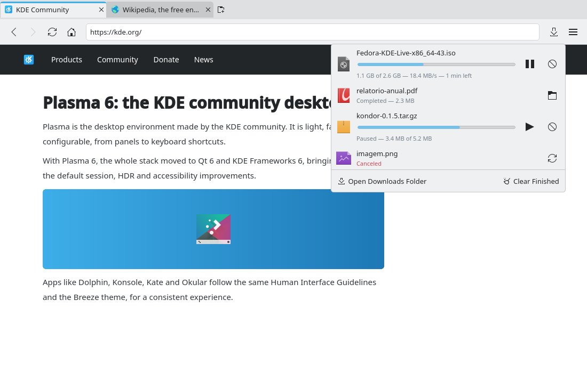

# Download manager (#4)

> **Issue:** [#4](https://github.com/lukasborges/kondor/issues/4) · **Priority:** P1 (high) · **State:** see the issue's label (`to-spec` / `to-dev` / `in-review`).
> Read [`AGENTS.md`](../../AGENTS.md) first. This file is the source of truth for the issue; only the architect edits it.

## Objective

Replace the silent auto-download with a real download manager: choose location (optionally), see progress, pause/resume/cancel, open the file or its folder, and get a desktop notification.

## Context

`ProfileManager::setupProfile()` (`src/profilemanager.cpp`) connects `QQuickWebEngineProfile::downloadRequested` and immediately calls `setDownloadDirectory(DownloadLocation)` + `accept()`. Nothing tracks the downloads.

## Design / behavior

1. **`src/downloadmanager.{h,cpp}`** — QML singleton `DownloadManager` and a `DownloadModel` (`QAbstractListModel`) holding `QPointer<QWebEngineDownloadRequest>` items. Roles: `fileName`, `directory`, `url`, `receivedBytes`, `totalBytes`, `progress` (0..1, or -1 if unknown), `state` (`QWebEngineDownloadRequest::DownloadState`), `isPaused`, `isPrivate`, `speedText` (bytes/s computed from the last second), `interruptReasonString`. Connect each request's `receivedBytesChanged`, `totalBytesChanged`, `stateChanged`, `isPausedChanged` and emit `dataChanged` for its row.
2. Move the `downloadRequested` handling from `ProfileManager` to `DownloadManager::handleRequest(QWebEngineDownloadRequest *)`:
   - default directory from `Settings.downloadDirectory` (#3; fallback `DownloadLocation`).
   - if `Settings.askWhereToSave` is true → emit a signal `saveLocationRequested(request)` handled in QML by a `FileDialog { fileMode: FileDialog.SaveFile; currentFile: directory/suggestedFileName }`; on accept set `downloadDirectory`/`downloadFileName` then `accept()`, on reject `cancel()`.
   - else `accept()` immediately.
   - `isSavePageDownload()` (from "Save page", #17) is handled the same way.
3. Invokables: `pause(row)`, `resume(row)`, `cancel(row)`, `openFile(row)` (`QDesktopServices::openUrl(QUrl::fromLocalFile(path))`), `showInFolder(row)` (call `org.freedesktop.FileManager1.ShowItems` over D-Bus with the file URL; fallback: open the directory), `removeFromList(row)`, `clearFinished()`.
4. **Notification**: on `DownloadCompleted` call the shared `Notifier` block (create it as described in `AGENTS.md`: D-Bus `org.freedesktop.Notifications.Notify`) with title "Download completed", body = file name, icon `download`. On `DownloadInterrupted` notify "Download failed" with the reason.
5. **UI**:
   - A `ToolButton` in the navigation toolbar (before the menu button), `icon.name: "download"`, visible only when the model is not empty; shows a small progress ring/bar overlay while any download is active (use a `ProgressBar` 2 px high anchored to the bottom of the button).
   - Clicking opens `qml/DownloadsPopup.qml` (a `Popup` ≈ 420 px wide, anchored under the button) with a `ListView`: icon by MIME type (`Kirigami.Icon { source: model.mimeIconName }` — add a `mimeIconName` role via `QMimeDatabase().mimeTypeForName(mimeType).iconName()`), file name, `ProgressBar`, status text ("12.3 MB of 40 MB — 2.1 MB/s", "Done", "Canceled"), and buttons pause/resume (`media-playback-pause`/`media-playback-start`), cancel (`dialog-cancel`), open folder (`folder-open`). Footer: "Clear Finished".
   - Use `QLocale().formattedDataSize()` for sizes.
   - Also open the popup automatically (once) when a new download starts.
6. Remove the old lambda from `ProfileManager::setupProfile()` and connect both default and private profiles to `DownloadManager`.
### Edge cases

- Downloads from private tabs: shown in the list but **removed from the list when the app quits** and never written anywhere.
- File name collisions: Qt WebEngine adds `(1)`; keep its `downloadFileName`.
- Closing the tab that started a download must not cancel it.
- Quitting with active downloads: show a `MessageDialog` "Downloads are still in progress. Quit anyway?" (handle `onClosing` in `Main.qml`).

## Acceptance criteria

- [ ] Downloads appear in the popup with live progress, speed and size.
- [ ] Pause, resume, cancel, open file and show in folder (Dolphin selects the file) work.
- [ ] "Ask where to save" setting shows a save dialog; otherwise files go to the configured folder.
- [ ] A Plasma notification appears on completion and on failure.
- [ ] Quitting with active downloads asks for confirmation.

## Manual test

Download a large file (e.g. a Linux distribution ISO) and a small one (a PDF), pause/resume the large one, cancel another, open the finished one and show it in the folder, then toggle "Ask where to save" and download again.

## Out of scope

Download history persisted across restarts, segmented downloads, torrent/magnet handling.

## Dependencies

Uses `Settings` (#3) and creates `Notifier` (shared block). Coordinates with #17 (save page).

## Prototype

Visual target — match it (controls, Kirigami components, icon names, wording, placement). If it disagrees with this spec, the spec wins.

**Downloads button with progress and the download list popup** — [`prototypes/04-downloads.qml`](../../prototypes/04-downloads.qml)

## Decisions

_None yet._ Answers to developer questions (`question` label) are recorded here as `| Question | Decision |` rows.
