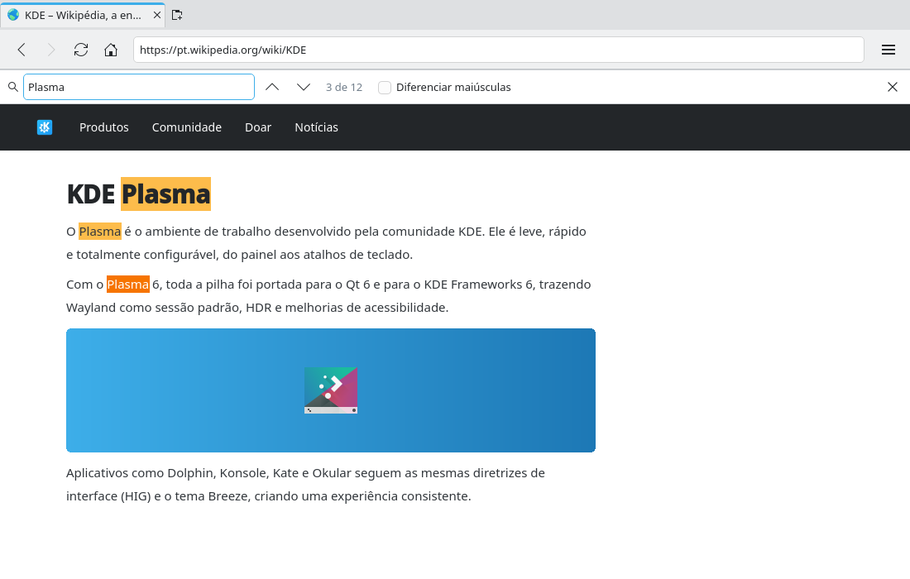

# Find in page (#5)

> **Issue:** [#5](https://github.com/lukasborges/kondor/issues/5) · **Priority:** P1 (high) · **State:** see the issue's label (`to-spec` / `to-dev` / `in-review`).
> Read [`AGENTS.md`](../../AGENTS.md) first. This file is the source of truth for the issue; only the architect edits it.

## Objective

Find text in the current page with a find bar (Ctrl+F), next/previous navigation and a match counter.

## Context

No find support. `WebEngineView` offers `findText(string subString, FindFlags options, var resultCallback)` and the signal `findTextFinished(WebEngineFindTextResult result)` with `numberOfMatches` and `activeMatch`.

## Design / behavior

1. **Shared `InlineBar` block** (`qml/InlineBar.qml`, see `AGENTS.md`): a `Rectangle` with `Kirigami.Theme.colorSet: Kirigami.Theme.View`, top/bottom 1 px separators (`Kirigami.Separator`), content via a default property, height = implicit content height + 2×`Kirigami.Units.smallSpacing`. It is placed between the header and the page content in `Main.qml`.
2. **`Tab` additions** (C++, follow the bridge pattern):
   - Commands: `Q_INVOKABLE void find(const QString &text, bool backward, bool caseSensitive)` → `emit findRequested(text, backward, caseSensitive)`; `Q_INVOKABLE void stopFind()` → `emit stopFindRequested()`.
   - State: `Q_PROPERTY(int findMatches …)`, `Q_PROPERTY(int findActiveMatch …)` with setters `setFindResult(int matches, int active)`.
3. **`WebViewTab.qml`**:
   ```qml
   onFindTextFinished: function(result) { root.tab.setFindResult(result.numberOfMatches, result.activeMatch) }
   // in Connections { target: root.tab }
   function onFindRequested(text, backward, caseSensitive) {
       let flags = 0
       if (backward) flags |= WebEngineView.FindBackward
       if (caseSensitive) flags |= WebEngineView.FindCaseSensitively
       webView.findText(text, flags)
   }
   function onStopFindRequested() { webView.findText("") }   // clears highlights
   ```
4. **`qml/FindBar.qml`** (uses `InlineBar`): `TextField` (placeholder "Find in page"), label "3 of 12" / "No results" (red text via `Kirigami.Theme.negativeTextColor` when 0 matches and text not empty), buttons `go-up` (previous) and `go-down` (next), `CheckBox` "Match case", close button `window-close`.
   - Typing searches incrementally (each `textChanged` → `tab.find(text, false, caseSensitive)`).
   - Enter = next, Shift+Enter = previous (`Keys.onReturnPressed` checking `event.modifiers & Qt.ShiftModifier`).
   - Esc closes the bar and calls `stopFind()`.
5. **`Main.qml`**: `Shortcut { sequence: StandardKey.Find }` opens the bar, focuses and selects the field (pre-fill with the page's selected text is optional); `F3` / `Shift+F3` next/previous when the bar is open; menu item "Find in Page…" (`edit-find`).
6. When the current tab changes or the page navigates, re-run the search for the new tab if the bar is open, or reset the counter.

## Acceptance criteria

- [ ] Ctrl+F opens the bar with focus; typing highlights matches and shows "N of M".
- [ ] Enter/F3 next, Shift+Enter/Shift+F3 previous, wraps around.
- [ ] Case-sensitive toggle works; Esc closes and removes highlights.
- [ ] No-result state is clearly shown.

## Manual test

Open a long Wikipedia article, search a common word, navigate matches, toggle case, switch tabs with the bar open, close with Esc.

## Out of scope

Regex search, find in PDF viewer internals, highlight-all toggle.

## Dependencies

None. Creates the `InlineBar` block reused by #7, #9, #18.

## Prototype

Visual target — match it (controls, Kirigami components, icon names, wording, placement). If it disagrees with this spec, the spec wins.

**Find in page bar** — [`prototypes/05-find-in-page.qml`](../../prototypes/05-find-in-page.qml)



## Decisions

_None yet._ Answers to developer questions (`question` label) are recorded here as `| Question | Decision |` rows.
