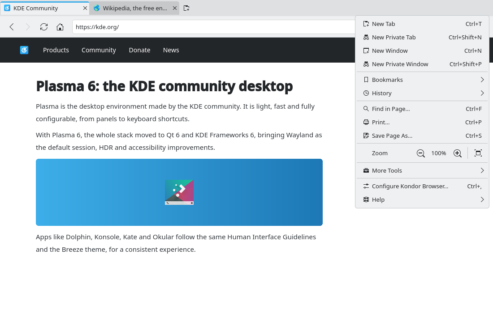
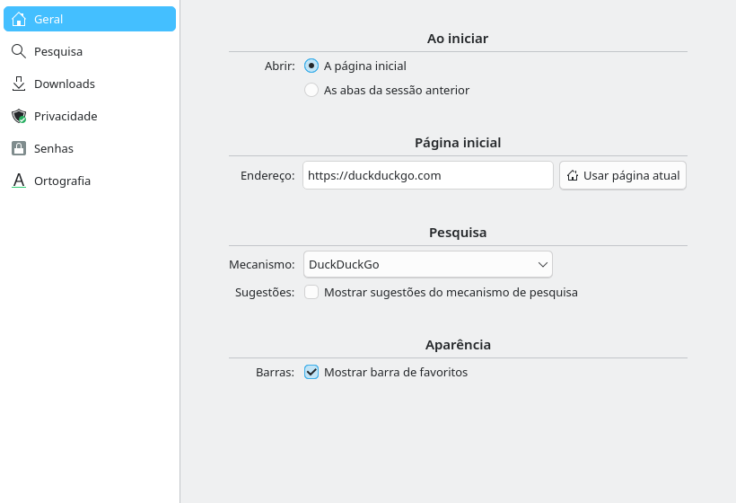

# Session restore and reopen closed tab (#6)

> **Issue:** [#6](https://github.com/lukasborges/kondor/issues/6) · **Priority:** P1 (high) · **State:** see the issue's label (`to-spec` / `to-dev` / `in-review`).
> Read [`AGENTS.md`](../../AGENTS.md) first. This file is the source of truth for the issue; only the architect edits it.

## Objective

Restore the previous session's tabs on startup (configurable) and reopen recently closed tabs with Ctrl+Shift+T.

## Context

`Main.qml` `Component.onCompleted` creates one tab with the home page. `TabModel::closeTab()` (`src/tabmodel.cpp`) deletes tabs without keeping any record.

## Design / behavior

1. **Session file**: `<AppDataLocation>/session.json` (atomic write with `QSaveFile`):
   ```json
   { "version": 1, "currentIndex": 2,
     "tabs": [ { "url": "https://…", "title": "…" }, … ] }
   ```
   Only non-private tabs are saved; `currentIndex` is recomputed over the saved tabs.
2. **`src/sessionmanager.{h,cpp}`** (QML singleton `SessionManager`):
   - `Q_INVOKABLE void save(TabModel *model)` — writes the file.
   - `Q_INVOKABLE bool restore(TabModel *model)` — reads it and calls `model->addTab(false, url)` for each entry, then `setCurrentIndex`; returns false if nothing restored.
   - Autosave: a `QTimer` (single shot, 2 s) restarted whenever `TabModel` emits `countChanged`/`currentIndexChanged` or any tab's `urlChanged`; also save on `QCoreApplication::aboutToQuit`.
3. **Startup** in `Main.qml`: `if (Settings.startupBehavior === "restore" && SessionManager.restore(tabs)) {} else tabs.addTab(false)`. Without #3, read the setting with a default of `homepage`, and add a menu checkbox "Restore Tabs on Startup".
4. **Closed tabs stack** in `TabModel`:
   - Before deleting a non-private tab in `closeTab()`, push `{url, title, index}` into `QList<ClosedTab> m_closed` (max 20).
   - `Q_INVOKABLE void reopenClosedTab()` pops the last entry and inserts a tab at the old index (add an `insertTab(int index, bool isPrivate, const QUrl &url)` helper; `addTab` can call it with `index = count()`).
   - `Q_PROPERTY(bool canReopenClosedTab …)`.
5. **UI**: `Shortcut { sequence: "Ctrl+Shift+T"; onActivated: tabs.reopenClosedTab() }`; menu item "Reopen Closed Tab" (`edit-undo`) enabled by `tabs.canReopenClosedTab`.
6. Closing the last tab currently closes the window (`window.closeTabAt`): the session saved at that moment must still contain that tab, so save **before** closing (in `onClosing` of the `ApplicationWindow`).
### Edge cases

- Session with zero normal tabs (only private ones open) → start with the home page.
- Corrupted/invalid JSON → ignore and start normally (log a warning).
- Restored tabs should not all load at once ideally; acceptable first version: load all. (Lazy loading is out of scope.)
- Back/forward history of each tab is not restored (out of scope).

## Acceptance criteria

- [ ] With "Restore the previous session", closing and reopening Kondor restores the same normal tabs, order and active tab.
- [ ] Private tabs are never restored nor written to `session.json`.
- [ ] Ctrl+Shift+T reopens up to the 20 last closed normal tabs at their original position.
- [ ] A crash (kill -9) loses at most ~2 s of tab changes.

## Manual test

Enable restore, open 4 tabs, select the 3rd, quit, reopen. Close 3 tabs and press Ctrl+Shift+T three times. Run `pkill -9 kondor` and restart.

## Out of scope

Restoring navigation history per tab, multiple windows (#14 will extend the format), lazy tab loading.

## Dependencies

Uses `Settings.startupBehavior` (#3) if available.

## Prototype

Visual target — match it (controls, Kirigami components, icon names, wording, placement). If it disagrees with this spec, the spec wins.

**Main menu with "Reopen Closed Tab"** — [`prototypes/00-main-menu.qml`](../../prototypes/00-main-menu.qml)



**"On Startup" option in Settings** — [`prototypes/03-settings.qml`](../../prototypes/03-settings.qml)



## Decisions

_None yet._ Answers to developer questions (`question` label) are recorded here as `| Question | Decision |` rows.
