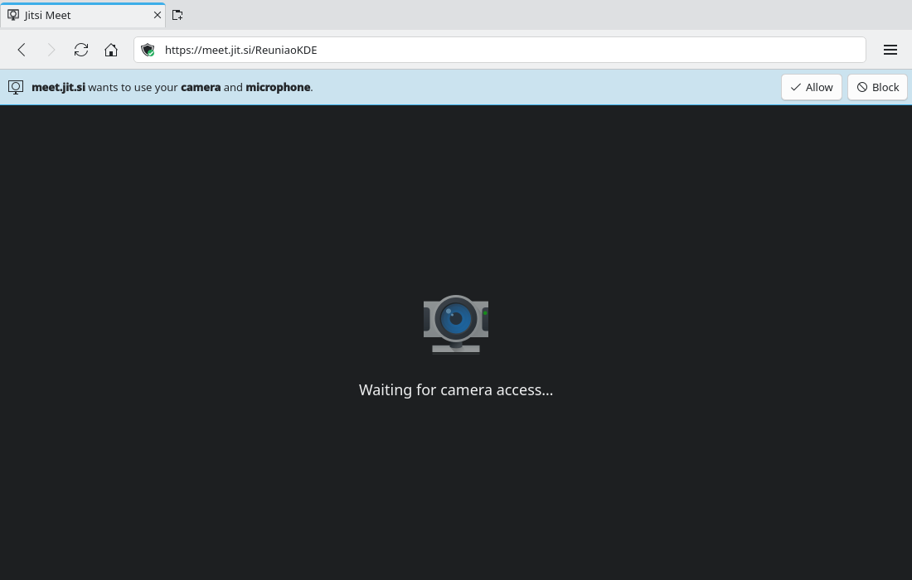
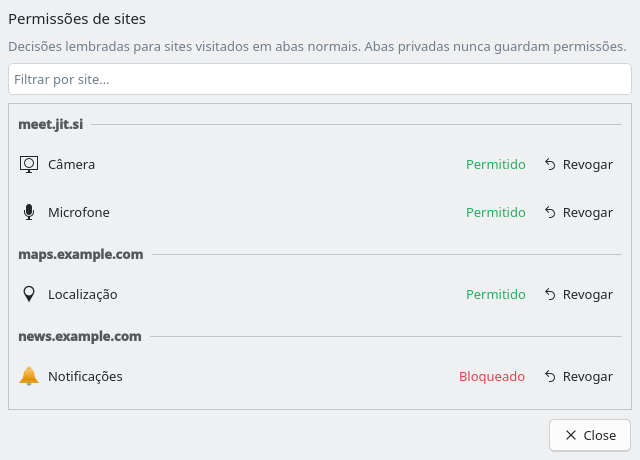

# Site permission requests (#7)

> **Issue:** [#7](https://github.com/lukasborges/kondor/issues/7) · **Priority:** P1 (high) · **State:** see the issue's label (`to-spec` / `to-dev` / `in-review`).
> Read [`AGENTS.md`](../../AGENTS.md) first. This file is the source of truth for the issue; only the architect edits it.

## Objective

Handle site permission requests (camera, microphone, screen sharing, location, notifications, clipboard, pointer lock) with an inline prompt, remember the decision, and let the user review/revoke it.

## Context

`WebViewTab.qml` does not handle `permissionRequested`, so requests are never answered and features silently fail. Qt 6.8+ provides `WebEngineView.permissionRequested(webEnginePermission permission)` with `permission.origin`, `permission.permissionType` (`WebEnginePermission.PermissionType`: `MediaAudioCapture`, `MediaVideoCapture`, `MediaAudioVideoCapture`, `DesktopVideoCapture`, `DesktopAudioVideoCapture`, `MouseLock`, `Notifications`, `Geolocation`, `ClipboardReadWrite`, `LocalFontsAccess`), `grant()`, `deny()`, `reset()`, `state`. Profiles have `persistentPermissionsPolicy`, `listAllPermissions()`, `listPermissionsForOrigin(url)` and `queryPermission(url, type)`.

## Design / behavior

1. In `ProfileManager::defaultProfile()` set `m_defaultProfile->setPersistentPermissionsPolicy(QWebEngineProfile::PersistentPermissionsPolicy::StoreOnDisk)` (Qt stores granted/denied permissions itself). Private profiles: `StoreInMemory`.
2. **`Tab` additions**: a queue of pending permissions exposed as `Q_PROPERTY(QVariant pendingPermission …)` (holding the `QWebEnginePermission` value) and `Q_INVOKABLE void answerPermission(bool grant)`. Simplest robust approach: keep the `QWebEnginePermission` objects in a `QList` in C++ (`Q_INVOKABLE void enqueuePermission(const QWebEnginePermission &p)`), show the first one, call `grant()`/`deny()` on answer, then show the next.
3. **`WebViewTab.qml`**: `onPermissionRequested: function(permission) { root.tab.enqueuePermission(permission) }`.
4. **`qml/PermissionBar.qml`** (uses the shared `InlineBar` block from #5): text like "**meet.google.com** wants to use your camera and microphone" (map each `PermissionType` to an English phrase and a Breeze icon: `camera-web`, `audio-input-microphone`, `video-display`, `mark-location`, `preferences-desktop-notification`, `edit-paste`, `input-mouse`), buttons "Allow" and "Block". Since the profile policy stores the answer, no extra "remember" checkbox is needed (document this in the UI tooltip: "This decision is remembered for this site").
5. **Notifications permission**: when granted, the profile emits `presentNotification(QWebEngineNotification *)` (C++ `QQuickWebEngineProfile::setNotificationPresenter` also exists). Forward them to the shared `Notifier` block (#4): title, message, and on click activate the tab is out of scope.
6. **Screen sharing** (`DesktopVideoCapture`): on Wayland Qt WebEngine uses the xdg-desktop-portal picker itself; just granting is enough. Also handle `WebEngineView.desktopMediaRequested(request)` if it fires: select the first screen via `request.selectScreen(request.screensModel.index(0,0))` or show a simple chooser — keep it minimal.
7. **Site permissions dialog** `qml/SitePermissionsDialog.qml`: lists `ProfileManager.defaultProfile().listAllPermissions()` grouped by origin, each with type, state ("Allowed"/"Blocked") and a "Revoke" button (`permission.reset()`). Reachable from Settings → Privacy (#3) and from the main menu "Site Permissions…".
8. Pending prompts belong to their tab: switching tabs shows that tab's prompt; navigating away denies the pending ones.

## Acceptance criteria

- [ ] Camera/mic test site (`https://webcamtests.com` or `https://meet.jit.si`) shows the bar; "Allow" makes the camera work, "Block" denies.
- [ ] Location (`https://browserleaks.com/geo`) and notifications (`https://www.bennish.net/web-notifications.html`) prompts work; granted notifications show as Plasma notifications.
- [ ] Decisions persist across restarts for normal tabs and can be revoked in the dialog.
- [ ] Private tabs never persist decisions.

## Manual test

Run the sites above, restart, verify no new prompt for granted sites, revoke one and reload.

## Out of scope

Per-site settings for cookies/JavaScript/pop-ups, WebAuthn UX.

## Dependencies

Uses `InlineBar` (#5) and `Notifier` (#4) blocks; dialog linked from Settings (#3).

## Prototype

Visual target — match it (controls, Kirigami components, icon names, wording, placement). If it disagrees with this spec, the spec wins.

**Permission request (Kirigami.InlineMessage)** — [`prototypes/07-permissions.qml`](../../prototypes/07-permissions.qml)

**Site Permissions dialog** — [`prototypes/07b-site-permissions-dialog.qml`](../../prototypes/07b-site-permissions-dialog.qml)

## Decisions

| Question | Decision |
| --- | --- |
| The permission APIs (`WebEnginePermission`, `permissionRequested`, `persistentPermissionsPolicy`) need Qt 6.8+, but the declared minimum is Qt 6.5. Raise the minimum or add guards for 6.5? | Raise the minimum to **Qt 6.8**; no compile/runtime guards. In PR #66: `find_package(Qt6 6.8 …)` and `qt_standard_project_setup(REQUIRES 6.8)` in `CMakeLists.txt`, "Qt 6.8+" in `README.md` (both places) and in the comment of `.github/workflows/build.yml`. The architect updates `AGENTS.md` on `main`. CI and releases already build on Fedora (Qt 6.11). |
