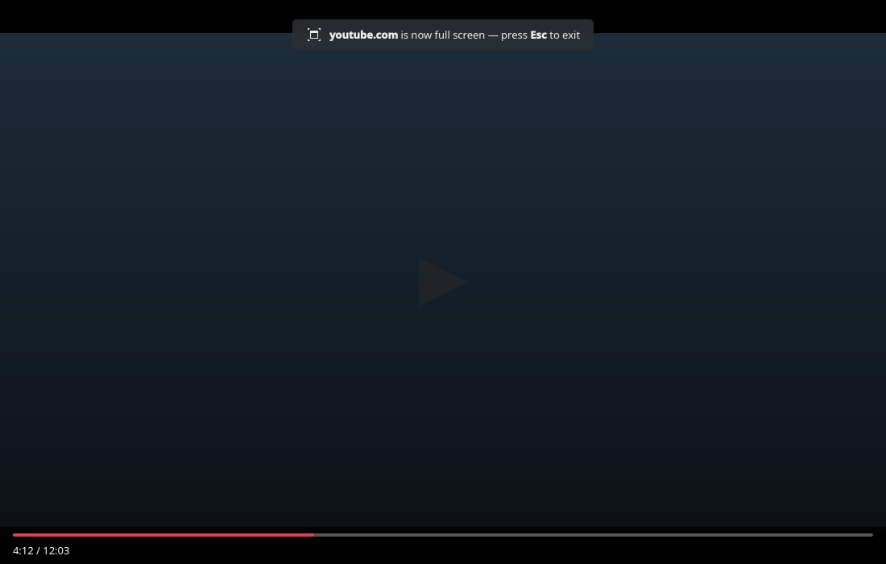

# Fullscreen support (#8)

> **Issue:** [#8](https://github.com/lukasborges/kondor/issues/8) · **Priority:** P1 (high) · **State:** see the issue's label (`to-spec` / `to-dev` / `in-review`).
> Read [`AGENTS.md`](../../AGENTS.md) first. This file is the source of truth for the issue; only the architect edits it.

## Objective

Support fullscreen requested by pages (videos) and a window fullscreen mode toggled with F11.

## Context

`fullScreenRequested` is not handled, so the YouTube fullscreen button does nothing. The window is a QQC2 `ApplicationWindow` whose `header` contains the tab bar and the toolbar.

## Design / behavior

1. **`Tab` additions**: `Q_PROPERTY(bool isFullScreen …)` + `setFullScreen(bool)`; command `Q_INVOKABLE void exitFullScreen()` → `emit exitFullScreenRequested()`.
2. **`WebViewTab.qml`**:
   ```qml
   onFullScreenRequested: function(request) {
       request.accept()
       root.tab.setFullScreen(request.toggleOn)
   }
   // Connections: function onExitFullScreenRequested() { webView.triggerWebAction(WebEngineView.ExitFullScreen) }
   ```
3. **`Main.qml`**:
   - `property bool pageFullScreen: tabs.currentTab ? tabs.currentTab.isFullScreen : false`
   - `property bool windowFullScreen: false` toggled by **F11** (`Shortcut { sequence: StandardKey.FullScreen }` plus `"F11"`).
   - `onPageFullScreenChanged`/`onWindowFullScreenChanged`: `if (pageFullScreen || windowFullScreen) window.showFullScreen() else window.showNormal()` (remember if the window was maximized before and restore with `showMaximized()`).
   - Hide the header in **page** fullscreen: `header: … visible: !window.pageFullScreen` (keep it visible in F11 window mode, like Firefox/Konqueror; optional auto-hide is out of scope).
   - **Esc**: `Shortcut { sequence: "Esc"; enabled: window.pageFullScreen; onActivated: tabs.currentTab.exitFullScreen() }`.
   - Show a transient hint "Press Esc to exit full screen" for 3 s centered at the top (a `Popup`/`Label` with `Kirigami.Theme` colors) when entering page fullscreen.
4. Switching tabs or closing the tab while in page fullscreen exits fullscreen.

## Acceptance criteria

- [ ] YouTube/Vimeo fullscreen button makes the video fill the screen without tab bar/toolbar.
- [ ] Esc or the player's button returns to the previous window state (normal or maximized).
- [ ] F11 toggles window fullscreen keeping the toolbar.
- [ ] The Esc hint appears on entering page fullscreen.

## Manual test

YouTube video → fullscreen → Esc; maximized window → fullscreen → exit → still maximized; F11 twice.

## Out of scope

Picture-in-picture, auto-hiding toolbar in F11 mode.

## Dependencies

None.

## Prototype

Visual target — match it (controls, Kirigami components, icon names, wording, placement). If it disagrees with this spec, the spec wins.

**Full-screen video with the Esc hint** — [`prototypes/08-fullscreen.qml`](../../prototypes/08-fullscreen.qml)



## Decisions

_None yet._ Answers to developer questions (`question` label) are recorded here as `| Question | Decision |` rows.
