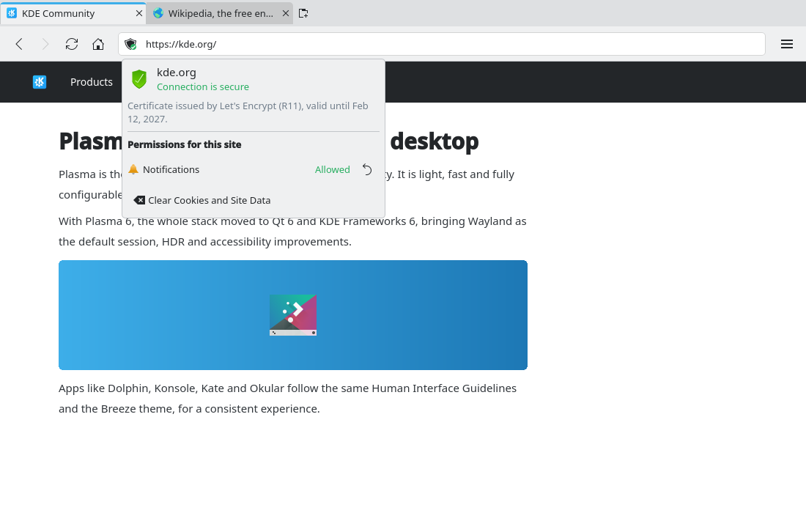
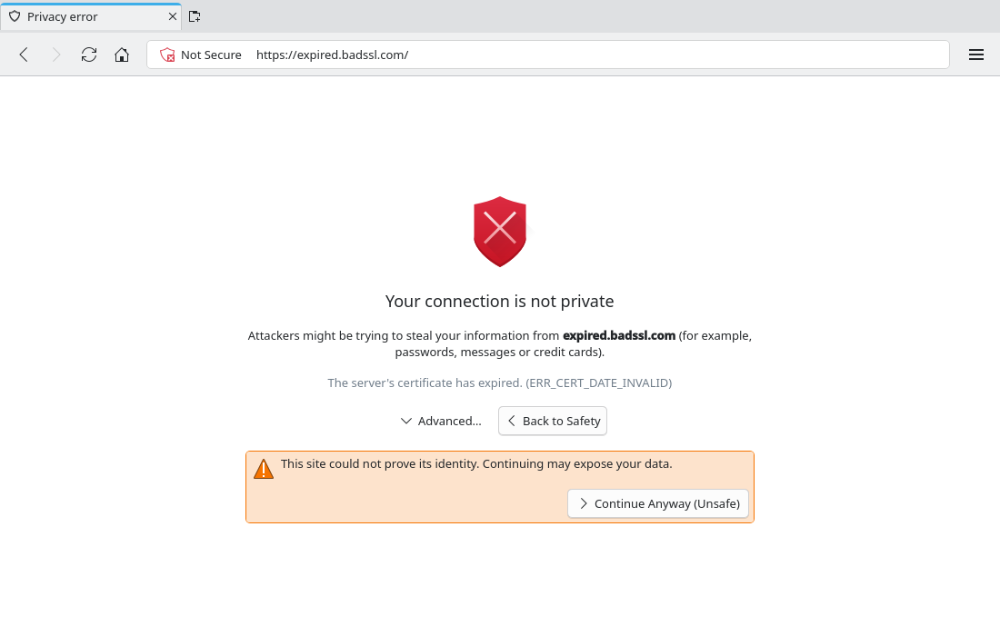

# Security indicator and certificate errors (#9)

> **Issue:** [#9](https://github.com/lukasborges/kondor/issues/9) · **Priority:** P1 (high) · **State:** see the issue's label (`to-spec` / `to-dev` / `in-review`).
> Read [`AGENTS.md`](../../AGENTS.md) first. This file is the source of truth for the issue; only the architect edits it.

## Objective

Show connection security in the address bar and handle certificate errors safely.

## Context

The address bar (`TextField { id: addressBar }` in `Main.qml`) shows the raw URL. `certificateError` is not handled: Qt WebEngine's default is to reject the certificate and show an empty/blocked page with no explanation.

## Design / behavior

1. **`Tab` additions**: `Q_PROPERTY(QString securityState …)` with values `"secure"` (https, no errors), `"insecure"` (http), `"error"` (certificate overridden), `"local"` (`file:`, `about:`, `data:`). Computed in `Tab::setUrl()` from the scheme, plus `setCertificateOverridden(bool)` for the error state (reset on navigation to another host).
2. **Certificate errors** in `WebViewTab.qml`:
   ```qml
   onCertificateError: function(error) {
       error.defer()                         // keep the request pending
       root.tab.setPendingCertificateError(error.url, error.description, error.overridable)
       certErrorHolder.error = error         // keep a JS reference to answer later
   }
   ```
   (Use `WebEngineCertificateError` properties `url`, `description`, `type`, `overridable`, methods `acceptCertificate()`, `rejectCertificate()`.) Add Tab commands `acceptCertificateError()` / `rejectCertificateError()` → signals handled in `WebViewTab.qml` calling the stored `error`.
3. **`qml/CertificateErrorPage.qml`**: an `Item` overlaid on the `WebEngineView` (inside `WebViewTab.qml`, `visible` while an error is pending) with a big `Kirigami.Icon { source: "security-low" }`, heading "Your connection is not private", the host, `error.description`, and buttons "Back" (reject + `goBack()` or close if no history) and — only if `overridable` — a less prominent "Advanced…" expander revealing "Continue Anyway (Unsafe)" (accept; then `securityState = "error"`).
4. **Address bar indicator**: a `ToolButton` inside the left side of `addressBar` (set `leftPadding` accordingly) with icon by state: `security-high` (secure), `security-medium` or `channel-insecure-symbolic` (insecure, with "Not Secure" text when the field is not focused), `security-low` (error), `text-html` (local). Clicking opens `qml/SiteInfoPopup.qml` showing host, state description ("Connection is secure" / "Your connection is not private"), and (if #7 exists) the site's permissions with revoke buttons.
5. Certificate details (issuer, validity) are optional: `WebEngineCertificateError` exposes `certificateChain` in C++ (`QWebEngineCertificateError::certificateChain()` → `QSslCertificate`); show subject CN, issuer CN and expiry if easily available.

## Acceptance criteria

- [ ] HTTPS pages show a padlock; HTTP pages show the insecure indicator.
- [ ] `https://expired.badssl.com`, `https://self-signed.badssl.com`, `https://wrong.host.badssl.com` show the error page with a working "Back"; overriding (when allowed) loads the page and the indicator shows the error state.
- [ ] `https://revoked.badssl.com`-style non-overridable errors do not offer "continue".
- [ ] The site info popup opens from the indicator.

## Manual test

Visit the badssl.com pages above, `http://neverssl.com`, a normal HTTPS site, and `file:///etc/hosts`.

## Out of scope

HSTS management, certificate manager, mixed-content indicator.

## Dependencies

None (popup integrates with #7 if present).

## Prototype

Visual target — match it (controls, Kirigami components, icon names, wording, placement). If it disagrees with this spec, the spec wins.

**Padlock and site information popup** — [`prototypes/09-security-indicator.qml`](../../prototypes/09-security-indicator.qml)



**Certificate error page** — [`prototypes/09b-certificate-error.qml`](../../prototypes/09b-certificate-error.qml)



## Decisions

_None yet._ Answers to developer questions (`question` label) are recorded here as `| Question | Decision |` rows.
