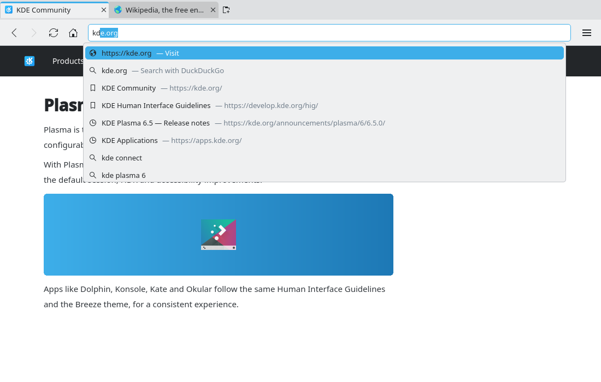

# Address bar suggestions (#11)

> **Issue:** [#11](https://github.com/lukasborges/kondor/issues/11) · **Priority:** P2 (medium) · **State:** see the issue's label (`to-spec` / `to-dev` / `in-review`).
> Read [`AGENTS.md`](../../AGENTS.md) first. This file is the source of truth for the issue; only the architect edits it.

## Objective

While typing in the address bar, show a dropdown with matching history entries, bookmarks and (optionally) search-engine suggestions, with keyboard navigation and inline completion.

## Context

`addressBar` (`qml/Main.qml`) is a plain `TextField`; `onAccepted` calls `ProfileManager.resolveAddress(text)`.

## Design / behavior

1. **Data sources (C++)**:
   - `HistoryManager` (#1): add `Q_INVOKABLE QVariantList suggest(const QString &text, int limit = 6) const` — `SELECT url, title, COUNT(*) AS visits, MAX(visited_at) AS last FROM history WHERE url LIKE ?1 OR title LIKE ?1 GROUP BY url ORDER BY visits DESC, last DESC LIMIT ?2` (`?1` = `%text%`, escaped). Each item: `{type: "history", url, title}`.
   - `BookmarkManager` (#2): `Q_INVOKABLE QVariantList search(const QString &text, int limit = 4) const` → `{type: "bookmark", url, title}`.
   - **Search suggestions** (only if `Settings.searchSuggestions`, new bool setting, default `false`): `src/searchsuggestions.{h,cpp}` with `QNetworkAccessManager` (`Qt6::Network`), `Q_INVOKABLE void request(const QString &text)` and signal `suggestionsReady(const QString &text, const QStringList &items)`. Endpoint for DuckDuckGo: `https://duckduckgo.com/ac/?q=<text>&type=list` (JSON `["text", ["s1","s2",…]]`); for Google `https://suggestqueries.google.com/complete/search?client=firefox&q=<text>` (same JSON shape). Cancel the previous `QNetworkReply` when a new request starts. Never send requests for private tabs.
2. **`qml/AddressSuggestions.qml`** already exists from #44 (Visit/Search rows, keyboard and click handling): extend it, do not replace it. It now opens for any non-blank typed text. Content: `ListView` with sections: first the #44 rows (for an address: "<url> — Visit" then "<text> — Search with <engine>"; otherwise only the Search row, icon `edit-find`), then bookmarks (icon `bookmarks`), history (icon `view-history`), search suggestions (icon `edit-find`). Each row shows title + URL (dimmed). Max 10 rows.
3. **Keyboard** in `addressBar`: `Keys.onDownPressed`/`onUpPressed` move `currentIndex` (and write the row URL into the field without triggering a new query); Enter with a selected row navigates to it; Esc closes the popup and restores the typed text; Tab/Shift+Tab ignored.
4. **Inline completion**: when the text has no spaces and a history URL's host starts with it (`kd` → `kde.org`), set the text to the full host and select the completed part (`select(typedLength, text.length)`); typing Backspace removes the selection without re-completing.
5. Query on `textEdited` only (not on programmatic `text` changes), debounced 120 ms; don't show the popup when the field is not focused or text is empty.
6. Clicking a row navigates the current tab; middle-click opens a new background tab.
### Edge cases

- Private tab focused: show bookmarks + history suggestions only from the persistent data (reading is fine), never call the network suggester, never record.
- Very fast typing: ignore stale `suggestionsReady` whose `text` differs from the current text.
- Without #1/#2 implemented, show only the "Search" row and network suggestions.

## Acceptance criteria

- [ ] Typing shows matching bookmarks and history (most visited first) in a dropdown under the address bar.
- [ ] Up/Down/Enter/Esc behave as described; mouse click works.
- [ ] Inline host completion works and is easy to undo with Backspace/Delete.
- [ ] Network suggestions only when enabled in Settings and never from private tabs.

## Manual test

Visit kde.org several times, type `kd` (inline completion), type `plasma` (history/bookmark matches), enable suggestions and type `qt webengine`.

## Out of scope

Search keywords/shortcuts (`!w`), tab switching from the bar, favicons in rows.

## Dependencies

#44 (the dropdown and its Visit/Search rows), #1 (history), #2 (bookmarks), #3 (Settings) for full functionality.

## Prototype

Visual target — match it (controls, Kirigami components, icon names, wording, placement). If it disagrees with this spec, the spec wins.

**Suggestions and inline completion in the address bar** — [`prototypes/11-address-suggestions.qml`](../../prototypes/11-address-suggestions.qml)

## Decisions

_None yet._ Answers to developer questions (`question` label) are recorded here as `| Question | Decision |` rows.
