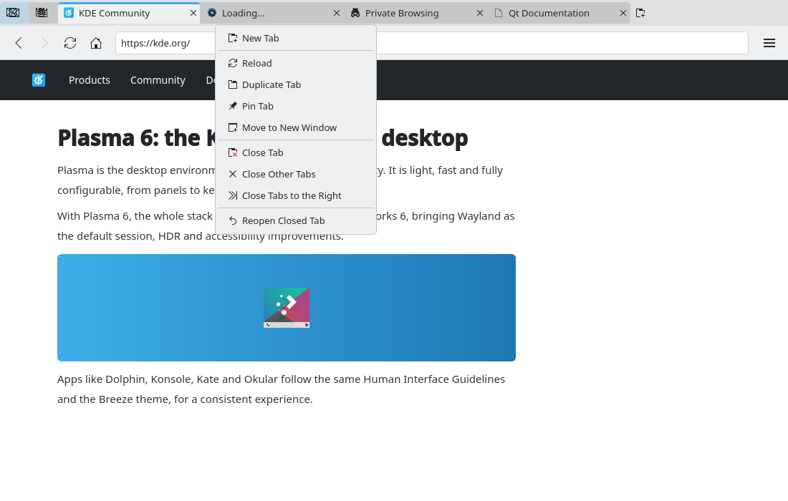

# Tab management improvements (#12)

> **Issue:** [#12](https://github.com/lukasborges/kondor/issues/12) · **Priority:** P2 (medium) · **State:** see the issue's label (`to-spec` / `to-dev` / `in-review`).
> Read [`AGENTS.md`](../../AGENTS.md) first. This file is the source of truth for the issue; only the architect edits it.

## Objective

Bring tab handling up to what users expect: favicons, drag to reorder, pinned tabs, middle-click, a tab context menu, keyboard switching, background tabs and graceful overflow. Also fix a privacy bug.

## Context

- `qml/Main.qml`: `TabBar { id: tabBar }` with a `Repeater` of `TabButton`s (fixed 130–220 px, manual title eliding, close `ToolButton`). No favicon (the `Tab` already has `iconUrl`).
- `src/tabmodel.cpp`: `addTab(isPrivate, url)` always appends and makes the new tab current.
- **Bug**: `qml/WebViewTab.qml` `onNewWindowRequested` calls `root.tabModel.addTab(false, request.requestedUrl)`, so a link opened from a **private** tab (`target=_blank`, `window.open`, middle-click) ends up in a **normal** tab.

## Design / behavior

1. **TabModel API** (`src/tabmodel.{h,cpp}`):
   - `Q_INVOKABLE Tab *insertTab(int index, QQuickWebEngineProfile *profile, const QUrl &url, bool activate)`; make `addTab()` call it. Add `Q_INVOKABLE Tab *addTabWithProfile(QQuickWebEngineProfile *profile, const QUrl &url, bool background)` that inserts **right after the current tab** (like Firefox for child tabs).
   - `Q_INVOKABLE void moveTab(int from, int to)` using `beginMoveRows` (mind the Qt rule: when moving down, destination row is `to + 1`). Keep `m_currentIndex` pointing to the same tab.
   - `Q_INVOKABLE void duplicateTab(int index)`, `closeOtherTabs(int index)`, `closeTabsToTheRight(int index)` (skip pinned tabs), `Q_INVOKABLE void setPinned(int index, bool pinned)`.
2. **Tab**: `Q_PROPERTY(bool pinned …)`. Pinned tabs are kept at the start of the model (`setPinned` moves the tab to the end of the pinned group).
3. **Fix the privacy bug and support background tabs** in `WebViewTab.qml`:
   ```qml
   onNewWindowRequested: function(request) {
       const bg = request.destination === WebEngineNewWindowRequest.InNewBackgroundTab
       // keep the opener's profile: private stays private (and keeps its session)
       root.tabModel.addTabWithProfile(root.tab.profile, request.requestedUrl, bg)
   }
   ```
   (`InNewWindow`/`InNewDialog` also become tabs until #14 exists.)
4. **Tab button** (extract to `qml/TabButtonDelegate.qml`):
   - favicon: `icon.source: tab.iconUrl` (fallback `icon.name: "text-html"`; a `BusyIndicator` 16 px while `tab.loading`); private tabs show `view-private` icon.
   - Replace the manual `TextMetrics` eliding loop with a `Label { elide: Text.ElideRight }` inside a custom `contentItem`.
   - Pinned: width = icon only (≈ 36 px), no close button, no title.
   - `TapHandler { acceptedButtons: Qt.MiddleButton; onTapped: window.closeTabFor(tab) }`.
   - Right click → `qml/TabContextMenu.qml`: "New Tab", separator, "Reload", "Duplicate Tab", "Pin Tab"/"Unpin Tab", "Move to New Window" (only if #14 exists), separator, "Close Tab", "Close Other Tabs", "Close Tabs to the Right", "Reopen Closed Tab" (if #6 exists).
   - Drag to reorder: `DragHandler { xAxis.enabled: true; yAxis.enabled: false }` on the delegate; on drop compute the target index from the x position and call `tabs.moveTab(from, to)`; pinned and unpinned groups cannot be mixed.
5. **Overflow**: when `count * minWidth > available width`, shrink tab widths down to a minimum of 90 px; beyond that let the `TabBar` scroll horizontally (it is a `ListView` internally — set `contentItem` interactive) and map the mouse wheel over the tab bar to horizontal scroll (`WheelHandler`). Keep the current tab visible (`positionViewAtIndex` on current change).
6. **Shortcuts** in `Main.qml`: `Ctrl+Tab` / `Ctrl+PgDown` next, `Ctrl+Shift+Tab` / `Ctrl+PgUp` previous (wrap around), `Ctrl+1`…`Ctrl+8` go to tab N, `Ctrl+9` last tab, `Ctrl+Shift+PgUp/PgDown` move the current tab left/right. Double-click on the empty area of the tab bar opens a new tab.

## Acceptance criteria

- [ ] Tabs show favicons and a loading indicator; titles elide cleanly.
- [ ] Links opened from a private tab open in a private tab sharing the same private session.
- [ ] Middle-click on a link opens a background tab next to the current one; middle-click on a tab closes it.
- [ ] Tabs can be reordered by dragging and with Ctrl+Shift+PgUp/PgDown; pin/unpin works.
- [ ] Context menu actions work; keyboard switching shortcuts work.
- [ ] 30+ tabs remain usable (shrinking, then scrolling).

## Manual test

Open a private tab, log into a site, middle-click a link: the new tab is private and still logged in. Open 30 tabs and navigate them with the wheel and Ctrl+Tab. Pin two tabs, restart (with #6, pinned state may be saved — optional).

## Out of scope

Tab groups, vertical tabs, tab previews on hover, persisting pinned state (can be added to #6 later).

## Dependencies

Integrates with #6 (reopen) and #14 (move to window) if present.

## Prototype

Visual target — match it (controls, Kirigami components, icon names, wording, placement). If it disagrees with this spec, the spec wins.

**Favicons, pinned tabs, private tab and tab context menu** — [`prototypes/12-tab-management.qml`](../../prototypes/12-tab-management.qml)



## Decisions

| Question | Decision |
| --- | --- |
| Should "Close Other Tabs" also close pinned tabs? | No. Pinned tabs are kept, like "Close Tabs to the Right" (accepted in the PR #31 review). |
| Does "Duplicate Tab" keep the pinned state? | Yes. The duplicate is pinned too, so the pinned group stays at the start of the model (PR #31). |
| From a private tab, does "New Tab" in the tab context menu open a private tab? | No. It opens a normal tab, like `Ctrl+T`. Links opened *from* a private tab still keep its profile (PR #31). |
