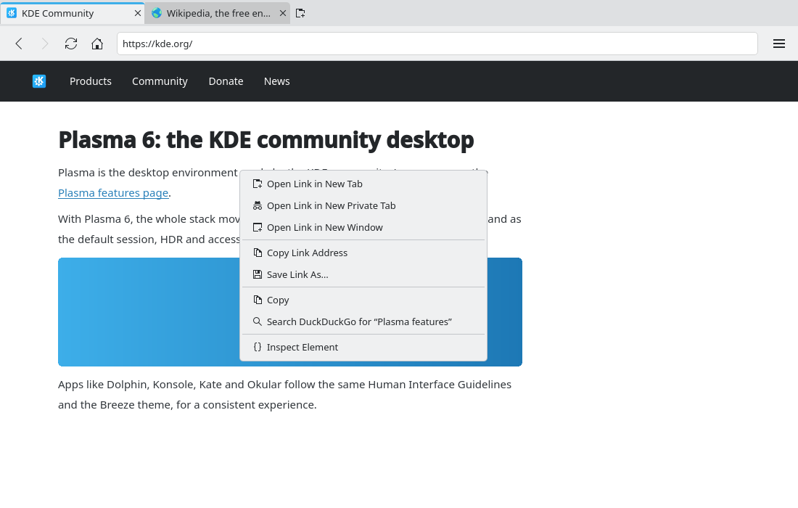

# Page context menu (#13)

> **Issue:** [#13](https://github.com/lukasborges/kondor/issues/13) · **Priority:** P2 (medium) · **State:** see the issue's label (`to-spec` / `to-dev` / `in-review`).
> Read [`AGENTS.md`](../../AGENTS.md) first. This file is the source of truth for the issue; only the architect edits it.

## Objective

A complete, KDE-styled right-click menu on web pages with link, image, selection and editing actions.

## Context

`WebViewTab.qml` does not handle `contextMenuRequested`, so Qt WebEngine shows its minimal default menu.

## Design / behavior

1. In `WebViewTab.qml` handle `onContextMenuRequested: function(request) { request.accepted = true; contextMenu.request = request; contextMenu.popup() }` and implement `qml/PageContextMenu.qml` (a QQC2 `Menu`) with `property var request` and a reference to the `WebEngineView`.
2. Items shown depending on the request (`request.linkUrl`, `request.mediaType`, `request.mediaUrl`, `request.selectedText`, `request.isContentEditable`, `request.editFlags`, `request.misspelledWord`, `request.spellCheckerSuggestions`):
   - **Link**: "Open Link in New Tab" (`tab-new`) → `tabModel.addTabWithProfile(tab.profile, request.linkUrl, true)` (#12; else `addTab(tab.isPrivate, url)`), "Open Link in New Private Tab" (`view-private`), "Open Link in New Window" (only with #14), "Copy Link Address" (`edit-copy`) → `webView.triggerWebAction(WebEngineView.CopyLinkToClipboard)`, "Save Link As…" (`document-save`) → `WebEngineView.DownloadLinkToDisk`.
   - **Image** (`request.mediaType === ContextMenuRequest.MediaTypeImage`): "Open Image in New Tab", "Save Image As…" (`DownloadImageToDisk`), "Copy Image" (`CopyImageToClipboard`), "Copy Image Address" (`CopyImageUrlToClipboard`).
   - **Video/audio**: "Save Media As…" (`DownloadMediaToDisk`), "Copy Media Address" (`CopyMediaUrlToClipboard`), "Show Controls" (`ToggleMediaControls`), "Loop" (`ToggleMediaLoop`).
   - **Selection**: "Copy" (`Copy`), "Search <engine> for “snippet…”" → new tab with `ProfileManager.resolveAddress(selectedText)` (truncate label to 30 chars).
   - **Editable field**: spelling suggestions (if `misspelledWord`) calling `webView.replaceMisspelledWord(s)`, then "Undo", "Redo", "Cut", "Copy", "Paste", "Paste as Plain Text" (`PasteAndMatchStyle`), "Select All" — enabled per `request.editFlags` (`ContextMenuRequest.CanUndo`, `CanCut`, …).
   - **Page (nothing else)**: "Back", "Forward", "Reload", separator, "Save Page As…" (#17), "Print…" (#17), "View Page Source" (`WebEngineView.ViewSource`, opens a new tab), "Inspect Element" (`InspectElement`, only when #16 exists).
3. Use Breeze icon names for every item; hide (not disable) items that do not apply; avoid double separators.
4. Keyboard: the `Menu` key and Shift+F10 open the page menu at the cursor/center (`webView.triggerWebAction` is not needed; call `contextMenu.popup()` with the last known position).

## Acceptance criteria

- [ ] Right-click on a link, an image, a video, selected text, an editable field and empty page area each shows the right items.
- [ ] Every action works (open in new/private tab, copy link, save image, search selection, paste, view source…).
- [ ] The menu uses the Breeze style and icons and appears at the cursor position.

## Manual test

Use a Wikipedia article (links, images, text), a YouTube page (video), and a search box (editable field, misspelled word if spell check is on).

## Out of scope

Extensions in the menu, "Send link to device".

## Dependencies

Better with #12 (`addTabWithProfile`), #14, #16, #17, #23 — hide the related items until they exist.

## Prototype

Visual target — match it (controls, Kirigami components, icon names, wording, placement). If it disagrees with this spec, the spec wins.

**Link context menu** — [`prototypes/13-page-context-menu.qml`](../../prototypes/13-page-context-menu.qml)

## Decisions

_None yet._ Answers to developer questions (`question` label) are recorded here as `| Question | Decision |` rows.
