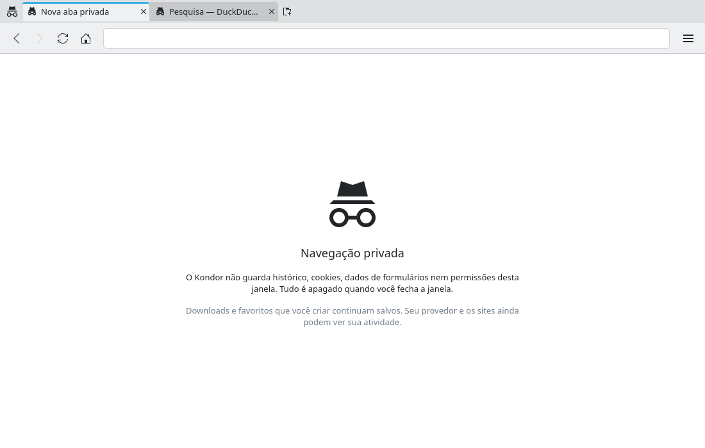
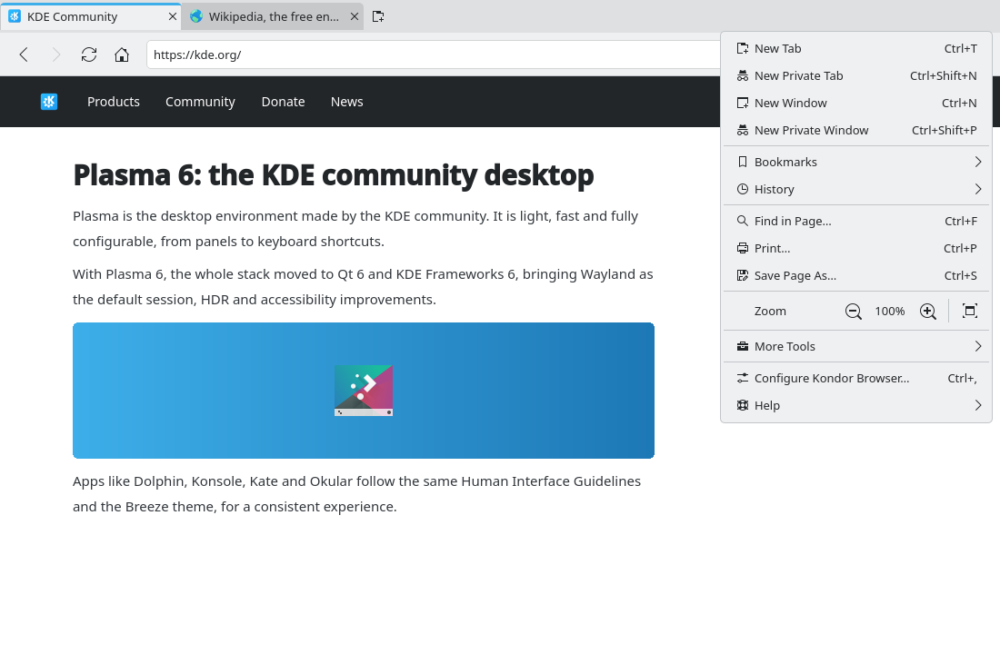

# Multiple windows (#14)

> **Issue:** [#14](https://github.com/lukasborges/kondor/issues/14) · **Priority:** P2 (medium) · **State:** see the issue's label (`to-spec` / `to-dev` / `in-review`).
> Read [`AGENTS.md`](../../AGENTS.md) first. This file is the source of truth for the issue; only the architect edits it.

## Objective

Support several browser windows (normal and private), and moving a tab to a new window.

## Context

`qml/Main.qml` *is* the single `ApplicationWindow` and owns `TabModel { id: tabs }`. `src/main.cpp` loads `Main` once with `engine.loadFromModule("Kondor", "Main")`.

## Design / behavior

1. **Refactor**: move the whole window from `Main.qml` into `qml/BrowserWindow.qml` (same content) with new properties `property bool privateWindow: false` and `property var initialUrls: []`. Make `Main.qml` a tiny non-visual root (`QtObject` or `Item`) that asks `WindowManager` to open the first window — or let `main.cpp` call `WindowManager::instance()->newWindow(...)` directly and drop `Main.qml` from the startup.
2. **`src/windowmanager.{h,cpp}`** — QML singleton `WindowManager`:
   - holds a `QQmlComponent` for `BrowserWindow` (`QQmlComponent(engine, QStringLiteral("Kondor"), QStringLiteral("BrowserWindow"))`), needs the `QQmlEngine*` (pass it from `main.cpp` with a `setEngine()` call).
   - `Q_INVOKABLE QObject *newWindow(bool privateWindow = false, const QList<QUrl> &urls = {})` → `component.createWithInitialProperties({{"privateWindow", …}, {"initialUrls", …}})`, keeps the object in a list, deletes it on the window's `closing`/destroyed.
   - `Q_PROPERTY(int windowCount …)`.
3. In `BrowserWindow.qml`: on completion, open `initialUrls` (or the home page) with `tabs.addTab(privateWindow, url)`; in a private window **every** tab and new tab is private (Ctrl+T opens a private tab) and the window shows a hint (e.g. `view-private` icon in the tab bar and title suffix "— Private Browsing").
4. **Shortcuts/menu**: Ctrl+N "New Window" (`window-new`), Ctrl+Shift+P "New Private Window" (keep Ctrl+Shift+N for private tab as today), Ctrl+Shift+W "Close Window".
5. **Move tab to new window**: `WindowManager.newWindow(tab.isPrivate, [tab.url])` then close the tab in the source window. The page reloads in the new window (moving the live `WebEngineView` between windows is out of scope).
6. `window.closeTabAt()` — closing the last tab closes only that window; the app quits when the last window closes (`QGuiApplication::quitOnLastWindowClosed`, default).
7. Links with `request.destination === WebEngineNewWindowRequest.InNewWindow` (shift+click) open a new window with that URL (same privacy as the source tab).
8. Session restore (#6), if present: extend `session.json` to `{"windows": [ {tabs…}, … ]}` — keep reading the old format.

## Acceptance criteria

- [ ] Ctrl+N opens an independent window with its own tabs; Ctrl+Shift+P opens a private window where all tabs are private.
- [ ] Closing a window does not close the others; closing the last one quits.
- [ ] "Move to New Window" moves a tab; Shift+click on a link opens a new window.
- [ ] Each window's title, address bar and shortcuts act on its own tabs.

## Manual test

Open 2 normal windows and 1 private window, log into a site in the private window (not logged in the normal ones), move tabs around, close windows in different orders.

## Out of scope

Dragging a tab out of the tab bar to create a window, merging windows.

## Dependencies

#6 should be updated if already merged; #10/#15 use `WindowManager.newWindow`.

## Prototype

Visual target — match it (controls, Kirigami components, icon names, wording, placement). If it disagrees with this spec, the spec wins.

**Private window** — [`prototypes/14-private-window.qml`](../../prototypes/14-private-window.qml)

**New window entries in the main menu** — [`prototypes/00-main-menu.qml`](../../prototypes/00-main-menu.qml)

## Decisions

_None yet._ Answers to developer questions (`question` label) are recorded here as `| Question | Decision |` rows.
