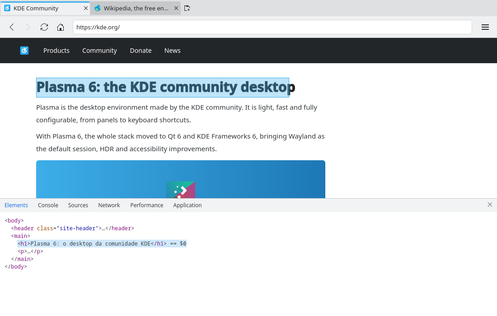

# Developer tools (#16)

> **Issue:** [#16](https://github.com/lukasborges/kondor/issues/16) · **Priority:** P2 (medium) · **State:** see the issue's label (`to-spec` / `to-dev` / `in-review`).
> Read [`AGENTS.md`](../../AGENTS.md) first. This file is the source of truth for the issue; only the architect edits it.

## Objective

Built-in developer tools (Chromium DevTools) toggled with F12 / Ctrl+Shift+I, docked in the window.

## Context

No DevTools. `WebEngineView` has the `devToolsView` / `inspectedView` properties and the `WebEngineView.InspectElement` web action.

## Design / behavior

1. **`Tab`**: `Q_PROPERTY(bool devToolsOpen …)` + `Q_INVOKABLE void toggleDevTools()` → `emit toggleDevToolsRequested()`; `Q_INVOKABLE void inspectElement()` → `emit inspectElementRequested()`.
2. **`WebViewTab.qml`**: wrap the page in a `SplitView { orientation: Qt.Vertical }` (or `Qt.Horizontal`, configurable later): the page `WebEngineView` and a second `WebEngineView { id: devTools; visible: root.tab.devToolsOpen; SplitView.preferredHeight: parent.height * 0.4 }`. When opening: `webView.devToolsView = devTools`; when closing: `webView.devToolsView = null`. Use the **same profile** as the page for the DevTools view.
3. `onInspectElementRequested`: open DevTools if closed, then `webView.triggerWebAction(WebEngineView.InspectElement)`.
4. DevTools' own `onWindowCloseRequested` (dock "×" in DevTools) → close the panel.
5. **Shortcuts/menu** in `Main.qml`: `F12` and `Ctrl+Shift+I` toggle; menu item "Developer Tools" (`code-context` or `document-properties`) under a "More Tools" submenu; "Inspect Element" in the page context menu (#13).
6. DevTools state is per tab; closing the tab closes its DevTools.

## Acceptance criteria

- [ ] F12/Ctrl+Shift+I opens DevTools docked at the bottom of the current tab and closes it again.
- [ ] Elements, Console and Network panels work for the inspected page.
- [ ] "Inspect Element" selects the right-clicked element.
- [ ] Switching tabs shows each tab's own DevTools state.

## Manual test

Open DevTools on kde.org, run `document.title` in the Console, inspect an image via the context menu, switch tabs, close with F12.

## Out of scope

Undocking DevTools into a separate window, remote debugging port settings.

## Dependencies

#13 for the context-menu entry.

## Prototype

Visual target — match it (controls, Kirigami components, icon names, wording, placement). If it disagrees with this spec, the spec wins.

**DevTools docked below the page** — [`prototypes/16-devtools.qml`](../../prototypes/16-devtools.qml)

## Decisions

_None yet._ Answers to developer questions (`question` label) are recorded here as `| Question | Decision |` rows.
