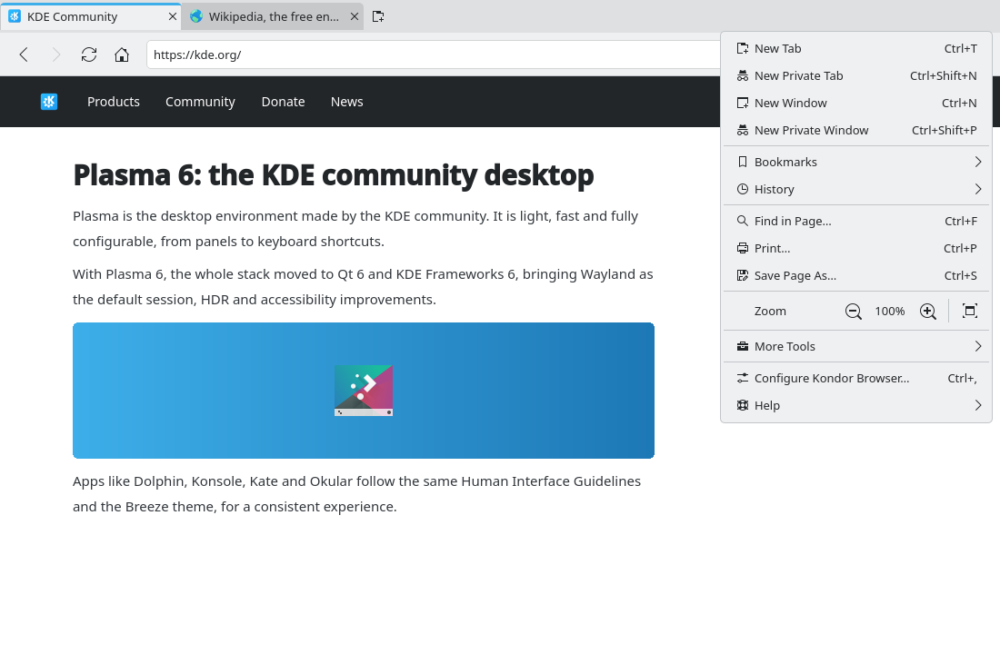

# Print and save as PDF (#17)

> **Issue:** [#17](https://github.com/lukasborges/kondor/issues/17) · **Priority:** P2 (medium) · **State:** see the issue's label (`to-spec` / `to-dev` / `in-review`).
> Read [`AGENTS.md`](../../AGENTS.md) first. This file is the source of truth for the issue; only the architect edits it.

## Objective

Print the current page, save it as PDF and save it as HTML.

## Context

Nothing. Qt WebEngine Quick provides `WebEngineView.printToPdf(filePath, pageSizeId, orientation)` with signal `pdfPrintingFinished(filePath, success)`, the signal `printRequested()` (page called `window.print()`), and `WebEngineView.save(filePath, format)` with formats `WebEngineDownloadRequest.SingleHtmlSaveFormat`, `CompleteHtmlSaveFormat`, `MimeHtmlSaveFormat`.

## Design / behavior

1. **`Tab` commands**: `printToPdf(const QString &filePath)`, `print()`, `savePage(const QString &filePath, int format)` → corresponding `…Requested` signals; state signal `pdfFinished(QString filePath, bool success)` re-emitted from `WebViewTab.qml`'s `onPdfPrintingFinished`.
2. **Save as PDF** (menu "Save as PDF…", icon `document-export`): `FileDialog { fileMode: FileDialog.SaveFile; nameFilters: ["PDF (*.pdf)"]; currentFile: <downloadDir>/<sanitized title>.pdf }` → `tab.printToPdf(localPath)`; page size A4 (`WebEngineView.A4`) portrait. On success show a `Notifier` notification (#4) or an inline message with "Open".
3. **Print** (Ctrl+P, menu "Print…", icon `document-print`; also on `printRequested` from the page): QML has no direct printer API, so: print to a temporary PDF in `QStandardPaths::TempLocation` and open it with the default PDF viewer (`QDesktopServices::openUrl`) where the user prints (Okular has full print options). Expose a small C++ helper `Q_INVOKABLE QString tempPdfPath()` and `Q_INVOKABLE void openFile(QString)` (or reuse `DownloadManager.openFile` from #4).
   - Alternative allowed if it fits better: link `Qt6::PrintSupport` + `Qt6::Widgets`, switch `QGuiApplication` to `QApplication` in `main.cpp`, and show a `QPrintDialog` then print the PDF via `QPdfDocument`… — only if it keeps the app stable; document the choice in the PR.
4. **Save page** (Ctrl+S, menu "Save Page As…", icon `document-save-as`): `FileDialog` with filters "Web Page, Complete (*.html)", "Web Page, HTML Only (*.html)", "Web Archive (*.mhtml)" → `tab.savePage(path, format)`; the resulting download goes through `DownloadManager` (#4) / profile `downloadRequested` with `isSavePageDownload` true — make sure it is accepted without asking again.
5. File names: sanitize the page title (replace `/\\:*?"<>|` with `_`, max 100 chars, fallback "page").

## Acceptance criteria

- [ ] "Save as PDF" produces a correct PDF of the page.
- [ ] Ctrl+P (and `window.print()` from a page) leads to a printable view in the system's PDF viewer (or a print dialog).
- [ ] Ctrl+S saves the page in the 3 formats; the complete format creates the `_files` folder.

## Manual test

Save a Wikipedia article as PDF and as complete HTML, open both; press Ctrl+P on a page; use a site with a "Print" button that calls `window.print()`.

## Out of scope

Print preview inside Kondor, page setup options (margins, headers).

## Dependencies

#4 for download/notification integration (optional).

## Prototype

Visual target — match it (controls, Kirigami components, icon names, wording, placement). If it disagrees with this spec, the spec wins.

**Save Page As, Save as PDF and Print entries in the main menu** — [`prototypes/00-main-menu.qml`](../../prototypes/00-main-menu.qml)

## Decisions

_None yet._ Answers to developer questions (`question` label) are recorded here as `| Question | Decision |` rows.
