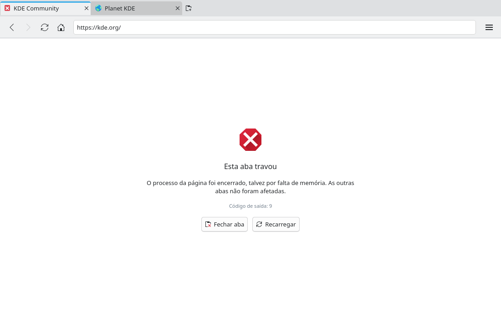

# Crashed page handling (#18)

> **Issue:** [#18](https://github.com/lukasborges/kondor/issues/18) · **Priority:** P2 (medium) · **State:** see the issue's label (`to-spec` / `to-dev` / `in-review`).
> Read [`AGENTS.md`](../../AGENTS.md) first. This file is the source of truth for the issue; only the architect edits it.

## Objective

When a tab's renderer process dies (crash, killed, out of memory), show an explanatory page with a reload button instead of a blank tab.

## Context

`WebViewTab.qml` ignores `renderProcessTerminated(terminationStatus, exitCode)`; the tab stays blank.

## Design / behavior

1. **`Tab`**: `Q_PROPERTY(bool crashed …)` + `setCrashed(bool)`, `Q_PROPERTY(QString crashReason …)`.
2. **`WebViewTab.qml`**:
   ```qml
   onRenderProcessTerminated: function(terminationStatus, exitCode) {
       if (terminationStatus === WebEngineView.NormalTerminationStatus) return
       const reasons = {
           [WebEngineView.AbnormalTerminationStatus]: qsTr("The page's process ended unexpectedly."),
           [WebEngineView.CrashedTerminationStatus]: qsTr("The page crashed."),
           [WebEngineView.KilledTerminationStatus]: qsTr("The page's process was killed (possibly out of memory).")
       }
       root.tab.setCrashed(true, reasons[terminationStatus] ?? "")
   }
   onLoadingChanged: … if (loadRequest.status === WebEngineLoadingInfo.LoadStartedStatus) root.tab.setCrashed(false, "")
   ```
3. **`qml/CrashedPage.qml`** overlaid on the view when `tab.crashed`: icon `dialog-error` (64 px), title "This tab crashed", the reason, `exitCode` in small dimmed text, buttons "Reload" (`view-refresh`, default, Enter) → `tab.reload()` and "Close Tab".
4. The tab button (#12) shows `dialog-error` instead of the favicon while crashed.
5. If many tabs crash at once (GPU process crash), each tab shows its own page; no global dialog.

## Acceptance criteria

- [ ] Killing a page's `QtWebEngineProcess` shows the crash page in that tab only.
- [ ] "Reload" brings the page back; other tabs are unaffected.
- [ ] Normal navigations never show the page.

## Manual test

Open 3 tabs; find the renderer of one (`ps -ef | grep QtWebEngineProcess`, check `--renderer`… or load `chrome://crash` if supported by the Qt WebEngine build) and `kill -SEGV <pid>`; reload it.

## Out of scope

Crash reporting/upload, automatic reload.

## Dependencies

None.

## Prototype

Visual target — match it (controls, Kirigami components, icon names, wording, placement). If it disagrees with this spec, the spec wins.

**Crashed tab page** — [`prototypes/18-crashed-tab.qml`](../../prototypes/18-crashed-tab.qml)



## Decisions

_None yet._ Answers to developer questions (`question` label) are recorded here as `| Question | Decision |` rows.
