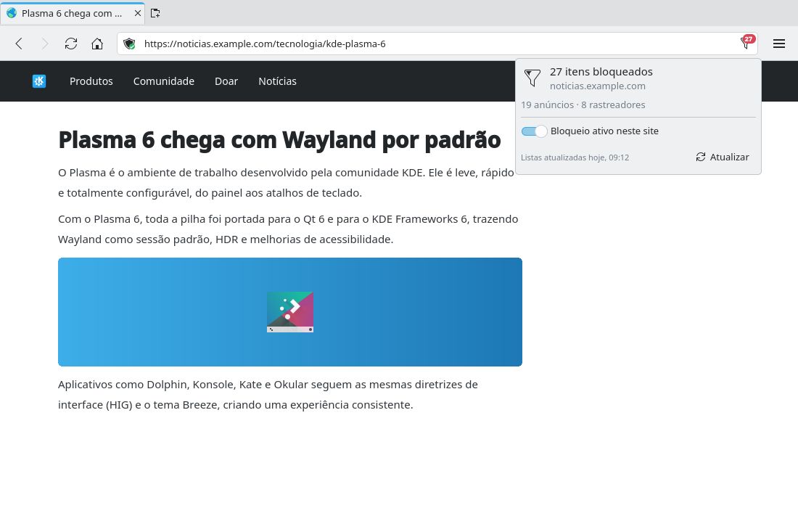

# Ad and tracker blocking (#20)

> **Issue:** [#20](https://github.com/lukasborges/kondor/issues/20) · **Priority:** P3 (low) · **State:** see the issue's label (`to-spec` / `to-dev` / `in-review`).
> Read [`AGENTS.md`](../../AGENTS.md) first. This file is the source of truth for the issue; only the architect edits it.

## Objective

Block ads and trackers with standard filter lists, with a per-site toggle and a blocked-request counter.

## Context

No request filtering. `QQuickWebEngineProfile` (C++) supports `setUrlRequestInterceptor(QWebEngineUrlRequestInterceptor *)`.

## Design / behavior

1. **`src/adblock/filterengine.{h,cpp}`** — parses a pragmatic subset of the Adblock Plus syntax (enough for EasyList/EasyPrivacy network rules):
   - `||example.com^` (domain anchor, also matches subdomains), with options after `$`: `third-party`, `~third-party`, `script`, `image`, `stylesheet`, `xmlhttprequest`, `subdocument`, `domain=a.com|~b.com`; unknown options → skip the rule.
   - `@@` exception rules with the same syntax.
   - Plain `|https://…` / substring rules: support only simple substrings without wildcards (`*`) at first; skip rules with regex (`/…/`).
   - **Ignore cosmetic rules** (`##`, `#@#`, `#?#`) and comments (`!`, `[Adblock`).
   - Data structures: `QHash<QString, QList<Rule>>` keyed by domain for `||` rules (look up the request host and each parent domain), plus a small list of substring rules. Build the engine off the GUI thread (`QtConcurrent::run` → requires `Qt6::Concurrent`, or a `QThread`), then swap it in with `std::shared_ptr<const FilterEngine>` protected by a `QReadWriteLock`/`std::atomic_load` — **the interceptor runs on the IO thread**.
2. **`src/adblock/adblockinterceptor.{h,cpp}`** — `QWebEngineUrlRequestInterceptor::interceptRequest(QWebEngineUrlRequestInfo &info)`: skip if disabled or if `info.firstPartyUrl().host()` is in the allow list; map `info.resourceType()` to the option names; `info.block(true)` on match; count blocked requests per first-party host in a thread-safe `QHash` and post the update to the GUI thread (`QMetaObject::invokeMethod(…, Qt::QueuedConnection)`).
3. **`src/adblock/adblockmanager.{h,cpp}`** — QML singleton `AdBlockManager`:
   - Lists: EasyList `https://easylist.to/easylist/easylist.txt` and EasyPrivacy `https://easylist.to/easylist/easyprivacy.txt`, cached in `<AppDataLocation>/adblock/`. Download with `QNetworkAccessManager` on first run and when older than 4 days (check at startup, use `If-Modified-Since`). Until the first download finishes, browsing works unfiltered.
   - `Q_PROPERTY(bool enabled …)` (setting `AdBlock/Enabled`, default true), `Q_INVOKABLE bool isAllowed(QString host)`, `Q_INVOKABLE void setAllowed(QString host, bool)` (setting `AdBlock/AllowList`), `Q_INVOKABLE int blockedCount(QString host)`, signal `blockedCountChanged(QString host)`, `Q_INVOKABLE void updateLists()`.
   - Install the interceptor on the default profile and every private profile (`ProfileManager::setupProfile`).
4. **UI**: a `ToolButton` at the right end of the address bar with icon `security-high` (active) / `security-low` (disabled for the site) and a small count badge; popup with "Blocked on this page: N", switch "Blocking enabled on this site", link "Update Lists Now". Settings (#3) page "Privacy": global enable switch and last update date.
5. Reload the page automatically after toggling the site switch.

## Acceptance criteria

- [ ] On a news site with ads, ad requests are blocked and the counter increases; pages still work.
- [ ] Per-site allow list works and persists; the global switch disables blocking.
- [ ] Lists download on first run, are cached, refresh periodically; offline start works.
- [ ] No UI freeze while parsing lists (> 70k rules).

## Manual test

Compare a heavy ad site with blocking on/off; check `https://d3ward.github.io/toolz/adblock` score; disable for a site and reload.

## Out of scope

Cosmetic filtering (element hiding), YouTube ad blocking, custom user rules UI, uBlock-specific syntax.

## Dependencies

Uses `Settings` (#3). Network + Concurrent Qt modules (update CMake, README, workflows as per `AGENTS.md`).

## Prototype

Visual target — match it (controls, Kirigami components, icon names, wording, placement). If it disagrees with this spec, the spec wins.

**Button with counter and blocking popup** — [`prototypes/20-adblock.qml`](../../prototypes/20-adblock.qml)

## Decisions

_None yet._ Answers to developer questions (`question` label) are recorded here as `| Question | Decision |` rows.
