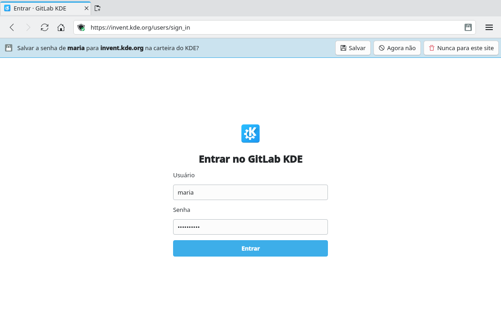
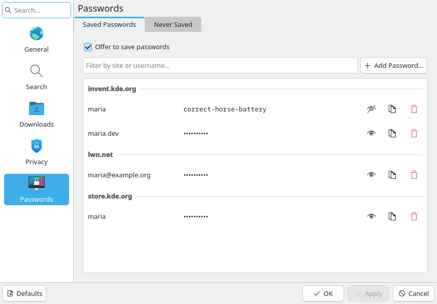
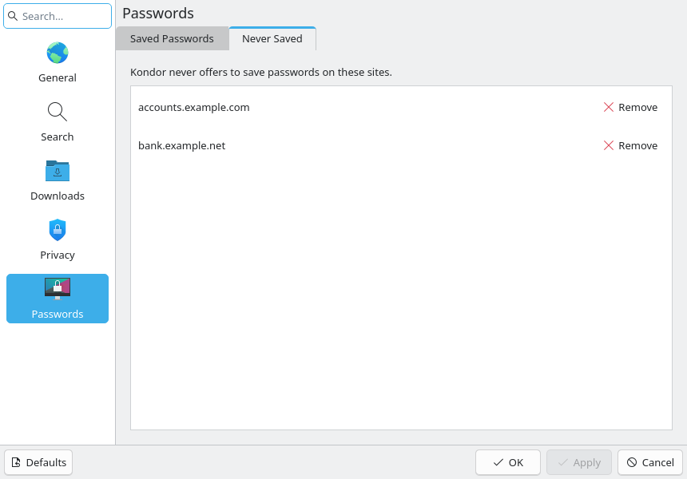
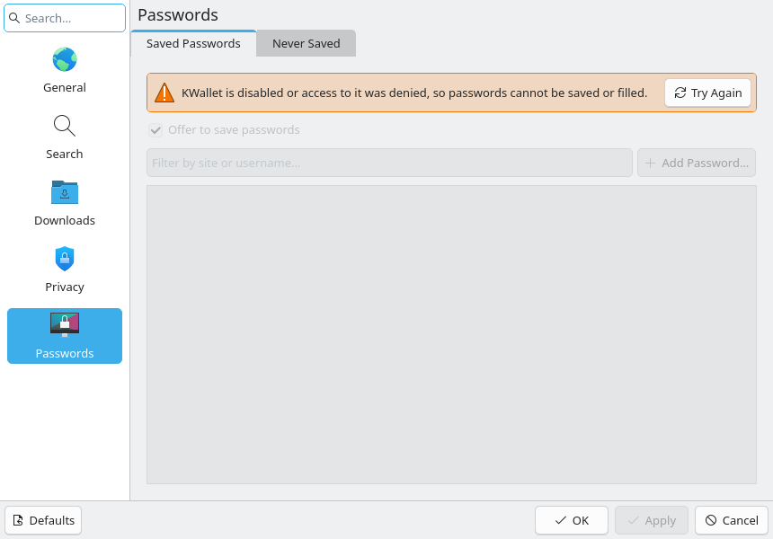

# Password manager and autofill (#21)

> **Issue:** [#21](https://github.com/lukasborges/kondor/issues/21) · **Priority:** P3 (low) · **State:** see the issue's label (`to-spec` / `to-dev` / `in-review`).
> Read [`AGENTS.md`](../../AGENTS.md) first. This file is the source of truth for the issue; only the architect edits it.

## Objective

Offer to save login credentials, store them securely in KWallet, autofill them on later visits and manage them in Settings.

## Context

Nothing. Kondor already bundles `QtWebChannel` (see `release.yml`), and `QQuickWebEngineProfile` has `userScripts`. Fedora has `kf6-kwallet` (KWallet 6).

## Design / behavior

1. **Dependency**: `find_package(KF6Wallet REQUIRED)` and `KF6::Wallet`; add `kf6-kwallet-devel` to README/workflows. Add `WebChannel` to Qt components (`Qt6::WebChannel`).
2. **Bridge object** `src/passwords/passwordbridge.{h,cpp}` registered on a `QWebChannel` per `WebEngineView` (`webView.webChannel` in QML, object id `"kondorPasswords"`), with slots:
   - `void formSubmitted(const QString &origin, const QString &username, const QString &password)` → emits a signal the tab turns into a "save password" prompt (only for non-private tabs, only if not already saved with the same password, only for `https:` origins or `localhost`).
   - `QVariantList credentialsFor(const QString &origin)` → returns `[{username, password}]` (JS receives it via callback).
3. **User script** `qrc:/scripts/passwords.js` injected into **every** profile via `WebEngineScript { injectionPoint: WebEngineScript.DocumentReady; worldId: WebEngineScript.ApplicationWorld; runOnSubframes: true; sourceUrl: "qrc:/scripts/passwords.js" }` together with `qrc:///qtwebchannel/qwebchannel.js`:
   - find `input[type=password]` and the closest preceding text/email input as username;
   - on `submit` of the form (and on click of a submit button for JS-driven forms), call `formSubmitted(location.origin, user, pass)`;
   - on load, call `credentialsFor(location.origin)` and if exactly one credential exists fill both fields and dispatch `input`/`change` events; if several, fill nothing (the chooser is part of the UI below).
   - Running in `ApplicationWorld` keeps the bridge invisible to page scripts.
4. **Storage** `src/passwords/passwordstore.{h,cpp}`: KWallet folder `"Kondor"`, one map entry per origin: `{ "<username>": "<password>", … }` via `KWallet::Wallet::openWallet(KWallet::Wallet::NetworkWallet(), 0, KWallet::Wallet::Asynchronous)`, `writeMap`/`readMap`. Handle "wallet disabled/denied": feature silently off with a one-time inline warning.
5. **UI**:
   - Save prompt using the shared `InlineBar` (#5): "Save the password for **user** on **site**?" — "Save", "Not Now", "Never for This Site" (store the origin in setting `Passwords/NeverSave`).
   - Address bar key icon (`dialog-password`) when credentials exist for the site; click → menu of usernames → fills the chosen credential (call a JS function through `runJavaScript(…, WebEngineScript.ApplicationWorld)`).
   - **Settings page "Passwords"** in the Configure window (#3 with the #57 layout).
     - It is a new sidebar entry after Privacy, with the `preferences-desktop-user-password` icon. Its keywords include "password", "KWallet" and "never".
     - It has two tabs. See the 21b/21c/21d prototypes.
     - **Saved Passwords** tab:
       - **Offer to save passwords** checkbox: setting `offerToSavePasswords`, default on. It is a normal pending option, applied with OK/Apply, and **Defaults** resets it.
       - **Filter field**, "Filter by site or username…".
       - **List:** a `ListView` in a `Frame` with `Kirigami.Theme.View` colors, grouped by site with `Kirigami.ListSectionHeader` (host only, sorted). The rows are sorted by username.
       - **Each row:**
         - the username;
         - the password masked as "••••••••••";
         - icon-only `ToolButton`s with tooltips: **Show Password** (`view-visible`, toggles to **Hide Password** `view-hidden`), **Copy Password** (`edit-copy`) and **Delete** (`edit-delete`).
       - **What the list holds:** only origins and usernames. A password is read from the wallet only when Show or Copy is clicked, and it is masked again when the window closes.
       - **Copy** puts the password on the clipboard. It is cleared after 30 s if the clipboard still holds it.
       - **Delete** asks first, with a `MessageDialog`: "Delete the saved password for %1 on %2?" (Yes/No). It then removes the entry from the wallet **at once**: it is an action, like "Clear Cookies and Cache Now", not a pending option.
     - **Never Saved** tab:
       - the label "Kondor never offers to save passwords on these sites.";
       - the list of `Passwords/NeverSave` origins, each with a flat **Remove** button (`list-remove`). Removing acts at once.
     - **Wallet unavailable:** if KWallet is disabled or access is denied, the Saved Passwords tab shows a warning `Kirigami.InlineMessage`: "KWallet is disabled or access to it was denied, so passwords cannot be saved or filled." It has a **Try Again** action (`view-refresh`) that reopens the wallet, and the rest of the tab is disabled.
     - New strings go in `qsTr()` and are translated in every `i18n/*.ts`.
6. **Never** in private tabs: don't inject the script into private profiles, or make the bridge refuse.

## Acceptance criteria

- [ ] Logging into a site offers to save; accepted credentials appear in KWallet (KWalletManager, folder "Kondor").
- [ ] Revisiting the login page autofills a single credential; multiple credentials can be chosen from the key icon.
- [ ] "Never for This Site" works; private tabs never prompt or fill.
- [ ] Settings → Passwords matches the 21b/21c/21d prototypes. Saved credentials are listed by site, and passwords can be shown, copied and deleted (with confirmation). "Never Saved" sites can be removed, and the wallet-denied state shows the warning with Try Again.
- [ ] Nothing is stored in plain text by Kondor, and passwords are never kept in the list model unless Show was clicked.

## Manual test

Use a test login page (e.g. `https://practicetestautomation.com/practice-test-login/` user `student` / `Password123`), save, log out, return; check KWalletManager; try a private tab. Then open Settings → Passwords: show, copy (paste it somewhere, wait 30 s, paste again) and delete the credential; choose "Never for This Site" on a login and remove it from the Never Saved tab; deny the wallet (or disable KWallet in System Settings) and check the warning and Try Again.

## Out of scope

Password generator, import from other browsers, passkeys/WebAuthn, non-KWallet keyrings.

## Dependencies

#3 (Settings), #5 (`InlineBar`).

## Prototype

Visual target — match it (controls, Kirigami components, icon names, wording, placement). If it disagrees with this spec, the spec wins.

**Save-password prompt and key icon in the address bar** — [`prototypes/21-passwords.qml`](../../prototypes/21-passwords.qml)

**Settings → Passwords, Saved Passwords tab** — [`prototypes/21b-passwords-settings.qml`](../../prototypes/21b-passwords-settings.qml)

**Settings → Passwords, Never Saved tab** — [`prototypes/21c-passwords-never-saved.qml`](../../prototypes/21c-passwords-never-saved.qml)

**Settings → Passwords when KWallet is disabled or denied** — [`prototypes/21d-passwords-wallet-denied.qml`](../../prototypes/21d-passwords-wallet-denied.qml)

## Decisions

| Question | Decision |
| --- | --- |
| How is the page script installed (design item 3 says a QML `WebEngineScript`)? | Accepted as built in PR #96: `ProfileManager` adds one `QWebEngineScript` (`qwebchannel.js` + `passwords.js`, application world, subframes) to the persistent profile only, so private profiles never get it. |
| How does the key icon fill a chosen credential (design item 5 says `runJavaScript`)? | Accepted as built in PR #96: through a bridge signal to the page script, so the password never passes through QML. An explicit fill from the key icon always replaces the username field, even when it is not empty. |
| Where does the one-time "wallet unavailable" warning of design item 4 appear? | In the tab's `InlineBar`, the first time a login would have been offered while KWallet is unavailable, with the same text as the Settings warning and a Close button. |
| What may the object registered on the `QWebChannel` expose? | Only the API of design item 2 (`formSubmitted`, `credentialsFor`) and the signals the page script needs. No `Tab`, profile or other object may be reachable from it (a `QObject*` property is published with its whole object graph). |
| When is the wallet opened? | Only when it is needed: a page that has a password field (the script asks for credentials only then), a submitted login, or the Settings → Passwords page. Loading a page without a password field never opens KWallet. |
| How do tests and agent runs stay away from the real wallet? KWallet is reached over the session D-Bus, so the temporary `XDG_*` directories do not isolate it. | With `KONDOR_NO_KWALLET=1` in the environment, `PasswordStore` goes straight to the "unavailable" state without any D-Bus call. `tests/CMakeLists.txt` sets it for every test. Agents that need a wallet run Kondor inside `dbus-run-session` (never on the maintainer's session bus). |
| Where is the Passwords entry in the sidebar now that Spelling (#23) exists? | Right after Privacy and before Spelling, as design item 5 says. |
| What does autofill do when the site already put a different username in the field (a remembered username)? | Nothing: with one saved credential, autofill fills the form only when the username field is empty or already holds that credential's username (or the form has no username field). It never puts one account's password next to another username. The key icon still fills on request and replaces the username. |
| Are login forms inside iframes filled? | No. As built in PR #96 only the top-level document talks to the bridge: a login form in a cross-origin iframe is neither filled nor offered for saving, and causes no KWallet call. Accepted for #21. |
