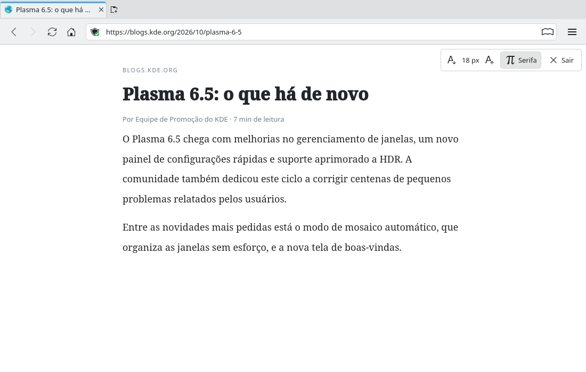

# Reader mode (#22)

> **Issue:** [#22](https://github.com/lukasborges/kondor/issues/22) · **Priority:** P3 (low) · **State:** see the issue's label (`to-spec` / `to-dev` / `in-review`).
> Read [`AGENTS.md`](../../AGENTS.md) first. This file is the source of truth for the issue; only the architect edits it.

## Objective

A reader mode that shows articles in a clean layout following the KDE color scheme, toggled from the address bar.

## Context

Nothing. `WebEngineView.runJavaScript(script, worldId, callback)` and `loadHtml(html, baseUrl)` are available.

## Design / behavior

1. Vendor **Mozilla Readability** (`Readability.js` and `Readability-readerable.js`, Apache-2.0, <https://github.com/mozilla/readability>) into `3rdparty/readability/` with its LICENSE, and add both files to a Qt resource (`qt_add_resources(kondor "reader" PREFIX "/reader" FILES …)`). Mention it in README "Third-party code".
2. **Detection**: after `LoadSucceededStatus`, run (in `WebEngineScript.ApplicationWorld`) the readerable script + `isProbablyReaderable(document)` and store the result in `Tab::readerAvailable` (new property).
3. **Toggle**: `Tab::toggleReaderMode()` command. In `WebViewTab.qml`: run `new Readability(document.cloneNode(true)).parse()` in the application world, get `{title, byline, content, siteName}` back via the callback, build an HTML document from `qrc:/reader/template.html` (placeholders replaced in JS/C++), and `webView.loadHtml(html, originalUrl)`. Set `Tab::readerActive = true`. Toggling again (or Back) reloads `originalUrl` and sets it false.
4. **Template**: max width 42em centered, serif/sans option, line-height 1.6, colors injected from `Kirigami.Theme` (`backgroundColor`, `textColor`, `linkColor`, `disabledTextColor`) so it follows light/dark schemes; images max-width 100%.
5. **Controls**: a small floating toolbar in reader mode (top-right overlay in QML, not HTML): font size −/+ (setting `Reader/FontSize`, applied via `webView.zoomFactor` or CSS variable), font family toggle, "Exit Reader Mode".
6. **Address bar button**: icon `view-readermode` (Breeze) visible when `readerAvailable`, checked when `readerActive`; shortcut `Ctrl+Alt+R`.

## Acceptance criteria

- [ ] On a news article/blog post the reader button appears; clicking shows a clean article with title, byline and images.
- [ ] Colors follow the KDE color scheme (test Breeze Light and Breeze Dark).
- [ ] Font size controls persist; leaving reader mode restores the original page.
- [ ] Non-article pages (home pages, web apps) don't show the button.

## Manual test

Try a Wikipedia article, a blog post and a news article; switch Plasma to Breeze Dark; try kde.org home page (no button).

## Out of scope

Text-to-speech, saving articles for later, reader view for PDFs.

## Dependencies

None.

## Prototype

Visual target — match it (controls, Kirigami components, icon names, wording, placement). If it disagrees with this spec, the spec wins.

**Reader mode with floating controls** — [`prototypes/22-reader-mode.qml`](../../prototypes/22-reader-mode.qml)

## Decisions

_None yet._ Answers to developer questions (`question` label) are recorded here as `| Question | Decision |` rows.
