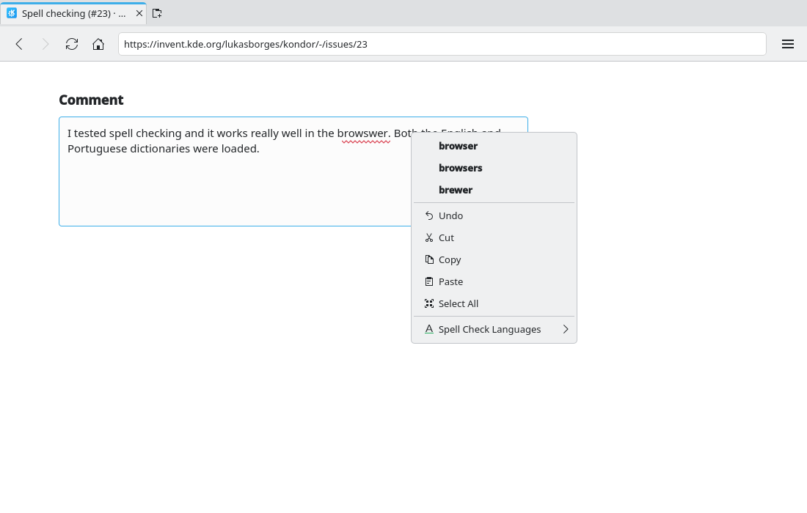

# Spell checking (#23)

> **Issue:** [#23](https://github.com/lukasborges/kondor/issues/23) · **Priority:** P3 (low) · **State:** see the issue's label (`to-spec` / `to-dev` / `in-review`).
> Read [`AGENTS.md`](../../AGENTS.md) first. This file is the source of truth for the issue; only the architect edits it.

## Objective

Spell checking in editable fields with selectable languages and suggestions in the context menu.

## Context

Off. `QQuickWebEngineProfile` has `spellCheckEnabled` and `spellCheckLanguages`. Qt WebEngine needs **`.bdic` dictionaries** in a `qtwebengine_dictionaries` directory (looked up in `QTWEBENGINE_DICTIONARIES_PATH`, then next to the executable, then in Qt's data dir). Fedora ships Hunspell dictionaries in `/usr/share/hunspell/*.dic|.aff` (packages `hunspell-en-US`, `hunspell-pt`, …) and the converter `/usr/lib64/qt6/libexec/qwebengine_convert_dict` (package `qt6-qtwebengine`).

## Design / behavior

1. **Build-time conversion** in CMake (option `KONDOR_SPELLCHECK_LANGS`, default `en_US;pt_BR`): for each language, if `/usr/share/hunspell/<lang>.dic` exists, `add_custom_command` running `qwebengine_convert_dict <lang>.dic ${CMAKE_BINARY_DIR}/qtwebengine_dictionaries/<lang>.bdic` (find the tool with `find_program(QWEBENGINE_CONVERT_DICT qwebengine_convert_dict HINTS ${QT6_INSTALL_PREFIX}/${QT6_INSTALL_LIBEXECS})`); add a custom target depending on the outputs; `install(DIRECTORY …/qtwebengine_dictionaries DESTINATION ${CMAKE_INSTALL_DATADIR}/kondor)`. Warn (not fail) if dictionaries/tool are missing.
2. **Runtime path** in `src/main.cpp` **before** `QtWebEngineQuick::initialize()`: if `QTWEBENGINE_DICTIONARIES_PATH` is not set, set it to the first existing of: `<appDir>/../share/kondor/qtwebengine_dictionaries` (installed / AppImage), `<appDir>/qtwebengine_dictionaries` (build dir).
3. **Settings** (#3): `spellCheckEnabled` (default true), `spellCheckLanguages` (QStringList, default from `QLocale::system().name()` if available else `en_US`). The Settings page lists the available `.bdic` files (scan the directory) as checkboxes. Apply to the default profile and new private profiles (`setSpellCheckEnabled`, `setSpellCheckLanguages`).
4. **Context menu** (#13): show `request.spellCheckerSuggestions` (max 5) at the top when `request.misspelledWord` is set; clicking calls `webView.replaceMisspelledWord(word)`. Optional "Add to Dictionary" is out of scope.
5. **AppImage/CI**: add `hunspell-en-US hunspell-pt` to the dnf lists in `build.yml`/`release.yml`; the release step must copy `share/kondor/qtwebengine_dictionaries` (it is installed by `cmake --install`, check it lands in the AppDir).

## Acceptance criteria

- [ ] Misspelled words in a textarea are underlined for the enabled languages (English and Portuguese).
- [ ] Right-click on a misspelled word shows suggestions that replace the word.
- [ ] Languages can be enabled/disabled in Settings; the change applies without restart (or after reload of the page).
- [ ] Works in the AppImage.

## Manual test

Type "teh" and "caza" in a GitHub comment box with both languages enabled; disable Portuguese and reload.

## Out of scope

Personal dictionary, grammar checking, auto-detecting the language per field.

## Dependencies

#3 (Settings), #13 (context menu).

## Prototype

Visual target — match it (controls, Kirigami components, icon names, wording, placement). If it disagrees with this spec, the spec wins.

**Spelling suggestions in the context menu** — [`prototypes/23-spellcheck.qml`](../../prototypes/23-spellcheck.qml)

## Decisions

_None yet._ Answers to developer questions (`question` label) are recorded here as `| Question | Decision |` rows.
