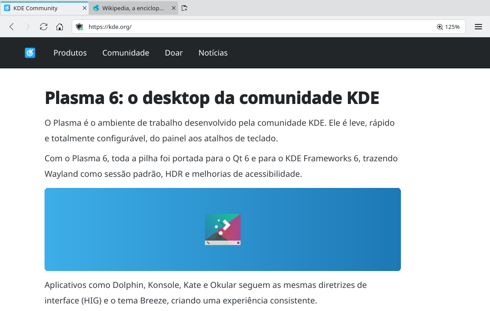

# Per-site zoom (#24)

> **Issue:** [#24](https://github.com/lukasborges/kondor/issues/24) · **Priority:** P3 (low) · **State:** see the issue's label (`to-spec` / `to-dev` / `in-review`).
> Read [`AGENTS.md`](../../AGENTS.md) first. This file is the source of truth for the issue; only the architect edits it.

## Objective

Remember the zoom level per site and show it in the address bar when it is not 100%.

## Context

Zoom commands exist (`Tab::zoomIn/zoomOut/resetZoom` → `WebViewTab.qml` changes `webView.zoomFactor` in 0.1 steps, range 0.25–5.0) but the value is not exposed nor saved; it resets on navigation in some cases and is never shown.

## Design / behavior

1. **`Tab`**: `Q_PROPERTY(qreal zoomFactor …)` + `setZoomFactor(qreal)` (state reported by the view).
2. **Zoom steps**: use the standard browser levels `[0.3, 0.5, 0.67, 0.8, 0.9, 1.0, 1.1, 1.25, 1.5, 1.75, 2.0, 2.5, 3.0, 4.0, 5.0]` instead of ±0.1.
3. **Persistence**: `src/zoommanager.{h,cpp}` (or methods on `Settings` #3) storing `host → factor` in `QSettings` group `SiteZoom` (only values ≠ 1.0; remove the key when back to 100%). `Q_INVOKABLE qreal zoomFor(QString host)`, `Q_INVOKABLE void setZoomFor(QString host, qreal factor)`.
4. **`WebViewTab.qml`**:
   - after each zoom command: `root.tab.setZoomFactor(webView.zoomFactor)` and, if not private, `ZoomManager.setZoomFor(hostOf(webView.url), factor)`.
   - on `onUrlChanged` when the host changes and on `LoadSucceededStatus`: apply `ZoomManager.zoomFor(host)` (private tabs: read saved zoom, never write).
   - all tabs of the same host update when one changes (connect to a `zoomChanged(host)` signal).
5. **Address bar indicator**: a flat `ToolButton` inside the right side of `addressBar` with text `"110%"` (`Math.round(zoomFactor*100) + "%"`), visible only when ≠ 100%; click resets (Ctrl+0); tooltip "Redefinir zoom".
6. Also support Ctrl + mouse wheel zoom (Qt WebEngine does it natively — make sure the resulting `zoomFactor` change is captured: listen to `onZoomFactorChanged` on the view rather than only after commands).

## Acceptance criteria

- [ ] Zooming a site to 125%, navigating to another page of the same site and restarting Kondor keeps 125%; other sites stay at 100%.
- [ ] Indicator shows the level and resets on click.
- [ ] Ctrl+wheel changes are saved too; private tabs don't save.

## Manual test

Zoom kde.org with Ctrl++ and Ctrl+wheel, open another kde.org page, restart; check another site; private tab zoom not persisted.

## Out of scope

Default zoom setting for all sites, text-only zoom.

## Dependencies

#3 (Settings) optional.

## Prototype

Visual target — match it (controls, Kirigami components, icon names, wording, placement). If it disagrees with this spec, the spec wins.

**Zoom indicator in the address bar** — [`prototypes/24-site-zoom.qml`](../../prototypes/24-site-zoom.qml)

## Decisions

_None yet._ Answers to developer questions (`question` label) are recorded here as `| Question | Decision |` rows.
