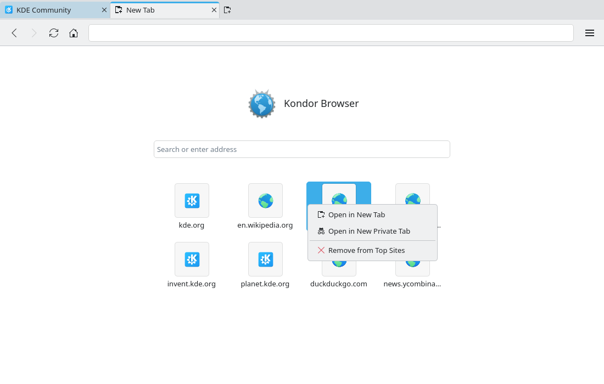
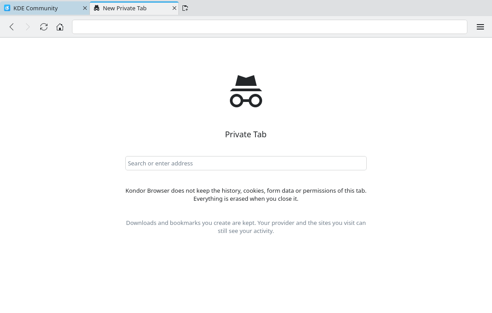
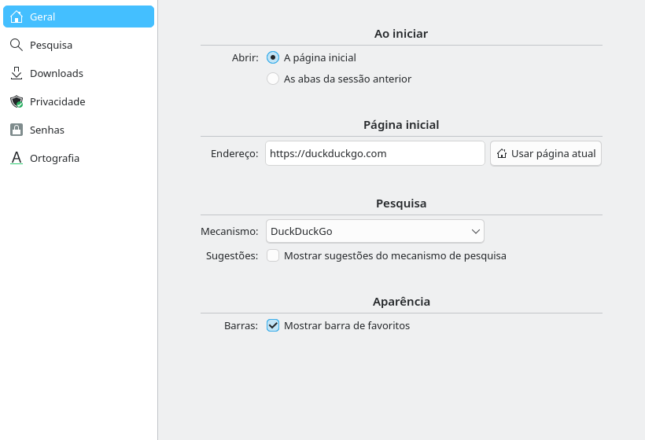

# New Tab page (#43)

> **Issue:** [#43](https://github.com/lukasborges/kondor/issues/43) · **Priority:** P1 (high) · **State:** see the issue's label (`to-spec` / `to-dev` / `in-review`).
> Read [`AGENTS.md`](../../AGENTS.md) first. This file is the source of truth for the issue; only the architect edits it.

## Objective

New tabs open Kondor Browser's own **New Tab page** (like Firefox Home): the application logo and
name, a search/address field and the sites the user visits most. The configured home page is only
used by the first tab at startup and by the Home button; a blank home page means the New Tab page,
and blank is the new default. Private tabs show a private variant without top sites.

## Context

- `TabModel::insertTab()` (`src/tabmodel.cpp`) replaces an empty URL with `ProfileManager.homePage`,
  so every new tab (Ctrl+T, the `+` button, menus, middle click on the tab bar) loads the home page.
- `Settings.homePage` (`src/settings.cpp`) defaults to `https://duckduckgo.com`;
  `Settings.startupBehavior` is `homepage` or `restore`. The Settings window edits both in the
  "On Startup" and "Home Page" sections (`qml/SettingsWindow.qml`).
- The startup tabs are created in `Main.qml` `Component.onCompleted` (session restore, command-line
  URLs, then a fallback `tabs.addTab(...)`). The Home button calls
  `navigateTo(ProfileManager.resolveAddress(""))`, which returns the home page.
- `WebViewTab.qml` only loads `tab.url` when it is not empty. `SessionManager` skips entries with an
  empty URL; `TabModel` remembers closed tabs (url, title, index) for "Reopen Closed Tab".
- History lives in the **Database** block (`history(id, url, title, visited_at)`), written only for
  normal tabs by `HistoryManager`.

## Design / behavior

1. **`Tab` state** (bridge pattern): `Q_PROPERTY(bool newTabPage READ newTabPage NOTIFY newTabPageChanged)`.
   - A tab created with an empty URL starts with `newTabPage == true`.
   - `Q_INVOKABLE void showNewTabPage()` sets it to `true` and emits `newTabPageRequested()`;
     `WebViewTab.qml` handles that by loading `about:blank` in the `WebEngineView` (so Back returns
     to the page that was there).
   - `navigateTo(url)` with a non-empty URL sets it to `false` before emitting
     `navigationRequested`. `navigateTo()` with an empty URL does nothing.
   - `setUrl(url)` sets it to `false` when `url` is neither empty nor `about:blank` (Back/Forward,
     links, reload of a real page).
2. **`TabModel::insertTab()`** no longer substitutes the home page: an empty URL means the New Tab
   page. `ClosedTab` entries are not recorded for tabs on the New Tab page.
3. **`qml/NewTabPage.qml`** (new file, in `QML_FILES`), placed in `WebViewTab.qml` above the
   `WebEngineView` with `anchors.fill: parent; visible: root.tab.newTabPage`. Background:
   `Kirigami.Theme.colorSet: Kirigami.Theme.View`, `Kirigami.Theme.inherit: false`,
   `color: Kirigami.Theme.backgroundColor`. Layout as in the prototype: a centered column,
   `gridUnit * 4` from the top, `spacing: gridUnit * 2`, at most `gridUnit * 36` wide.
   - **Normal tab:** a row with `Kirigami.Icon { source: "kondor" }` (64 px) and
     `Kirigami.Heading { level: 1; text: Qt.application.displayName }`; a `TextField`
     (`gridUnit * 30` wide, placeholder `qsTr("Search or enter address")`; Enter →
     `tab.navigateTo(ProfileManager.resolveAddress(text))`, ignored when the text is blank); the
     **top sites** grid (item 4) when `Settings.showTopSites` is on.
   - **Private tab** (`tab.isPrivate`): `Kirigami.Icon { source: "view-private" }` (96 px),
     `Kirigami.Heading { level: 1; text: qsTr("Private Tab") }`, the same `TextField`, and the two
     labels of the prototype (second one in `Kirigami.Theme.disabledTextColor`). No top sites, no
     history query.
4. **Top sites.** `Q_INVOKABLE QVariantList HistoryManager::topSites(int limit)` returns up to
   `limit` maps `{ url, title, host }`:
   - reads `url, title, visited_at` of the visits in the last 90 days (http/https only);
   - groups them by host, with a leading `www.` removed; a host's score is its number of visits;
   - for each host, the tile URL is that host's most visited URL (tie: most recent), and the title
     is the latest non-empty title of that URL;
   - sorts by score, then by most recent visit; skips hosts listed in `Settings.hiddenTopSites`.
   - The page asks for 8 sites every time it becomes visible (`onVisibleChanged`) and when
     `Settings.hiddenTopSites` changes. No caching, no new table.
   - Grid: `GridLayout` with `columns: Math.max(1, Math.min(4, Math.floor(width / (gridUnit * 8))))`,
     one `ItemDelegate` per site (`gridUnit * 7` wide) with a `gridUnit * 3.5` rounded
     `Rectangle` (`Kirigami.Theme.alternateBackgroundColor`, 1 px border from the text color at 15%)
     holding a `SiteIcon` (`iconSizes.medium`, `fallback: "internet-web-browser"`; favicons from
     `FaviconStore`, see bug #45), and the host as an elided `Label` below.
     `ToolTip` (`delay: 600`) shows title and URL.
   - Click → `tab.navigateTo(url)`. Middle click or Ctrl+click → new background tab
     (`tabModel.addTabWithProfile(tab.profile, url, true)`).
   - Right click → `Menu`: "Open in New Tab" (`tab-new`), "Open in New Private Tab"
     (`view-private`), separator, "Remove from Top Sites" (`list-remove`, appends the host to
     `Settings.hiddenTopSites`).
   - With no history (or every site hidden) the grid is replaced by a `Label` in
     `Kirigami.Theme.disabledTextColor`: `qsTr("The sites you visit most will appear here.")`.
5. **Address bar and toolbar** (`Main.qml`) when `currentTab.newTabPage`:
   - the address field shows an empty text (placeholder visible), even after `showNewTabPage()`;
   - Reload and the page actions that need a page (find in page, zoom, bookmark star once #2 is
     merged) are disabled; Back/Forward keep following `canGoBack`/`canGoForward`;
   - the tab button and the window title use `qsTr("New Tab")` (`qsTr("New Private Tab")` for a
     private tab) instead of the page title; the tab icon is `tab-new` (`view-private` for private).
6. **Opening new tabs.** Add `function openNewTab(isPrivate)` to `Main.qml`: `tabs.addTab(isPrivate)`,
   then focus and select the address field (deferred with `Qt.callLater`, as the Ctrl+F fix in #32
   does). Use it for every "new tab" entry point: the `+` button, double/middle click on the empty
   tab bar, File/menu "New Tab" and "New Private Tab", Ctrl+T, Ctrl+Shift+N and the tab context
   menu (`TabContextMenu.qml` emits `newTabRequested()` instead of calling the model).
7. **Home page = first tab only.**
   - Startup with `startupBehavior == "homepage"` and no command-line URL: one tab with
     `Settings.homePage` (blank → New Tab page).
   - Startup with `restore`: the restored tabs; if nothing was restored, one home page tab as above.
   - `kondor --private` without URL: one private New Tab page.
   - Home button: `Settings.homePage` blank → `currentTab.showNewTabPage()`, else
     `navigateTo(homePage)`.
   - `ProfileManager.resolveAddress("")` keeps returning the home page (it may now be an empty URL);
     callers must not navigate to an empty URL (see item 1).
8. **Settings** (**Settings** block, `src/settings.{h,cpp}`):
   - `homePage` default changes to `""` (values already saved by users are kept).
   - New `Q_PROPERTY(bool showTopSites …)` (key `NewTab/ShowTopSites`, default `true`) and
     `Q_PROPERTY(QStringList hiddenTopSites …)` (key `NewTab/HiddenTopSites`, default empty).
   - `SettingsWindow.qml`, General page, as in the updated `03-settings` prototype:
     - "Home Page" section: the address field's placeholder becomes `qsTr("New Tab page")`, and a
       new button "Use New Tab Page" (`tab-new`) clears the address. It is disabled when the
       address is already blank. Clearing the field by hand also means the New Tab page: skip
       `resolveAddress()` for blank text.
     - New "New Tabs" section with the `CheckBox` "Show top sites" (form label "New Tab page:") and
       the button "Restore Removed Sites" (`edit-undo`, clears `hiddenTopSites`, disabled when the
       list is empty).
9. **Session restore** (`SessionManager`): a tab on the New Tab page is saved as
   `"url": "about:newtab"` and restored as a New Tab page tab (`addTab(false, QUrl())`). Private
   tabs stay excluded as before.
10. **Privacy:** the private variant never calls `HistoryManager.topSites()`; "Open in New Private
    Tab" from a tile opens a private tab, and nothing about it is written. `about:blank` loaded by
    `showNewTabPage()` must not be recorded in history (check `HistoryManager::isTracked`).
11. **Strings and docs:** every new string in `qsTr()` and translated in all `i18n/*.ts` files (CI
    "Check translations"). README: add the New Tab page to Features → Implemented, and describe the
    home page change.

## Acceptance criteria

- [ ] Ctrl+T, the `+` button, the menus and the tab context menu open the New Tab page with the
      address field focused; typing there or in the page field and pressing Enter navigates.
- [ ] With the default settings, startup shows the New Tab page; with a home page set, only the
      first tab at startup (and the Home button) loads it, new tabs still show the New Tab page.
- [ ] Top sites show up to 8 sites from the last 90 days of history, most visited first, with
      favicons (globe icon when none) and the host name; click, middle click and the context menu
      work; "Remove from Top Sites" hides a site until "Restore Removed Sites".
- [ ] "Show top sites" off hides the grid; with no history the placeholder text is shown.
- [ ] A private tab shows the private variant, with no top sites; nothing from it reaches disk.
- [ ] Back after navigating from a Home-button New Tab page returns to the previous page; the
      tab/window title says "New Tab"; Reload is disabled on the page.
- [ ] Session restore brings back New Tab page tabs; they are not added to "Reopen Closed Tab".
- [ ] All new strings are translated in every `i18n/*.ts`; the README is updated.
- [ ] Matches the prototypes.

## Manual test

Use an isolated profile (temporary `XDG_*` dirs, see `AGENTS.md`).
1. Start Kondor: the New Tab page with an empty grid placeholder. Visit kde.org (3 pages),
   wikipedia.org (2 pages) and fedoraproject.org once.
2. Ctrl+T: the address field has focus; the grid shows kde.org, wikipedia.org, fedoraproject.org in
   that order, with favicons. Middle-click one tile: a background tab opens.
3. Right-click wikipedia.org → "Remove from Top Sites": it disappears. Settings → "Restore Removed
   Sites": it comes back on the next New Tab page.
4. Settings → home page `https://kde.org`. Restart: the first tab loads kde.org; Ctrl+T still shows
   the New Tab page. "Use New Tab Page", restart: the New Tab page again.
5. On a site, press Home with a blank home page: the New Tab page shows; press Back: the site again.
6. Ctrl+Shift+N: the private variant, without top sites.
7. Startup "restore" with two New Tab pages and one site open, restart: all three come back.

## Out of scope

Pinning or reordering tiles, adding custom tiles, editing tile titles, thumbnails/screenshots of
sites, widgets (weather, clocks, news), sponsored tiles, wallpapers, a "New tabs open:" choice
(always the New Tab page), recently closed tabs on the page, bookmarks on the page. An HTML
`kondor:` URL scheme (the page is native QML).

## Dependencies

#1 (history, Database), #3 (Settings), #6 (session restore), #12 (tab context menu), #19/#34
(translations). Merge after #2 (Bookmarks), which also edits `Main.qml` and `WebViewTab.qml`.

## Prototype

Visual target — match it (controls, Kirigami components, icon names, wording, placement). If it disagrees with this spec, the spec wins.

**New Tab page (tile menu open)** — [`prototypes/43-new-tab-page.qml`](../../prototypes/43-new-tab-page.qml)

**New private tab** — [`prototypes/43b-new-private-tab-page.qml`](../../prototypes/43b-new-private-tab-page.qml)

**Settings, General page** ("Home Page" and "New Tabs" sections) — [`prototypes/03-settings.qml`](../../prototypes/03-settings.qml)

## Decisions

| Question | Decision |
| --- | --- |
| Native QML page or an HTML page on a custom scheme? | Native QML overlay in `WebViewTab.qml` (Breeze look, `Kirigami.Theme` colors). The `about:blank` load in `showNewTabPage()` keeps Back working. |
| What does the home page setting control now? | Only the first tab at startup and the Home button. Blank (the new default) means the New Tab page. |
| Which shortcut opens the private New Tab page? (PR #48) | Ctrl+Shift+N, the existing documented shortcut; Ctrl+Shift+P stays reserved for "New Private Window" (#14). |
| Why do top-site tiles show no favicon? (bug #45) | `image://favicon/<page URL>` never resolves on Qt 6.11; tiles use `SiteIcon` backed by `FaviconStore` (fixed with bug #45). |
