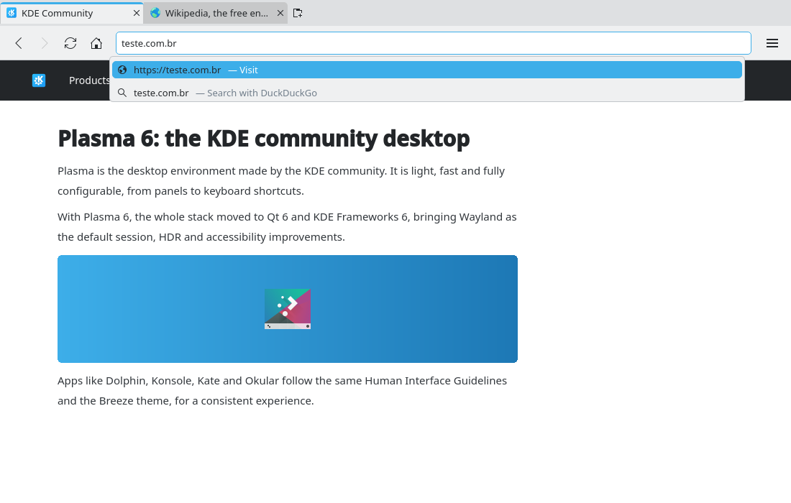

# Address bar: choose between visiting and searching (#44)

> **Issue:** [#44](https://github.com/lukasborges/kondor/issues/44) · **Priority:** P2 (medium) · **State:** see the issue's label (`to-spec` / `to-dev` / `in-review`).
> Read [`AGENTS.md`](../../AGENTS.md) first. This file is the source of truth for the issue; only the architect edits it.

## Objective

When the typed text looks like an address (`teste.com.br`, `node.js`, `localhost:8080`), the
address bar shows a dropdown with two choices: **Visit** the address (selected, what Enter does)
and **Search with <engine>** for the same text. Today such text can only be visited; this lets
the user search it with one key press (Down, Enter) or a click.

## Context

- `addressBar` (`qml/Main.qml`) is a `TextField`; `onAccepted` calls
  `tabs.currentTab.navigateTo(ProfileManager.resolveAddress(text))`.
- `resolveAddress()` (`src/addressresolver.{h,cpp}`, free function, unit-tested in
  `tests/tst_addressresolver.cpp`) returns the home page for blank text, a URL for
  `scheme://…`, `about:`, `data:` and host-like text (IP, `localhost`, `name.tld`, optional port
  and path), else the search URL built from `Settings.searchUrlTemplate()`.
- The engine is `Settings.searchEngine` (`duckduckgo`, `google`, `startpage`, `brave`, `custom`).
- #11 (Address bar suggestions, later in the roadmap) will add history, bookmark and network rows
  to the same dropdown. This issue creates that dropdown.

## Design / behavior

1. **Resolver split** (`src/addressresolver.{h,cpp}`), behavior of `resolveAddress()` unchanged:
   - `QUrl addressUrl(const QString &text)`: the URL when the trimmed text is an address (the
     `://` / `about:` / `data:` branch or the host regex), else an empty `QUrl`.
   - `QUrl searchUrl(const QString &text, const QString &searchTemplate)`: always the search URL.
   - `resolveAddress()` uses both. Add test cases for the two new functions to
     `tests/tst_addressresolver.cpp` (address, search text, `node.js`, `localhost:8080`, blank).
2. **QML access:** `ProfileManager` gets `Q_INVOKABLE QUrl addressUrl(const QString &text) const`
   and `Q_INVOKABLE QUrl searchUrl(const QString &text) const` (the latter with
   `Settings::instance()->searchUrlTemplate()`). `Settings` gets
   `Q_INVOKABLE QString searchEngineName() const`: "DuckDuckGo", "Google", "Startpage",
   "Brave Search", or `""` for a custom engine (and for an invalid custom URL, which falls back to
   DuckDuckGo: return "DuckDuckGo" then).
3. **`qml/AddressSuggestions.qml`** (new, in `QML_FILES`): a `Popup` under `addressBar`
   (`x`/`width` of the field, `y` = its bottom), `padding: 0`, `focus: false` (the keyboard stays
   in the field), `closePolicy: Popup.CloseOnEscape | Popup.CloseOnPressOutsideParent`.
   - API: `property string text`, `property int currentIndex`, `readonly property var rows`,
     `function activate(index)`, `signal navigate(url url)`.
   - Rows, rebuilt when `text` changes, only when `ProfileManager.addressUrl(text)` is valid:
     1. icon `globe`, main label `addressUrl.toDisplayString()`, dimmed suffix
        `"— " + qsTr("Visit")`;
     2. icon `edit-find`, main label = the trimmed text, dimmed suffix
        `"— " + qsTr("Search with %1").arg(Settings.searchEngineName())`, or `"— " + qsTr("Search")`
        when the name is empty.
   - Each row is an `ItemDelegate` with `focusPolicy: Qt.NoFocus`, `highlighted` when it is the
     current row, layout as in the prototype (16 px `Kirigami.Icon`, `Label`, dimmed `Label` in
     `Kirigami.Theme.disabledTextColor`, `highlightedTextColor` when highlighted).
4. **`Main.qml` wiring:**
   - On `textEdited` (user typing only, not programmatic `text` changes): set the popup's `text`;
     open it with `currentIndex: 0` when it has rows, close it otherwise.
   - Close it on `activeFocus` loss, blank text, tab switch and after navigating.
   - `Keys.onDownPressed` / `Keys.onUpPressed` while it is open: move `currentIndex` between 0 and
     1 (no wrap) and accept the event; when it is closed they keep their current behavior.
   - `onAccepted`: popup open → act on the current row; closed → `resolveAddress()` as today.
     Clicking a row acts on it. "Act" = `tabs.currentTab.navigateTo(url)`, close the popup, drop the
     field focus (as `onAccepted` does today).
   - Esc with the popup open only closes the popup (the typed text stays).
5. **No storage, no network:** everything is computed locally; private tabs behave the same and
   nothing is written.
6. **Strings:** "Visit", "Search with %1", "Search" in `qsTr()` (translator comment: `%1` is the
   search engine name), translated in all `i18n/*.ts`. README: mention the Visit/Search choice in
   Features → Implemented.

## Acceptance criteria

- [ ] Typing `teste.com.br` shows two rows, "https://teste.com.br — Visit" (selected) and
      "teste.com.br — Search with DuckDuckGo" (engine from Settings).
- [ ] Enter visits; Down then Enter searches; clicking either row does the same.
- [ ] Typing plain words (`kde plasma`) shows no dropdown and Enter searches, as today.
- [ ] Esc closes the dropdown and keeps the text; switching tabs or leaving the field closes it.
- [ ] `resolveAddress()` results are unchanged (existing tests pass) and the new functions have tests.
- [ ] Strings translated in every `i18n/*.ts`; matches the prototype.

## Manual test

Use an isolated profile (temporary `XDG_*` dirs, see `AGENTS.md`). Type `teste.com.br`: Enter
opens `https://teste.com.br`. Type it again, Down, Enter: the search results page. Type
`localhost:8080`: "http://localhost:8080 — Visit". Type `kde plasma`: no dropdown. Change the
engine to Google in Settings: the row says "Search with Google". Repeat in a private tab.

## Out of scope

History, bookmark and network suggestions, inline completion (all #11); search keywords (`!w`);
choosing another engine per search; favicons in rows; middle click to open in a new tab.

## Dependencies

#3 (Settings), #26 (tests). #11 builds on the dropdown created here.

## Prototype

Visual target — match it (controls, Kirigami components, icon names, wording, placement). If it disagrees with this spec, the spec wins.

**Visit or search** — [`prototypes/44-address-visit-or-search.qml`](../../prototypes/44-address-visit-or-search.qml)

## Decisions

| Question | Decision |
| --- | --- |
| Show a dropdown for plain search text too? | No: with a single choice it adds nothing. #11 shows the dropdown for every text once it has history/bookmark rows. |
