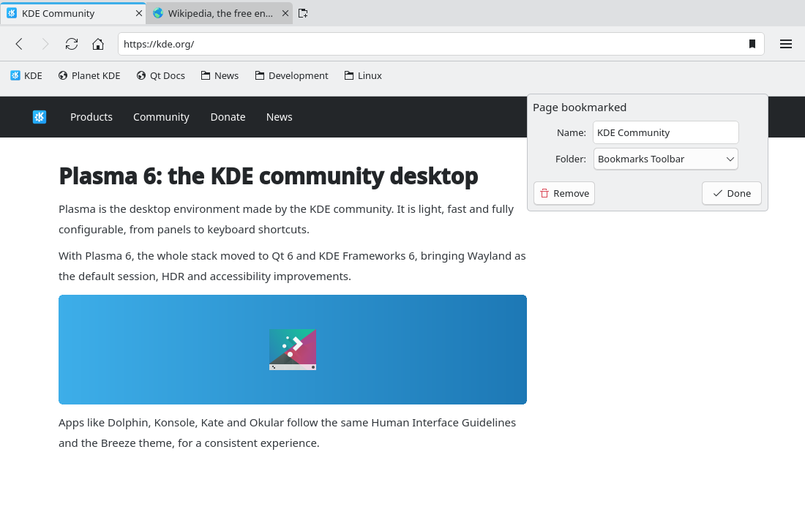

# Default bookmarks on first run (#47)

> **Issue:** [#47](https://github.com/lukasborges/kondor/issues/47) · **Priority:** P3 (low) · **State:** see the issue's label (`to-spec` / `to-dev` / `in-review`).
> Read [`AGENTS.md`](../../AGENTS.md) first. This file is the source of truth for the issue; only the architect edits it.

## Objective

A new profile starts with a useful set of KDE and Linux bookmarks in the Bookmarks Toolbar,
the same ones the #2 prototype shows plus a "Linux" folder. They are added once. Users who
already have bookmarks get nothing, and deleted defaults never come back.

## Context

- Bookmarks live in the **Database** block (`src/database.cpp`), table `bookmarks`, created by
  migration 2 together with the two root folders (`special = 'toolbar'` "Bookmarks Toolbar",
  `special = 'other'` "Other Bookmarks"). `kSchemaVersion` is 2.
- `BookmarkManager` (`src/bookmarkmanager.{h,cpp}`) reads that table; `tests/tst_bookmarks.cpp`
  tests it on a temporary `XDG_DATA_HOME`.
- Translators are installed in `main.cpp` before the QML engine is created, and the database is
  first opened by the QML singletons, so translated strings are available when migrations run.

## Design / behavior

1. **Migration 3** in `Database::migrate()` (`kSchemaVersion = 3`), in the same transaction as the
   others:
   - If the `bookmarks` table has **no row with `special IS NULL`** (no user bookmark or folder),
     insert the defaults below under the `toolbar` root, in this order (`position` 0, 1, 2…
     inside each parent; folders `is_folder = 1`, `url NULL`; `created_at` = now).
   - Otherwise do nothing. Either way `user_version` becomes 3, so the step never runs again.
   - Put the data in one static table in `src/database.cpp` (or a small
     `src/defaultbookmarks.{h,cpp}` registered in CMake), not spread across `INSERT`s.
2. **Folder names** are translated at insert time with
   `QCoreApplication::translate("DefaultBookmarks", "News")` etc. (and translated in every
   `i18n/*.ts`). Bookmark titles are site names and stay as written.
3. **Defaults** (Bookmarks Toolbar):

   | # | Title | URL |
   | --- | --- | --- |
   | 1 | KDE | https://kde.org/ |
   | 2 | Planet KDE | https://planet.kde.org/ |
   | 3 | Qt Docs | https://doc.qt.io/ |
   | 4 | 📁 **News** | |
   | | LWN.net | https://lwn.net/ |
   | | Phoronix | https://www.phoronix.com/ |
   | | 9to5Linux | https://9to5linux.com/ |
   | | OMG! Ubuntu | https://www.omgubuntu.co.uk/ |
   | | GamingOnLinux | https://www.gamingonlinux.com/ |
   | | DistroWatch | https://distrowatch.com/ |
   | 5 | 📁 **Development** | |
   | | KDE Developer | https://develop.kde.org/ |
   | | KDE Human Interface Guidelines | https://develop.kde.org/hig/ |
   | | KDE Invent | https://invent.kde.org/ |
   | | freedesktop.org | https://www.freedesktop.org/ |
   | | The Linux Kernel Archives | https://www.kernel.org/ |
   | | Kondor Browser on GitHub | https://github.com/lukasborges/kondor |
   | 6 | 📁 **Linux** | |
   | | Fedora Project | https://fedoraproject.org/ |
   | | Fedora Docs | https://docs.fedoraproject.org/ |
   | | ArchWiki | https://wiki.archlinux.org/ |
   | | Flathub | https://flathub.org/ |
   | | KDE Applications | https://apps.kde.org/ |
   | | KDE UserBase | https://userbase.kde.org/ |
   | | KDE Discuss | https://discuss.kde.org/ |

   "Other Bookmarks" stays empty. `Settings.showBookmarksBar` keeps its default (`false`). The
   defaults show up in the Bookmarks menu and in the manager, and on the toolbar once it is shown.
4. **Tests** (`tests/tst_bookmarks.cpp`):
   - a fresh database has the 6 toolbar entries above, in order, with 6 / 6 / 7 children;
   - a database at version 2 that already has a user bookmark is migrated to 3 with nothing added;
   - removing a default and re-opening the database does not bring it back.
5. **Privacy:** this only touches the persistent profile's database; private tabs are unaffected.
6. README: mention the default bookmarks in Features → Implemented.

## Acceptance criteria

- [ ] With an empty profile, the Bookmarks Toolbar (Ctrl+Shift+B) shows KDE, Planet KDE, Qt Docs,
      News, Development and Linux, and the folders hold the bookmarks of the table, in order.
- [ ] Folder names are translated (e.g. pt_BR "Notícias", "Desenvolvimento", "Linux").
- [ ] An existing profile with bookmarks gets no defaults; deleted defaults never return.
- [ ] New tests pass; translations complete; offscreen smoke test clean.
- [ ] Matches the toolbar of the `02-bookmarks` prototype.

## Manual test

Isolated profile (temporary `XDG_*` dirs): start, Ctrl+Shift+B, open each folder, open a few
bookmarks. Delete "Qt Docs", restart: it stays deleted. Start with `LANG=pt_BR.UTF-8` on another
empty profile: translated folder names.

## Out of scope

Showing the toolbar by default, an "Other Bookmarks" set, distro-specific sets chosen at runtime,
a "Restore default bookmarks" action, favicons (bug #45 covers them).

## Dependencies

#2 (bookmarks), #34 (translations). Independent of #45.

## Prototype

Visual target — match it (controls, Kirigami components, icon names, wording, placement). If it disagrees with this spec, the spec wins.

**Bookmarks toolbar with the defaults** — [`prototypes/02-bookmarks.qml`](../../prototypes/02-bookmarks.qml)

## Decisions

| Question | Decision |
| --- | --- |
| Seed through a migration or a first-run flag? | Migration 3: it runs exactly once per database, needs no extra setting, and the "no user bookmarks" guard protects existing profiles. |
