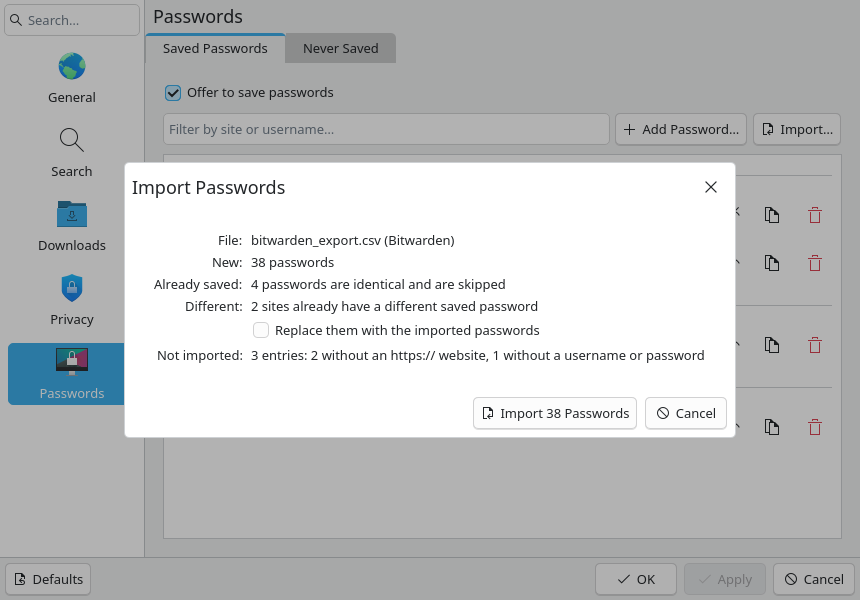
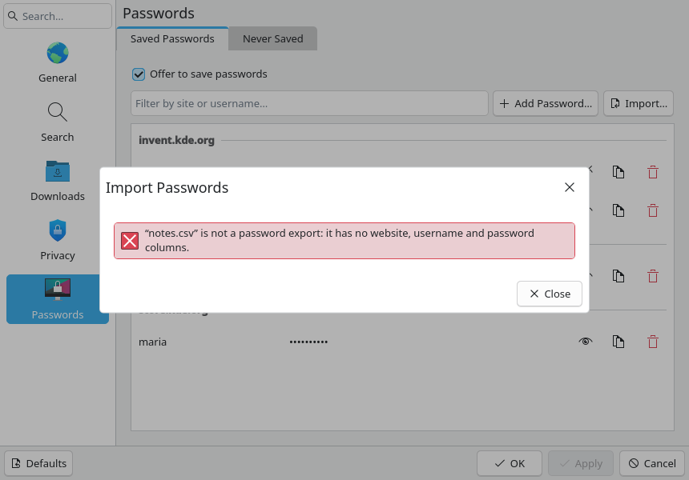
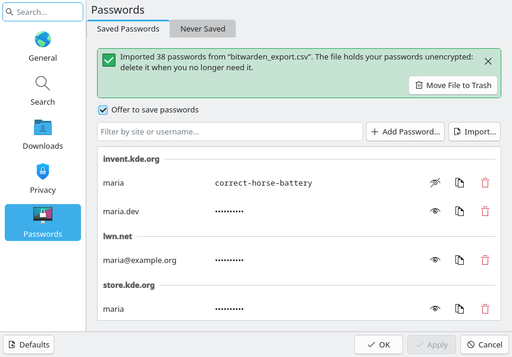
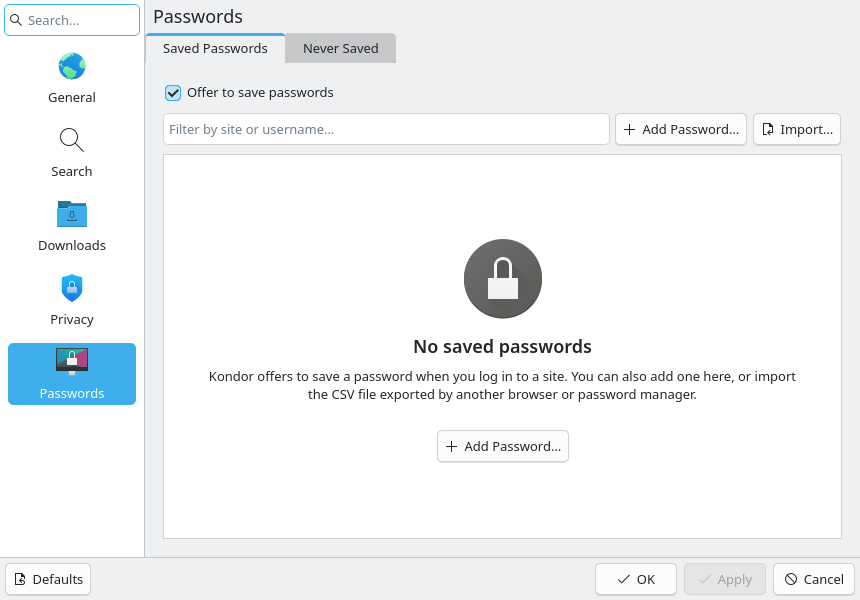

# Import passwords from a CSV file (#106)

> **Issue:** [#106](https://github.com/lukasborges/kondor/issues/106) · **Priority:** P2 (medium) · **State:** see the issue's label (`to-spec` / `to-dev` / `in-review`).
> Read [`AGENTS.md`](../../AGENTS.md) first. This file is the source of truth for the issue; only the architect edits it.

## Objective

Let people bring their saved passwords into Kondor from another browser or password manager.
Settings → Passwords gets an **Import…** button that reads the CSV file those apps export:
- Chrome, Chromium, Edge, Brave, Vivaldi and Opera;
- Firefox, LibreWolf and Waterfox;
- Bitwarden;
- 1Password;
- any other CSV with website, username and password columns (KeePassXC, LastPass…).

It shows what will be imported, then saves the logins to KWallet.

## Context

- #21 stores logins in KWallet through `PasswordStore` (`src/passwords/passwordstore.{h,cpp}`).
  There is one map per origin, in the format `username → password`. #102 added "Add Password…" to
  `qml/PasswordsPage.qml`. The relevant API:
  - `save(origin, username, password)`;
  - `contains(origin, username)`, `password(origin, username)`;
  - `originFromInput(text)`: prefixes `https://` when there is no scheme, and returns an empty
    string unless `canSaveFor()` accepts the result (https, or http on localhost).
- The spec of #21 is [`0021-password-manager-and-autofill.md`](0021-password-manager-and-autofill.md).
  #102 listed import/export as out of scope; this issue adds import only.
- Reading another browser's profile directly was rejected (see Decisions). The browser's own CSV
  export is used instead.
- **Export formats.** A header row is always present. Column names are matched case-insensitively.

  | Source | Header (relevant columns in **bold**) |
  | --- | --- |
  | Chrome / Chromium / Edge / Brave / Vivaldi / Opera | `name,`**`url`**`,`**`username`**`,`**`password`**`,note` (`note` only in newer versions) |
  | Firefox / LibreWolf / Waterfox | **`url`**`,`**`username`**`,`**`password`**`,httpRealm,formActionOrigin,guid,timeCreated,timeLastUsed,timePasswordChanged` |
  | Bitwarden | `folder,favorite,`**`type`**`,name,notes,fields,reprompt,`**`login_uri`**`,`**`login_username`**`,`**`login_password`**`,login_totp`. An organization export starts with `collections` instead of `folder`. `login_uri` joins several URIs with `,` inside one quoted field. |
  | 1Password 8 | `Title,`**`Url`**`,`**`Username`**`,`**`Password`**`,OTPAuth,Favorite,Archived,Tags,Notes`. Only Login and Password items are exported. Some versions name the column `Website` instead of `Url`. |
  | KeePassXC | `Group,Title,`**`Username`**`,`**`Password`**`,`**`URL`**`,Notes,TOTP,…` |
  | LastPass | **`url`**`,`**`username`**`,`**`password`**`,totp,extra,name,grouping,fav` |

## Design / behavior

1. **Parser** in `src/passwords/passwordimport.{h,cpp}` (registered in `CMakeLists.txt` and in
   the `tst_passwordstore` sources). It is pure logic with no KWallet, so it can be unit tested.

   - **Entry point:** `static PasswordImport::Result PasswordImport::parse(const QByteArray &csv)`.
     It returns:
     - `format`: one of `Bitwarden`, `1Password`, `Firefox`, `Chrome`, `KeePassXC` or `CSV`;
     - `logins`: a `QList<Login>`, where `Login` is `{QString origin, username, password}`;
     - `skippedNoSite`, `skippedNoCredentials` and `skippedNotLogin`;
     - `error`: an enum, `None`, `NotPasswordExport` or `Empty`.
   - **CSV (RFC 4180):**
     - separator `,`;
     - fields may be quoted with `"`, and `""` inside quotes is a literal quote;
     - quoted fields may contain commas and line breaks;
     - lines end with LF or CRLF;
     - a UTF-8 BOM at the start is dropped;
     - blank lines are ignored;
     - a row with fewer fields than the header has the missing fields read as empty.
   - **Columns.** The first column whose trimmed, lower-cased name matches is used:
     - website: `url`, `login_uri`, `website`, `uri`, `web site`, `login url`;
     - username: `username`, `login_username`, `user name`, `login`, `login name`;
     - password: `password`, `login_password`.

     If any of the three is missing, `error = NotPasswordExport` and nothing else is returned.
   - **Format label** (only for the dialog). The first matching rule wins:
     - `Bitwarden` if `login_password` is present;
     - `1Password` if `otpauth` and `title` are present;
     - `Firefox` if `formactionorigin` or `httprealm` is present;
     - `KeePassXC` if `group` and `title` are present;
     - `Chrome` if the columns are exactly `name,url,username,password[,note]`;
     - otherwise `CSV`.
   - **Rows:**
     - With a `type` column (Bitwarden), rows whose type is not `login` count as
       `skippedNotLogin`.
     - The website field is split on `,` and on line breaks. Each part is trimmed and passed to
       `PasswordStore::originFromInput()`, and the distinct non-empty origins are kept. A row
       with no usable origin (empty, `http://` on a public host, `android://`, `chrome://`…)
       counts as `skippedNoSite`.
     - A row whose username or password is empty counts as `skippedNoCredentials`.
     - Otherwise there is one `Login` per origin.
     - The same origin + username appearing again in the file replaces the earlier one (the last
       row wins), and is counted once.
   - A file with a header but no data rows gives `error = Empty`.
2. **PasswordStore API.** The parsed logins are kept in C++ and are never handed to QML.
   - `Q_INVOKABLE QVariantMap prepareImport(const QUrl &file)`:
     - Reads a local file of at most 20 MiB and parses it. The parsed logins are kept in a private
       `m_pendingImport`, which replaces any earlier one. The file buffer is overwritten with zeros
       (`QByteArray::fill('\0')`) right after parsing.
     - Returns `{fileName, format, newCount, identicalCount, conflictCount, conflictSites,
       skippedNoSite, skippedNoCredentials, skippedNotLogin, error}`. A login is:
       - new when `!contains(origin, username)`;
       - identical when the saved password is equal;
       - a conflict otherwise.

       `conflictSites` is the number of distinct origins among the conflicts.
     - `error` is `""`, `"unreadable"`, `"tooLarge"`, `"notPasswordExport"`, `"empty"` or
       `"walletUnavailable"` (when the wallet is not open).
   - `Q_INVOKABLE int commitImport(bool replaceConflicts)`:
     - Writes the new logins, plus the conflicts when `replaceConflicts` is true. Identical
       logins are skipped.
     - Logins are grouped by origin: one `readMap`/`writeMap` per origin, then one
       `reloadUsernames()` and one `changed()` at the end.
     - Returns the number written, or `-1` when a write failed. Logins written before the failure
       stay saved.
     - Always clears `m_pendingImport`.
   - `Q_INVOKABLE void cancelImport()` clears `m_pendingImport`. It is also called when the
     Configure window closes.
   - `Q_INVOKABLE bool moveImportFileToTrash(const QUrl &file)` wraps `QFile::moveToTrash()`.
   - Nothing about the imported logins is logged, and nothing is written outside KWallet.
3. **UI**, in `qml/PasswordsPage.qml` (the "Saved Passwords" tab), matching the prototype:
   - **Import… button.** It goes right of "Add Password…" (`icon.name: "document-import"`,
     tooltip "Import passwords from a CSV file", `ToolTip.delay: 600`). Like Add, it is disabled
     while KWallet is unavailable.
   - **File chooser.** Clicking the button opens a `QtQuick.Dialogs` `FileDialog`:
     - title "Import Passwords";
     - `nameFilters`: "CSV files (*.csv)" and "All files (*)";
     - starts in the Downloads folder.
   - **Review dialog** (new `qml/ImportPasswordsDialog.qml`, a QQC2 `Dialog`; `modal`, `dim`, and
     `width: Kirigami.Units.gridUnit * 34`). It opens after a file is chosen, with title "Import
     Passwords" and a `Kirigami.FormLayout`. Rows with a zero count are hidden.
     - "File:" `<file name> (<format>)`. The format is omitted for `CSV`.
     - "New:" "%n password(s)".
     - "Already saved:" "%n password(s) are identical and are skipped".
     - "Different:" "%n site(s) already have a different saved password", followed by the
       CheckBox "Replace them with the imported passwords" (unchecked by default).
     - "Not imported:" "%n entries:" followed by the non-zero reasons, joined with ", ":
       - "%n without an https:// website";
       - "%n without a username or password";
       - "%n that are not logins".
     - **Buttons:** "Import %n Password(s)" (`document-import`, accept role) and "Cancel". The
       count is the new logins, plus the conflicts when Replace is checked. The import button is
       disabled when the count is 0.
     - **Errors.** When `error` is not empty, the dialog shows only an error
       `Kirigami.InlineMessage` and a "Close" button:
       - notPasswordExport: "“%1” is not a password export: it has no website, username and
         password columns."
       - empty: "“%1” has no passwords to import."
       - unreadable: "“%1” could not be read."
       - tooLarge: "“%1” is too large to be a password export."
       - walletUnavailable: "KWallet is not available, so passwords cannot be imported."
     - Cancel, Close and closing the window call `cancelImport()`.
   - **After the import:**
     - When `commitImport()` returns ≥ 0, the page shows a positive `Kirigami.InlineMessage` above
       "Offer to save passwords", with a close button: "Imported %n password(s) from “%1”. The
       file holds your passwords unencrypted: delete it when you no longer need it."
     - It has the action "Move File to Trash" (`user-trash`). On success the message is replaced
       by "“%1” was moved to the trash."; on failure the action is hidden and the message stays.
     - When `commitImport()` returns -1, the message is an error: "Some passwords could not be
       saved to KWallet."
     - The message is cleared when the window closes.
   - **Empty-list placeholder.** The explanation from #102 becomes "Kondor offers to save a
     password when you log in to a site. You can also add one here, or import the CSV file
     exported by another browser or password manager."
4. **README.**
   - Under Features, the Passwords bullet gains "importable from a CSV export".
   - A short "Importing passwords" paragraph says where each app exports its CSV:
     - Chrome-based browsers: Settings → Passwords (Password Manager) → Settings → Export
       passwords;
     - Firefox: Passwords (`about:logins`) → ⋯ → Export passwords;
     - Bitwarden: File/Vault → Export vault → `.csv`;
     - 1Password 8: ⋯ at the top of the sidebar → Export → CSV.
5. **Translations:** every new string goes in `qsTr()` (with `%n` plurals) and into all `i18n/*.ts`
   files, with pt_BR translated as in #19/#34.
6. **Tests** in `tests/tst_passwordimport.cpp` (new target, built like `tst_passwordstore`). The
   fixtures go under `tests/data/passwords/`, one per format of the Context table. They use only
   made-up `example.com`/`example.org` logins. The tests check:
   - **Formats:** the format label, and the origin, username and password of each login, for
     every fixture.
   - **CSV parsing:** quoted fields with commas, `""` and line breaks; CRLF; a BOM; short rows.
   - **Website column:** a Bitwarden `login_uri` with two URIs gives two logins. `http://localhost:8080`
     is kept, while `http://example.com` and `android://…` are skipped as no site. A bare
     `example.com` becomes `https://example.com`.
   - **Skipping and duplicates:** Bitwarden `type` `note` rows are skipped as not logins. Rows with
     an empty username or password are skipped. A repeated origin + username keeps the last
     password.
   - **Errors:** a CSV without a password column gives `NotPasswordExport`; a header-only file
     gives `Empty`.

## Acceptance criteria

- [ ] Settings → Passwords has "Import…" next to "Add Password…", disabled when KWallet is
  unavailable.
- [ ] A CSV exported by Chrome-based browsers, Firefox-based browsers, Bitwarden and 1Password
  imports its https logins into KWallet, and they appear in the list and fill on their sites.
- [ ] The review dialog shows the counts. Identical logins are never rewritten, and conflicts are
  replaced only when the checkbox is checked.
- [ ] Unrecognized, empty, unreadable and oversized files show the matching error and save nothing.
- [ ] After an import, the page warns that the file is unencrypted and can move it to the trash.
- [ ] Passwords are never logged, never exposed to QML and never written anywhere but KWallet. The
  pending import is cleared on Cancel, after the import and when the window closes.
- [ ] Matches the prototype. `tst_passwordimport` passes, the other tests still pass, the smoke test
  is clean, the translations are updated and the README is updated.

## Manual test

Use an isolated profile (temporary `XDG_*` dirs, as in AGENTS.md) with KWallet available:
1. Write a CSV in each format of the Context table, with made-up logins, and include:
   - one `http://` site;
   - one row without a password;
   - one Bitwarden secure-note row.
2. **New logins.** Settings → Passwords → Import…, then pick the Bitwarden file.
   - The dialog shows "(Bitwarden)" and the right counts.
   - Import; the logins appear grouped by site.
   - The message offers "Move File to Trash", and the file ends up in the trash.
3. **Identical logins.** Import the same file again. Everything is "Already saved", and the import
   button is disabled.
4. **Conflicts.** Edit one password in the file and import it.
   - "Different: 1 site" is shown.
   - With Replace unchecked, the saved password is unchanged.
   - Repeat with Replace checked: the saved password is replaced.
5. **Other formats.** Import the Chrome, Firefox and 1Password files.
6. **Errors.** Import a CSV with only `name,notes` columns: the not-a-password-export error is
   shown and nothing is saved.
7. **Autofill.** Open the login page of one imported site: the login is filled as in #21.

## Out of scope

- reading another browser's profile directly (Chrome `Login Data`, Firefox `logins.json`/`key4.db`);
- encrypted or JSON exports: Bitwarden `.json`/encrypted, 1Password `.1pux`, KeePass `.kdbx`;
- exporting passwords from Kondor;
- importing bookmarks, history, notes, TOTP secrets, cards or identities;
- editing logins in the review dialog or choosing logins one by one;
- deleting the file permanently (only Move to Trash).

## Dependencies

#21 and #102, both merged.

## Prototype

Rendered from `prototypes/common/SettingsDialogMock.qml` (`importDialog`, `importUnrecognized`,
`importDone`):

| State | QML | Screenshot |
| --- | --- | --- |
| Review dialog after choosing a Bitwarden export | [`106-passwords-import.qml`](../../prototypes/106-passwords-import.qml) |  |
| The file is not a password export | [`106b-passwords-import-unrecognized.qml`](../../prototypes/106b-passwords-import-unrecognized.qml) |  |
| After the import | [`106c-passwords-imported.qml`](../../prototypes/106c-passwords-imported.qml) |  |
| Empty list (explanation now mentions import) | [`102c-passwords-empty.qml`](../../prototypes/102c-passwords-empty.qml) |  |

## Decisions

| Question | Decision |
| --- | --- |
| Read other browsers' profiles directly, or import their CSV export? | CSV export only (maintainer's choice). Direct reading needs OpenSSL (Chrome's `Login Data` is encrypted with a key from KWallet/Secret Service) and NSS (Firefox's `key4.db`). It breaks when browsers change their encryption, and it is harder for Flatpak browsers. Every one of those browsers can export a CSV. |
| Which formats? | The site, username and password columns are found by name, so one parser covers Chrome-based and Firefox-based browsers, Bitwarden and 1Password (the maintainer asked for these), plus KeePassXC, LastPass and other CSVs with those columns. |
| Replace saved passwords that differ? | Only when the user checks "Replace them with the imported passwords" (unchecked by default), so an import never silently overwrites a login. |
| Logins without a username, or on http:// sites? | Skipped and counted. Kondor's autofill (#21) keys logins by username and only saves for https and localhost. |
| What about the plain-text CSV left on disk? | Warn after the import and offer "Move File to Trash". Never delete it permanently. |
