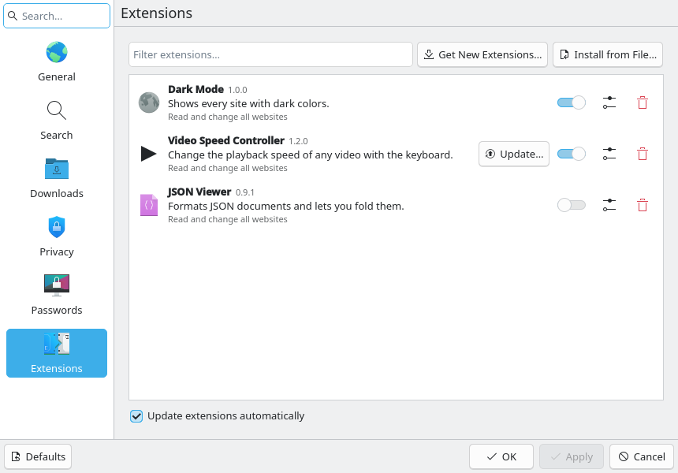
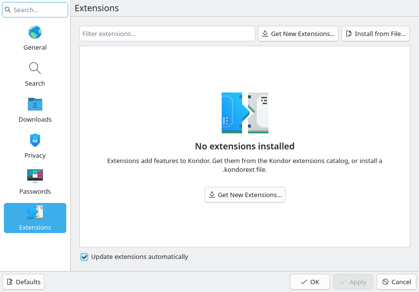
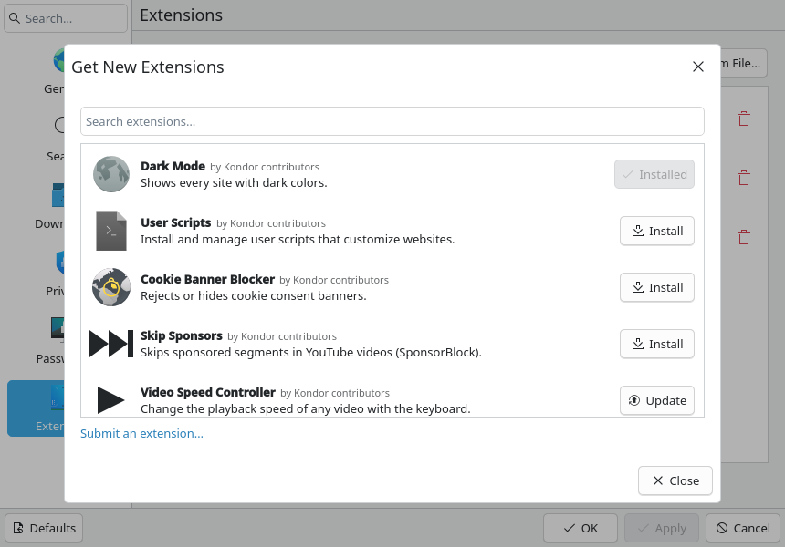
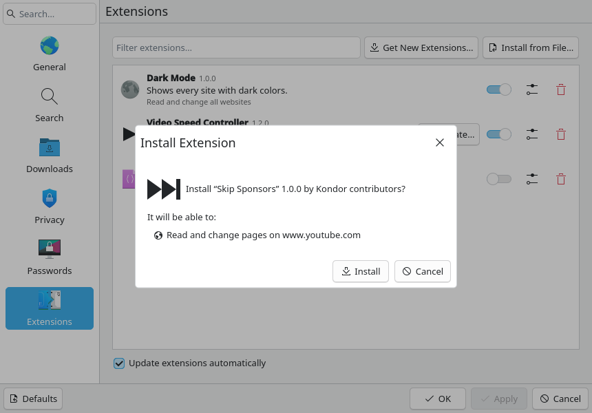
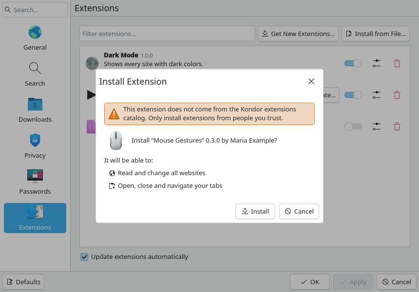
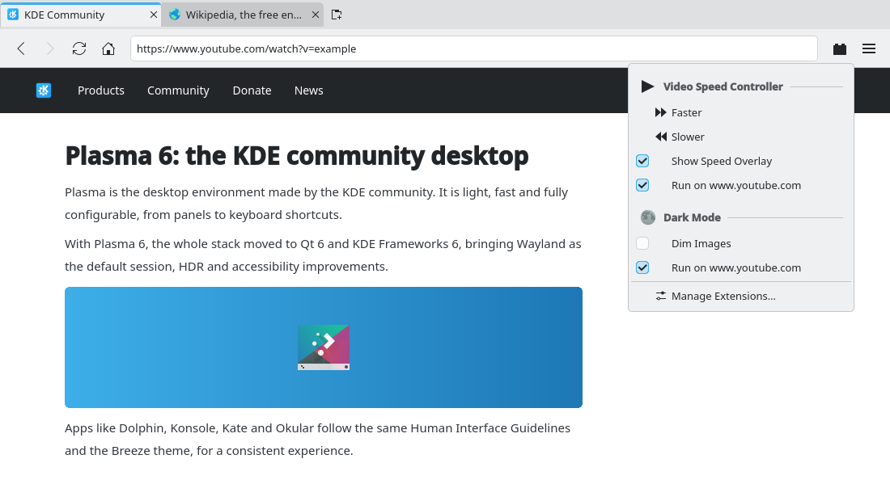

# Kondor extensions: platform, catalog and installation (#107)

> **Issue:** [#107](https://github.com/lukasborges/kondor/issues/107) · **Priority:** P2 (medium) · **State:** see the issue's label (`to-spec` / `to-dev` / `in-review`).
> Read [`AGENTS.md`](../../AGENTS.md) first. This file is the source of truth for the issue; only the architect edits it.

## Objective

Give Kondor its own extension system, since Chrome extensions do not work on Qt WebEngine (see
[`docs/extensions-compatibility.md`](../extensions-compatibility.md)).

- **What an extension is:** a small package of page scripts and styles, a declarative settings
  form, an optional toolbar menu, and a short list of permissions.
- **Where extensions come from:**
  - the **community catalog**, built from the
    [`lukasborges/kondor-extensions`](https://github.com/lukasborges/kondor-extensions) repository,
    where anyone can propose an extension by pull request (#108);
  - a **`.kondorext` file** downloaded to the computer.
- This issue builds the browser side: the format, the runtime, the JavaScript API, Settings →
  Extensions with "Get New Extensions…" and "Install from File…", the toolbar menu and automatic
  updates.

## Context

- **Scripts already in pages:** Kondor injects scripts with `QWebEngineScript` into the profile's
  `userScripts`. `ProfileManager` (`src/profilemanager.cpp`) inserts `qwebchannel.js` +
  `passwords.js` in `WebEngineScript.ApplicationWorld`. `WebViewTab.qml` binds a per-tab
  `WebChannel` (`passwordChannel`) to that world (`webChannelWorld: WebEngineScript.ApplicationWorld`),
  and the channel is null in private tabs.
- **Match patterns:** `QWebEngineScript` understands a Greasemonkey metadata block at the top of
  the source (`@match`, `@include`, `@exclude`, `@run-at`). Qt WebEngine applies it, so match
  patterns need no code of our own.
- **Shared blocks to reuse:** **Database** (`src/database.*`, migrations), **Settings**,
  **Notifier**, `DownloadManager`, and the Configure window (`qml/SettingsWindow.qml`, pages
  like `PasswordsPage.qml`).
- **Separate from #88:** the #88 `--load-extension` option (Chrome extensions) stays a
  developer-only tool and is unrelated to this system.
- **Archives:** a `.kondorext` is a ZIP. Qt has no public ZIP API, so this issue adds
  **KArchive** (`KF6Archive`, `KZip`).

## Design / behavior

### 1. Package format

A `.kondorext` is a ZIP with `manifest.json` at its root, next to the files it names. The
manifest:

```json
{
  "kondor": 1,
  "id": "dark-mode",
  "name": "Dark Mode",
  "name[pt_BR]": "Modo Escuro",
  "description": "Shows every site with dark colors.",
  "description[pt_BR]": "Mostra todos os sites com cores escuras.",
  "version": "1.0.0",
  "author": "Kondor contributors",
  "homepage": "https://github.com/lukasborges/kondor-extensions/tree/main/extensions/dark-mode",
  "license": "GPL-3.0-or-later",
  "icon": "icon.svg",
  "permissions": ["tabs"],
  "contentScripts": [
    { "matches": ["https://*/*", "http://*/*"], "exclude": [], "js": ["content.js"],
      "css": ["dark.css"], "runAt": "document-start", "allFrames": false }
  ],
  "settings": [
    { "key": "brightness", "type": "number", "label": "Brightness", "label[pt_BR]": "Brilho",
      "default": 100, "min": 50, "max": 150, "suffix": "%" }
  ],
  "action": {
    "items": [ { "id": "toggle-images", "title": "Dim Images", "checkable": true } ],
    "siteToggle": true
  }
}
```

**Fields:**
- **`kondor`:** API version, which must be `1`.
- **`id`:** `^[a-z0-9][a-z0-9-]{1,47}$`, unique in the catalog.
- **`version`:** `MAJOR.MINOR.PATCH`.
- **`icon`:** an SVG or a PNG of at least 64 px inside the package, or a Breeze icon name.
- **`permissions`:** any of the following. Storage and settings need no permission.
  - `tabs`: `kondor.tabs.*`;
  - `downloads`: `kondor.download()`;
  - `notifications`: `kondor.notify()`.
- **`contentScripts[]`:**
  - `matches`: Chrome-style match patterns (`<all_urls>`, `*://*.example.com/*`…);
  - `exclude`: optional;
  - `js` and `css`: lists of package files;
  - `runAt`: `document-start`, `document-end` or `document-idle` (default);
  - `allFrames`: default false.
- **`settings[]`:** `type` is one of the following. `label` is required, plus `default` and the
  type's own fields.
  - `bool`;
  - `number` (`min`, `max`, `step`, `suffix`);
  - `string`;
  - `text` (multi-line);
  - `choice` (`choices: [{value, label}]`);
  - `color`;
  - `keys` (a key sequence).
- **`action`:** optional.
  - `items[]`: each item has `id`, `title`, and optional `checkable` and `icon`.
  - `siteToggle`: adds the "Run on <site>" entry.
- **Translations:** `name`, `description`, `label` and `title` accept `key[<locale>]`
  translations, as in KDE metadata. The best match for `QLocale::system()` is used.

`ExtensionPackage::load(dir)` (`src/extensions/extensionpackage.{h,cpp}`) validates all of this:
- The file must be valid JSON.
- Required fields must be present, with the right types.
- `kondor` must be `1`.
- Every listed file must exist inside the package, with no `..` and no absolute paths.
- The unpacked package must be at most 5 MiB, with at most 200 files.
- Unknown keys are ignored.

The function returns an error string naming the first problem, for example "manifest.json:
contentScripts[0].js: file not found: content.js".

### 2. Installed extensions and state

- **Install location:** `QStandardPaths::AppDataLocation + "/extensions/<id>/"`, the unpacked
  package. An install unpacks into `<id>.new`, validates it, then renames it over the old
  directory.
- **`ExtensionManager`** (`src/extensions/extensionmanager.{h,cpp}`, QML singleton) keeps:
  - a list model, with roles `id`, `name`, `description`, `version`, `author`, `homepage`,
    `iconSource`, `enabled`, `privateAllowed`, `permissions` (the localized lines of item 6),
    `hasSettings`, `hasAction`, `source` (`catalog` or `file`), `updateAvailable` and
    `updateNeedsReview`;
  - its state in QSettings group `Extensions/<id>`: `Enabled`, `PrivateAllowed`, `Source`,
    `DisabledSites` (a list of origins) and `Settings/<key>`.
- **Storage:** extension storage is a new **Database** table, added by a migration:
  `extension_storage(extension_id TEXT, key TEXT, value TEXT, PRIMARY KEY(extension_id, key))`.
  Values are JSON, with at most 1 MiB per extension in total.
- **Uninstall:** "Remove" deletes the directory, the QSettings group and the storage rows.

### 3. Injection

- **Rebuild trigger:** for each enabled extension, `ExtensionManager` builds one `QWebEngineScript`
  per content script. It rebuilds them when an extension is installed, updated, enabled or
  disabled, when its settings or disabled sites change, and at startup.
- **Which profiles:** the default profile always gets the scripts. A private profile gets them
  only when `PrivateAllowed` is true. `ProfileManager` asks `ExtensionManager` for the scripts
  when it creates a profile.
- **Script properties:**
  - name `kondor-ext:<id>:<n>`;
  - `worldId: QWebEngineScript::ApplicationWorld` (see Decisions);
  - `runsOnSubFrames` set from `allFrames`;
  - the injection point from `runAt`.
- **Script source, in order:**
  1. **Metadata block:** `// ==UserScript==`, then one `// @match` per pattern, one
     `// @exclude` per exclusion, `// @run-at`, then `// ==/UserScript==`.
  2. **Closure:** a closure that receives the extension's `kondor` object (item 4), built from a
     snapshot of the settings, the disabled sites, the locale and a per-extension random
     **token**. The token is generated by `ExtensionManager` at startup and kept only in memory.
  3. **Site check:** an early return when the page origin is in `DisabledSites`.
  4. **CSS:** each CSS file is added as a `<style>`, at `document-start`, or as soon as
     `document.documentElement` exists.
  5. **JS:** each JS file, concatenated.
- **Isolation:** other extensions cannot reach an extension's `kondor` object or its token, since
  closures do not share variables.
- **Live settings:** a settings change also reaches tabs that are already open.
  `ExtensionManager::settingsChanged(id)` makes every `WebViewTab` run
  `window.__kondorExtensions?.["<id>"]?.(settings)` in ApplicationWorld, which fires the
  extension's `kondor.settings.onChanged`.

### 4. JavaScript API (version 1)

Every function that talks to the browser returns a Promise.

| API | Behavior |
| --- | --- |
| `kondor.extension` | `{ id, version }` |
| `kondor.locale` | e.g. `"pt_BR"` |
| `kondor.isPrivate` | true in a private tab |
| `kondor.settings.values` | frozen object `{key: value}` (the defaults for unset keys) |
| `kondor.settings.onChanged(cb)` | `cb(values)` after the user changes a setting |
| `kondor.storage.get(key)` / `set(key, value)` / `remove(key)` / `keys()` | JSON values in `extension_storage`. In a private tab, `set` and `remove` reject with "Storage is read-only in private windows". |
| `kondor.onAction(cb)` | `cb(itemId, checked)` when the user picks one of the extension's toolbar menu items for this tab |
| `kondor.action.setChecked(itemId, checked)` | updates a checkable item's state for this tab |
| `kondor.tabs.back()` / `forward()` / `reload()` / `close()` / `open(url, {background})` / `next()` / `previous()` | needs `tabs` |
| `kondor.download(url, fileName?)` | needs `downloads`; uses `DownloadManager` (in a private tab, nothing is remembered, as for any private download) |
| `kondor.notify(title, body)` | needs `notifications`; uses `Notifier` with the extension's name as the summary prefix |

**Transport:** a per-tab `ExtensionBridge` QObject (`src/extensions/extensionbridge.{h,cpp}`),
registered on the tab's `WebChannel` as `kondorExtensions`.
- Every call carries `(extensionId, token)`, and the bridge rejects a wrong token or a missing
  permission with an error the Promise rejects with.
- The bridge knows its `Tab`, so it knows `isPrivate`, and it implements `tabs.*` through the
  Tab bridge pattern (new `Tab` commands where needed).
- The QWebChannel client is created once per page by a new `channel.js`, which exposes a promise
  `window.__kondorChannel` in ApplicationWorld. `passwords.js` is changed to use that promise.
- **Private tabs:** they now also get a `WebChannel`, holding only `kondorExtensions` (the password
  bridge stays out of private tabs, as today).

### 5. Catalog

- **Catalog file:** #108 publishes
  `https://lukasborges.github.io/kondor-extensions/catalog.json`:
  ```json
  { "version": 1, "generated": "2026-11-10T21:00:00Z",
    "extensions": [ { "id": "dark-mode", "name": "Dark Mode", "name[pt_BR]": "Modo Escuro",
      "description": "…", "version": "1.0.0", "author": "…", "homepage": "…", "license": "…",
      "icon": "icons/dark-mode.png", "permissions": ["tabs"], "matches": ["https://*/*", "http://*/*"],
      "package": "packages/dark-mode-1.0.0.kondorext", "sha256": "…", "size": 12345 } ] }
  ```
  Relative URLs resolve against the catalog URL.
- **`ExtensionCatalog`** (`src/extensions/extensioncatalog.{h,cpp}`):
  - It fetches the catalog with `QNetworkAccessManager` from the default profile's network
    context (never a private one).
  - It caches the catalog in `CacheLocation/extensions-catalog.json`.
  - It exposes a model (`installed` and `updateAvailable` roles), `refresh()`, and the states
    `loading`, `ready` and `error`.
  - Installing downloads the package to a temporary file. The download is rejected if it is
    larger than `size` or than 5 MiB, or if its SHA-256 differs.
- **Updates:**
  - **When:** at startup, then every 24 h, when the "Update extensions automatically" setting is
    on (default on, `Settings.extensionsAutoUpdate`), the catalog is refreshed.
  - **No new permissions:** an installed extension (from the catalog) with a newer version is
    updated silently, provided its `permissions` and `matches` are equal to, or a subset of, the
    installed ones.
  - **New permissions:** otherwise it is marked `updateNeedsReview`, and Settings shows "Update…",
    which opens the confirmation dialog.
  - **File installs:** extensions installed from a file are never updated automatically.

### 6. Permissions shown to the user

The same lines are used in the install dialog and in Settings:
- **Matches → site access:**
  - `<all_urls>` or `*://*/*` (or `http`+`https` wildcards): "Read and change all websites";
  - otherwise "Read and change pages on %1", listing at most 3 hosts and then "and %n more".
- **Permissions:**
  - tabs: "Open, close and navigate your tabs";
  - downloads: "Download files";
  - notifications: "Show notifications".

### 7. UI (matches the prototype)

- **Settings → Extensions:** a new page of the Configure window (`qml/ExtensionsPage.qml`,
  sidebar icon `preferences-plugin`, title "Extensions"), placed after Passwords.
  - **Top row:** a filter field "Filter extensions…", then the buttons "Get New Extensions…"
    (`get-hot-new-stuff`) and "Install from File…" (`document-import`).
  - **Installed list** (in a `Frame`, like Passwords). Each row has:
    - the icon and the name in bold, with the version beside it in a smaller muted label;
    - the description, with the first permission line in muted text below it;
    - a `Switch` (enable);
    - a "Configure…" `ToolButton` (`configure`). It is always present, because every extension
      has "Allow in private windows".
    - a "Remove" `ToolButton` (`edit-delete`, with a confirmation "Remove the extension “%1” and
      its data?");
    - "Update…" (`update-none`), only when `updateNeedsReview`.
  - **Empty list:** `Kirigami.PlaceholderMessage` with "No extensions installed", the explanation
    "Extensions add features to Kondor. Get them from the Kondor extensions catalog, or install
    a .kondorext file.", and the helpful action "Get New Extensions…".
  - **Below the frame:** the CheckBox "Update extensions automatically".
- **Get New Extensions** dialog (`qml/ExtensionCatalogDialog.qml`, a QQC2 `Dialog`, about 40×30
  grid units):
  - a search field;
  - a list of catalog entries: icon, name, "by %1", description, and on the right "Install"
    (`download`), "Installed" (disabled, `checkmark`) or "Update" (`update-none`);
  - while loading, a `BusyIndicator`;
  - on error, an InlineMessage "The extensions catalog could not be loaded." with "Try Again";
  - a footer link "Submit an extension…" that opens the repository's CONTRIBUTING page.
- **Install confirmation** (`qml/InstallExtensionDialog.qml`), used both for the catalog and for
  files:
  - title "Install Extension";
  - "Install “%1” %2 by %3?";
  - "It will be able to:", followed by the permission lines with `Kirigami.Icon`s
    (`internet-services` for site access, `tab-new` for tabs, `download` for downloads,
    `notifications` for notifications);
  - for a file install, a warning InlineMessage: "This extension does not come from the Kondor
    extensions catalog. Only install extensions from people you trust.";
  - buttons "Install" / "Cancel";
  - when the id is already installed: "Replace" and the text "“%1” %2 is installed. Replace it
    with version %3?".
  - **Invalid file:** the dialog shows only an error with the validation message, as in "“%1”
    is not a valid Kondor extension: %2".
- **Install from File…:** a `FileDialog` with `nameFilters` "Kondor extensions (*.kondorext)",
  starting in Downloads. Opening a `.kondorext` from the file manager does the same: register the
  MIME type `application/x-kondor-extension` (`packaging/kondor-extension.xml`, installed into
  `share/mime/packages`) and add it to the `.desktop` `MimeType`. The single-instance forwarding
  of #15 passes the path to the running window, which opens Settings → Extensions with the
  confirmation dialog.
- **Configure dialog** (`qml/ExtensionSettingsDialog.qml`): a `Kirigami.FormLayout` generated
  from `settings`:
  - bool → CheckBox;
  - number → SpinBox (or a Slider with the value beside it when `max - min` is at most 200);
  - string → TextField;
  - text → TextArea;
  - choice → ComboBox;
  - color → a button with a swatch that opens `ColorDialog`;
  - keys → `Kirigami.KeySequenceItem`, or a TextField if that is unavailable.

  The rest of the dialog:
  - **Section "Privacy":** "Allow in private windows".
  - **"Turned off on:"** a list of `DisabledSites` with "Remove".
  - **Buttons:** "Restore Defaults", "OK" and "Cancel". Values are written on OK.
- **Toolbar:** a "Extensions" ToolButton (`preferences-plugin`, tooltip "Extensions") right of
  the address bar, before the main menu button.
  - It is visible when the current tab has at least one enabled extension with an `action` (in a
    private tab, only extensions allowed there).
  - Its menu has one section per extension: a header with the icon and name, its items (checkable
    state per tab), and "Run on %1" (checkable, the current host; hidden in private tabs).
  - It ends with "Manage Extensions…", which opens Settings → Extensions.
  - Unchecking "Run on %1" adds the origin to `DisabledSites` and reloads the tab.

### 8. Privacy (hard rule)

- **Off by default in private windows:** extensions do not run in private windows unless allowed.
  In private tabs, storage is read-only and the site toggle is hidden. Nothing from a private tab
  is written by the platform.
- **Catalog requests:** the catalog and the packages are fetched without cookies and are never
  attributed to a private profile.

### 9. Tests

`tests/tst_extensions.cpp`, with fixtures in `tests/data/extensions/`:
- a valid package;
- a missing file;
- a bad id;
- `..` in a path;
- a too-large package.

It checks:
- **Validation:** the validation messages for each fixture.
- **Script generation:** the metadata block, the run-at mapping and the localized name.
- **Install, update and remove:** with `QStandardPaths::setTestModeEnabled`.
- **Storage:** quota, and read-only for private.
- **Bridge:** it rejects a wrong token and a missing permission.
- **Updates:** the permission-subset rule for updates.
- **Catalog:** a local catalog, through a `file://` URL and a test override of the catalog URL,
  with a SHA-256 mismatch rejected.

A WebEngine test loads the sample extension and checks that its content script ran, and that it
did not run in a private profile or on a disabled site.

### 10. Docs

- `README.md`: a Features entry, plus where extensions come from.
- `docs/extensions/api.md`: the manifest and the API of this spec, written for extension authors.
  #108 links to it from the extensions repository.

## Acceptance criteria

- [ ] Settings → Extensions lists, enables, configures and removes extensions, and offers "Get New
  Extensions…" and "Install from File…".
- [ ] Installing from the catalog verifies size and SHA-256. Installing from a `.kondorext` file,
  or by opening one in the file manager, shows the warning. Both show the permissions first.
- [ ] Content scripts and CSS run on matching pages, in all frames when asked. They do not run on
  disabled sites, or in private windows unless allowed.
- [ ] Every API of item 4 works and enforces permissions and the token.
- [ ] Settings changes reach open tabs. Storage persists, and is read-only in private tabs.
- [ ] The toolbar menu shows actions, per-tab checked state and "Run on <site>".
- [ ] Catalog updates install automatically only without new permissions. Otherwise "Update…"
  asks.
- [ ] KArchive is added to `CMakeLists.txt`, `README.md`, `build.yml`, `release.yml` and the
  Flatpak manifest. Tests pass, the smoke test is clean, and translations and docs are updated.

## Manual test

Use an isolated profile (temporary `XDG_*` dirs):
1. Build the sample from `tests/data/extensions/sample` into `sample.kondorext`:
   `cd tests/data/extensions/sample && zip -r /tmp/sample.kondorext .`
2. **Install from file.** Settings → Extensions → Install from File… shows the permissions and the
   not-from-catalog warning. Install it: it appears, and its content script works on a matching
   page.
3. **Settings and site toggle.**
   - Configure → change a setting: an open matching tab reacts without a reload.
   - Toolbar → Extensions → uncheck "Run on <site>": the tab reloads without the extension.
4. **Private windows.**
   - In a private window the extension does not run.
   - Allow it in private windows: it runs there, and a storage write rejects.
5. **Catalog.** Get New Extensions… with the catalog of #108 (or a local test catalog served over
   `python3 -m http.server`): install an entry. Bump its version in the catalog without new
   permissions: it updates at the next check. Add a permission: "Update…" appears.
6. **File manager.** Open a `.kondorext` from Dolphin: Kondor opens the install dialog.
7. **Remove.** Remove the extension: its directory, settings and storage are gone.

## Out of scope

- Chrome/Firefox extension compatibility (`chrome.*`), and the #88 loader;
- arbitrary QML or native code in extensions, and background pages or service workers;
- popups with custom HTML (the action menu is declarative);
- cross-origin request permissions or request interception (`fetch` from a content script follows
  the page's CORS rules);
- ratings, comments, screenshots and categories in the catalog;
- signing packages (integrity relies on HTTPS + SHA-256 + review in the repository);
- the extensions themselves (#109–#118) and the extensions repository (#108).

## Dependencies

#21 (passwords channel, refactored here), #15 (single instance, for opening files) and #3
(Settings window).

## Prototype

Rendered with `prototypes/common/SettingsDialogMock.qml` (`withExtensions`, `extensionsEmpty`,
`catalogDialog`, `installDialog`, `installFromFile`) and `prototypes/common/ExtensionsMenuMock.qml`
over `BrowserFrame.qml`. The extension names, icons and texts in the mock are only examples.

| State | QML | Screenshot |
| --- | --- | --- |
| Settings → Extensions | [`107-extensions.qml`](../../prototypes/107-extensions.qml) |  |
| No extensions installed | [`107b-extensions-empty.qml`](../../prototypes/107b-extensions-empty.qml) |  |
| Get New Extensions | [`107c-extensions-catalog.qml`](../../prototypes/107c-extensions-catalog.qml) |  |
| Install confirmation (catalog) | [`107d-extensions-install.qml`](../../prototypes/107d-extensions-install.qml) |  |
| Install confirmation (file) | [`107e-extensions-install-file.qml`](../../prototypes/107e-extensions-install-file.qml) |  |
| Toolbar menu | [`107f-extensions-menu.qml`](../../prototypes/107f-extensions-menu.qml) |  |

## Decisions

| Question | Decision |
| --- | --- |
| Why not Chrome extensions? | Measured in #105: Qt WebEngine lacks `tabs`, `scripting`, `action`, `storage.sync`, `webNavigation`…, so real Chrome extensions do not work. Kondor gets its own, much smaller format, built on what Qt WebEngine does well: injected scripts. |
| Where do extensions come from? | The community catalog, built from `lukasborges/kondor-extensions`, where contributions arrive as pull requests (maintainer's choice), and `.kondorext` files from the computer (maintainer's request), shown with a warning. |
| Which JavaScript world? | ApplicationWorld, shared with `passwords.js`, because a page has a single WebChannel world. Page scripts cannot see it. Extensions are isolated from each other by closures and authenticated by a per-extension token. An extension that runs on a site can read that site's DOM, including filled passwords, as in any browser, so the permission dialog says "Read and change". |
| Code in the packages? | JS and CSS only, with no QML or native plugins: a catalog of reviewed scripts is much safer to accept from the community. |
| Archive library? | KArchive (KF6), the KDE library for ZIP, since Qt's ZIP reader is private API. |
| KArchive is not installed on the developer machine (`kf6-karchive-devel` missing, no sudo): switch to `unzip` or a bundled ZIP reader? | No. The spec stays on KArchive: shelling out to `unzip` adds an undeclared runtime dependency and fragile output parsing, and a bundled ZIP reader is security-sensitive code (path traversal, zip bombs) that KZip already handles. The maintainer installs `kf6-karchive-devel` on the dev machine; it is a normal Fedora package and is already listed for README, `build.yml` and `release.yml` by this spec. Do not vendor KArchive or build it locally. |
