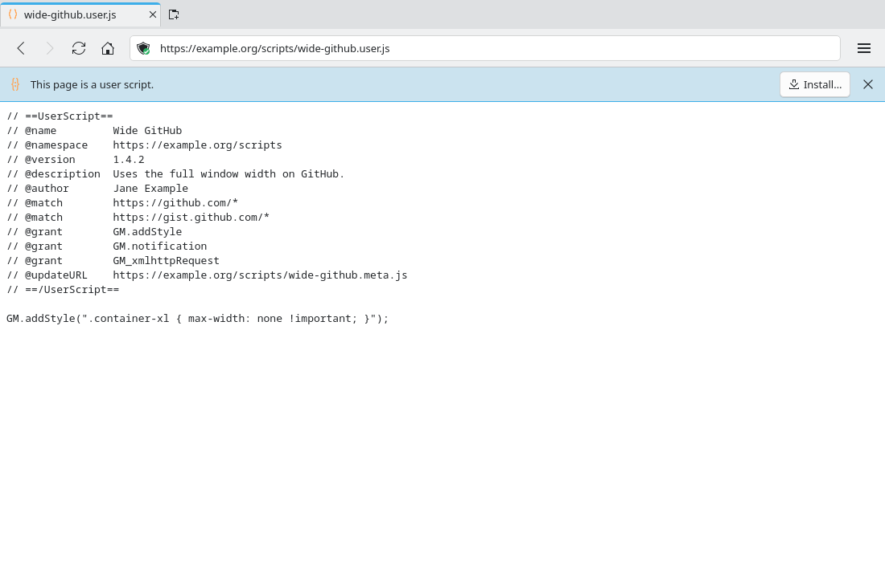
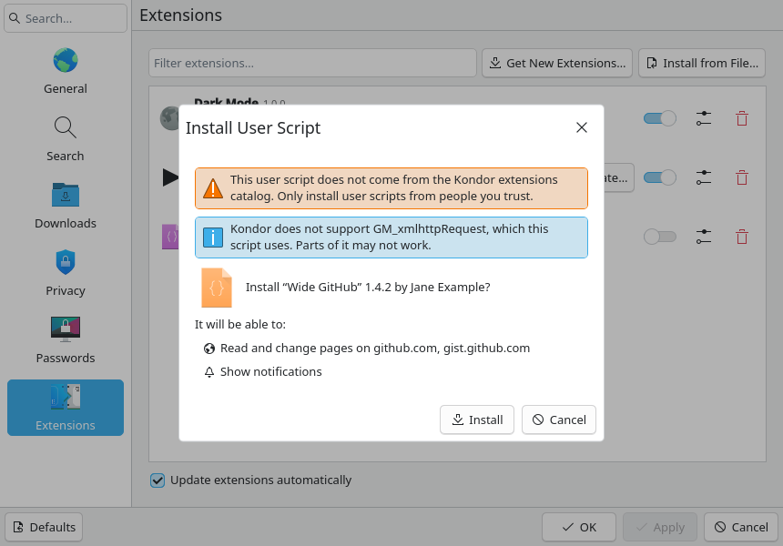

# User scripts (#111)

> **Issue:** [#111](https://github.com/lukasborges/kondor/issues/111) · **Priority:** P3 (low) · **State:** see the issue's label (`to-spec` / `to-dev` / `in-review`).
> **Repository:** `lukasborges/kondor`. This is a Kondor feature, not a catalog extension (see Decisions).
> Read [`AGENTS.md`](../../AGENTS.md) first. This file is the source of truth for the issue; only the architect edits it.

## Objective

Run Greasemonkey-style user scripts (`*.user.js`), as Tampermonkey and Violentmonkey do:
- **Install:** opening a `.user.js` page offers to install it, and so does "Install from File…".
- **Manage:** an installed user script is listed in Settings → Extensions like an extension. It
  can be turned on and off, configured (private windows, sites) and removed there.
- **Run:** it runs on the pages its `@match` / `@include` / `@exclude` select, at its `@run-at`.
- **API:** a subset of `GM.*`: values, styles, notifications and `GM.info`.
- **Update:** from `@updateURL` / `@downloadURL`, with the extension update rules.

## Context

- **Extension platform (#107, [`0107-kondor-extensions.md`](0107-kondor-extensions.md)):** an
  installed extension is an unpacked package in `AppDataLocation/extensions/<id>/`. Kondor turns
  each content script into a `QWebEngineScript` with a Greasemonkey metadata block, in
  ApplicationWorld, wrapped in a closure that receives the `kondor` object
  (`src/extensions/scripts/contentscriptbuilder.cpp`). The platform already provides:
  - enable / disable, "Allow in private windows", "Turned off on" sites, removal
    (`ExtensionManager`, `ExtensionsPage.qml`, `ExtensionSettingsDialog.qml`);
  - storage (`extension_storage`, read-only in private tabs) and `kondor.notify`;
  - staging a ZIP and confirming it in `InstallExtensionDialog.qml`
    (`ExtensionManager::prepareInstall(const PackageFile &)`, `pendingInstall`,
    `confirmInstall()`);
  - updates that are silent only without new access (`ExtensionManager::updatePackage`,
    `CatalogUpdater`, `Settings.extensionsAutoUpdate`).
- **The catalog rule:** the catalog (#108) forbids remote code, and an extension cannot fetch a
  script and run it. A user script is code the user chose from the web, like a `.kondorext` file,
  so it is installed by Kondor itself and never enters the catalog.
- **Freeze:** the Python port (#163–#174) has not started, so `src/` may change. Its spec ports
  whatever exists when it starts.

## Design / behavior

### 1. A user script becomes a package

Kondor converts a user script into an ordinary package and installs it with the #107 flow. Nothing
downstream (injection, list, settings dialog, storage, removal) needs a second code path.

**Metadata** (`// ==UserScript==` … `// ==/UserScript==`, the first such block in the file; lines
are `// @key value`, keys are case-sensitive, values trimmed):

| Key | Use |
| --- | --- |
| `@name` | required; manifest `name` |
| `@namespace` | identity (with `@name`) |
| `@version` | raw version; see item 4 |
| `@description`, `@author` | manifest `description`, `author` |
| `@homepageURL`, `@homepage`, `@website` | manifest `homepage` (first one present) |
| `@license` | manifest `license` |
| `@match` | `matches` (Chrome match patterns) |
| `@include` | `include` (Greasemonkey globs, item 2) |
| `@exclude`, `@exclude-match` | `exclude` |
| `@run-at` | `document-start` → `document-start`; `document-end` and `document-body` → `document-end`; anything else or absent → `document-idle` |
| `@noframes` | `allFrames: false` (default `true`) |
| `@grant` | item 3 |
| `@require` | fetched once at install or update, stored in the package (item 5) |
| `@resource` | unsupported (listed as unsupported, nothing fetched) |
| `@updateURL`, `@downloadURL` | updates (item 6) |

Other keys (`@icon`, `@connect`, localized `@name:xx`, …) are ignored.

**Refused scripts** (the dialog's invalid state, item 7): no metadata block; no `@name`; neither
`@match` nor `@include`; a download that fails or is larger than 5 MiB in total.

**Generated package** (a temporary `.kondorext` ZIP written with KZip, then
`prepareInstall({zipPath, "userscript", <file name>, true})`):

```json
{
  "kondor": 1,
  "id": "user-<first 16 hex digits of SHA-256(namespace + \"\\n\" + name)>",
  "name": "<@name>", "description": "<@description>", "version": "<normalized @version>",
  "author": "<@author>", "homepage": "<@homepageURL…>", "license": "<@license>",
  "icon": "text-x-javascript",
  "permissions": ["notifications"],
  "contentScripts": [ { "matches": [], "include": [], "exclude": [],
                        "js": ["gm.js", "require-1.js", "script.js"],
                        "runAt": "document-idle", "allFrames": true } ],
  "userScript": { "version": "<raw @version>", "namespace": "<@namespace>",
                  "installURL": "<where it was installed from>", "updateURL": "", "downloadURL": "",
                  "unsupported": ["GM_xmlhttpRequest"] }
}
```

- `permissions` is `["notifications"]` only when `GM.notification` or `GM_notification` is
  granted, else `[]`. Absent optional strings are written as `""` or left out.
- `script.js` is the user script file unchanged. `require-<n>.js` are the `@require` files in
  order. `gm.js` is item 3.
- The id is stable for the same `@namespace` + `@name`, so installing it again offers "Replace".

### 2. Platform changes for user scripts

- **`include`:** an optional string list in a content script, documented in
  `docs/extensions/api.md`. `contentscriptbuilder` writes one `// @include <glob>` line per entry
  (Qt WebEngine applies it). A content script needs a non-empty `matches` **or** `include`
  (today `matches` is required).
- **Site access lines (#107 item 6):** an include glob counts as "Read and change all websites"
  when its host part (between `://` and the next `/`) is empty or contains `*`, or the glob has no
  `://`; otherwise its host is listed like a match pattern's host.
- **`userScript`:** an optional object, read by `ExtensionPackage` into an accessor
  (`QJsonObject userScript() const`, empty for normal extensions). It is not validated beyond
  being an object.
- **Install dialog** (`InstallExtensionDialog.qml`). The preview gets `isUserScript` (source
  `userscript`) and `unsupportedFeatures` (the `unsupported` list). When `isUserScript`:
  - the title is "Install User Script";
  - the warning reads "This user script does not come from the Kondor extensions catalog. Only
    install user scripts from people you trust.";
  - when `unsupportedFeatures` is not empty, an Information `Kirigami.InlineMessage` below it
    reads "Kondor does not support %1, which this script uses. Parts of it may not work." (`%1`
    = the names joined with ", ");
  - an invalid script shows "“%1” is not a valid user script: %2".
- **Settings → Extensions:** user scripts are rows like any extension (icon `text-x-javascript`,
  the normalized version). For a user script, "Update…" calls
  `ExtensionManager.reviewUserScriptUpdate(id)` (item 6) instead of `ExtensionCatalog.install`.

### 3. The GM API (`gm.js`)

`gm.js` runs first in the extension closure, so it uses `kondor` and defines, for `script.js` and
the `@require` files, the constants `GM`, `GM_info` and `GM_addStyle` (other `GM_*` names stay
undefined). It is a resource file (`:/scripts/usergm.js`); the package writer prepends one line
`const __userScript = <JSON of name, namespace, version (raw), description>;`.

| API | Behavior |
| --- | --- |
| `GM.info` / `GM_info` | `{ script: { name, namespace, version, description }, scriptHandler: "Kondor", version: <Kondor version> }`, frozen |
| `GM.getValue(key, defaultValue)` | `kondor.storage.get(key)`, resolving `defaultValue` when the stored value is `undefined` or `null` |
| `GM.setValue(key, value)` | `kondor.storage.set` (rejects in private tabs, as storage does) |
| `GM.deleteValue(key)` / `GM.listValues()` | `kondor.storage.remove` / `kondor.storage.keys` |
| `GM.addStyle(css)` / `GM_addStyle(css)` | adds a `<style>` to `document.head`, or to `document.documentElement` while there is no head, and returns it |
| `GM.notification(text, title)` or `GM.notification({ text, title })` | `kondor.notify(title or the script name, text)`; rejects without the `notifications` permission, as the platform does |

**Grants.** Supported grant names: `none`, `GM.info`, `GM_info`, `GM.getValue`, `GM.setValue`,
`GM.deleteValue`, `GM.listValues`, `GM.addStyle`, `GM_addStyle`, `GM.notification`,
`GM_notification`. Every other `@grant` (for example `GM_xmlhttpRequest`, `GM_getValue`,
`unsafeWindow`, `GM.openInTab`) goes into `unsupported`, and so does `@resource` when the
script has one,, without duplicates, in file order. The supported API is defined whatever the grants
say.

**World.** The script runs in ApplicationWorld like every extension: it shares the page's DOM but
not the page's JavaScript globals.

### 4. Versions

- **Normalized** (`normalizedUserScriptVersion`): the first three dot-separated parts of
  `@version`, each reduced to its leading digits (none → `0`), missing parts `0`: `1.2` →
  `1.2.0`, `0.3.1b` → `0.3.1`, `2024.05.01.2` → `2024.5.1`, absent → `0.0.0`. This is the
  manifest `version`, shown in Settings and in the dialog.
- **Newer** (`isNewerUserScriptVersion(candidate, installed)`): compare the raw versions part by
  part (split on `.`), first by the leading number, then by the rest of the part as a string; a
  missing part counts as `0`. Only a strictly greater version is newer.

### 5. Fetching

- **`UserScriptDownload`** fetches a URL into memory with the default profile's
  `QNetworkAccessManager` used by the catalog (never a private profile, no cookies), following
  redirects, refusing more than 5 MiB in total for the script and its `@require` files.
  `file://` URLs are read the same way.
- `@require` URLs are resolved against the script URL. Only `https`, `http` and `file` are
  allowed; anything else refuses the script.

### 6. Updates

- **When:** with the catalog check (at startup and every 24 h, only while
  `Settings.extensionsAutoUpdate` is on), `UserScriptUpdater` checks every installed package whose
  source is `userscript` and whose `userScript.updateURL` (or else `downloadURL`) is `http(s)`.
  Scripts without one are never checked.
- **Check:** fetch that URL, read its metadata, and compare its `@version` with the installed raw
  version (item 4). If it is newer, fetch the full script from `downloadURL` (or else
  `installURL`; when the URL is the one just fetched, reuse it), build the package and call
  `ExtensionManager::updatePackage(file, id)`:
  - the same or narrower access (`matches` + `include` + `permissions`, the #107 subset rule) →
    installed silently;
  - broader access → `updateNeedsReview`, shown as "Update…" in Settings.
- **`reviewUserScriptUpdate(id)`:** runs the install flow (item 7) on the script's `downloadURL`
  (or else `installURL`), which shows the dialog with "Replace".
- A failed check changes nothing and is retried at the next check.

### 7. Installing

- **From a page:** a new `UserScriptBar.qml` in `qml/extensions/`, placed in `PageArea.qml`
  after `SiteReloadBar`, built on **InlineBar** (as `SiteReloadBar`):
  - icon `text-x-javascript`, the text "This page is a user script.", a "Install…" `Button`
    (`download`) and an icon-only close `ToolButton` (`window-close`, "Close", tooltip and
    `Accessible.name`);
  - visible when the current tab is **not private**, is not loading, its URL scheme is `http`,
    `https` or `file`, and its URL path ends with `.user.js` (case-insensitive;
    `ExtensionManager.isUserScriptUrl(url)`, a static `Q_INVOKABLE`);
  - "Install…" calls `ExtensionManager.inspectUserScript(url)`;
  - "Close" hides it for that URL until Kondor quits (a list of dismissed URLs in memory).
- **From a file:** "Install from File…" also accepts `*.user.js`
  (`nameFilters`: "Kondor extensions and user scripts (*.kondorext *.user.js)" first, then the
  existing ones). `inspectFile` sends a `.user.js` path to `inspectUserScript`.
- **`inspectUserScript(url)`:** fetches the script (item 5), converts it (item 1) and stages it.
  Like `openPackageFile`, it emits `manageRequested()`, so Settings → Extensions opens with the
  confirmation dialog. A download or conversion error shows the dialog's invalid state.
- The fetch runs in the background; the dialog appears when it is ready.

### 8. Privacy (hard rule)

- The bar never appears in a private tab, and nothing is fetched or written from one.
- An installed user script follows the extension rules: off in private windows unless allowed
  there, and read-only storage in private tabs (`GM.setValue` rejects, nothing is written).
- Fetches for install and update use the default profile's network, never a private profile.

### 9. Code layout

New sub-feature folder `src/extensions/userscripts/` (at most 10 files), for example:
`userscriptmetadata.{h,cpp}` (parsing, versions), `userscriptpackage.{h,cpp}` (the ZIP of
item 1), `userscriptdownload.{h,cpp}`, `userscriptupdater.{h,cpp}`, `usergm.js`, and one `.cpp`
with the `ExtensionManager` members of item 7. Existing files only get the hooks of item 2.
AGENTS.md → "Code quality" applies to the C++, the QML and `usergm.js`.

### 10. Tests

`tests/extensions/userscripts/` with fixtures in `tests/data/userscripts/`:
- metadata parsing: every key of item 1, the run-at mapping, the refused cases;
- the id (stable, same for the same name and namespace) and the generated manifest, loaded back
  with `ExtensionPackage::load`;
- `include` in the metadata block, and its site-access lines;
- `normalizedUserScriptVersion` and `isNewerUserScriptVersion` on the examples of item 4;
- install from a `file://` script with a `@require`, and an update that needs review;
- a WebEngine test: an installed script runs on a matching page, `GM.addStyle` styles it, and
  `GM.setValue` / `GM.getValue` round-trip; it does not run in a private profile.

## Acceptance criteria

- [ ] Opening a `.user.js` URL in a normal tab shows the bar of the prototype; "Install…" opens
  Settings → Extensions with "Install User Script", the warning, the site-access lines, the
  notifications line when granted, and the unsupported-features message when needed.
- [ ] The bar never appears in a private tab. "Close" hides it for that URL.
- [ ] "Install from File…" installs a `.user.js` file the same way.
- [ ] An installed script runs on matching pages at its `@run-at`, honors `@match`, `@include`,
  `@exclude` and `@noframes`, and can be turned off, configured (private windows, sites) and
  removed in Settings → Extensions.
- [ ] `@require` files are fetched once and work offline afterwards.
- [ ] The `GM` API of item 3 works; values persist and are read-only in private tabs.
- [ ] Installing the same script again offers "Replace". Updates from `@updateURL` /
  `@downloadURL` are silent without broader access, otherwise "Update…" asks.
- [ ] A script without a metadata block, `@name`, or `@match`/`@include` is refused with a clear
  message.
- [ ] `docs/extensions/api.md` documents `include`. README gets a Features bullet. All `i18n/*.ts`
  are complete. Tests of item 10 pass, the smoke test is clean, and
  `scripts/check-code-quality.py --changed origin/main` passes.

## Manual test

Use a build with isolated `XDG_CONFIG_HOME`, `XDG_DATA_HOME` and `XDG_CACHE_HOME` (AGENTS.md).

1. **Scripts.** In a temporary directory, create:
   - `wide.user.js` with `@name Wide Test`, `@namespace test`, `@version 1.0`,
     `@match http://localhost:8000/page.html`, `@grant GM.addStyle`, `@grant GM.setValue`,
     `@grant GM.getValue`, `@grant GM_xmlhttpRequest`, `@require lib.js`,
     `@updateURL http://localhost:8000/wide.user.js`, and a body that calls
     `GM.addStyle("body { outline: 5px solid red }")`, then increments a counter with
     `GM.getValue("n", 0)` / `GM.setValue` and writes it into the page title;
   - `lib.js` defining a function the script calls;
   - `page.html`, any page.

   Serve it with `python3 -m http.server 8000`.
2. **Install.** Open `http://localhost:8000/wide.user.js`: the bar appears. "Install…" opens the
   dialog titled "Install User Script", with "Read and change pages on localhost" and the
   message about `GM_xmlhttpRequest`. Install it: a "Wide Test" row with version `1.0.0` appears.
3. **Run.** Open `page.html`: red outline, title counter 1; reload: 2. Delete `lib.js` from the served
   directory and reload `page.html`: the script still works.
4. **Private.** Open `wide.user.js` in a private window: no bar. Allow "Wide Test" in private
   windows, open `page.html` there: the outline shows, the counter does not grow, and
   `sqlite3 "$XDG_DATA_HOME"/*/kondor.sqlite "select * from extension_storage"` has no new row.
5. **Update.** Change `@version` to `1.1`, restart Kondor: the row shows `1.1.0`. Add
   `@match http://127.0.0.1:8000/*` and `@version 1.2`, restart: "Update…" appears; it opens the
   dialog with "Replace".
6. **Refused.** Install from file a `.user.js` without `@name`: the dialog shows "is not a valid
   user script".
7. **Remove** "Wide Test": its directory and storage rows are gone.

## Out of scope

- `GM_xmlhttpRequest` / `GM.xmlHttpRequest`, synchronous `GM_getValue` / `GM_setValue`,
  `GM.openInTab`, `GM.setClipboard`, `GM_registerMenuCommand`, `@resource` and
  `GM.getResourceUrl`, `unsafeWindow` and running in the page's JavaScript world.
- `@icon` (every user script uses `text-x-javascript`), `@connect`, localized `@name:xx`.
- Editing a script inside Kondor, creating new scripts, and script sync or backup.
- Opening `.user.js` files from the file manager (MIME registration), and offering the bar for a
  `.user.js` the server sends as a download.
- Any change to the catalog or the `kondor-extensions` repository.

## Dependencies

#107 (extension platform), #183 (Extensions panel), merged.

## Prototype

| State | QML | Screenshot |
| --- | --- | --- |
| A `.user.js` page | [`111-user-script-bar.qml`](../../prototypes/111-user-script-bar.qml) |  |
| Install confirmation | [`111b-user-script-install.qml`](../../prototypes/111b-user-script-install.qml) (`installUserScript` in `common/SettingsDialogMock.qml`) |  |

The script name, author and sites in the mock are only examples.

## Decisions

| Question | Decision |
| --- | --- |
| Catalog extension, platform API for an extension, or built-in? | **Built-in, on top of the extension platform.** A catalog extension cannot fetch and run code (#108 forbids remote code), and it has no UI to show an install bar or a script list. A user script is converted into an ordinary package, so enable, sites, private windows, storage, removal and updates reuse #107 without a parallel system. The work happens in this repository, not in `kondor-extensions`. |
| A separate "User Scripts" page in Settings? | No. User scripts are listed with extensions: one place to manage what runs in pages. The `text-x-javascript` icon and the "Install User Script" dialog tell them apart. |
| An install bar with the script's name and sites? | Rejected. Showing the name needs a second fetch or reading the page from the UI. The bar says "This page is a user script.", and the dialog that follows shows name, author, version and access, as for extensions. |
| Install straight from the bar? | No. "Install…" opens the same confirmation as every other install, with the trust warning and the access lines. |
| Bar text "This page is the user script Wide GitHub." | Rejected in the UX review: too long, important words last. |
| Unsupported grants? | Installed anyway, with an Information message naming them, since most scripts use one optional grant. Refusing them would block most popular scripts. |
| `@require`? | Supported: fetched once at install or update and stored in the package, so no remote code runs later. `@resource` stays unsupported. |
| Versions that are not `X.Y.Z`? | The manifest keeps a normalized `X.Y.Z` (the platform requires it), and `userScript.version` keeps the raw one, which update checks compare. |
| Which JavaScript world? | ApplicationWorld, like extensions: the closure and token model of #107 stays intact. `unsafeWindow` and page-world scripts are out of scope. |
