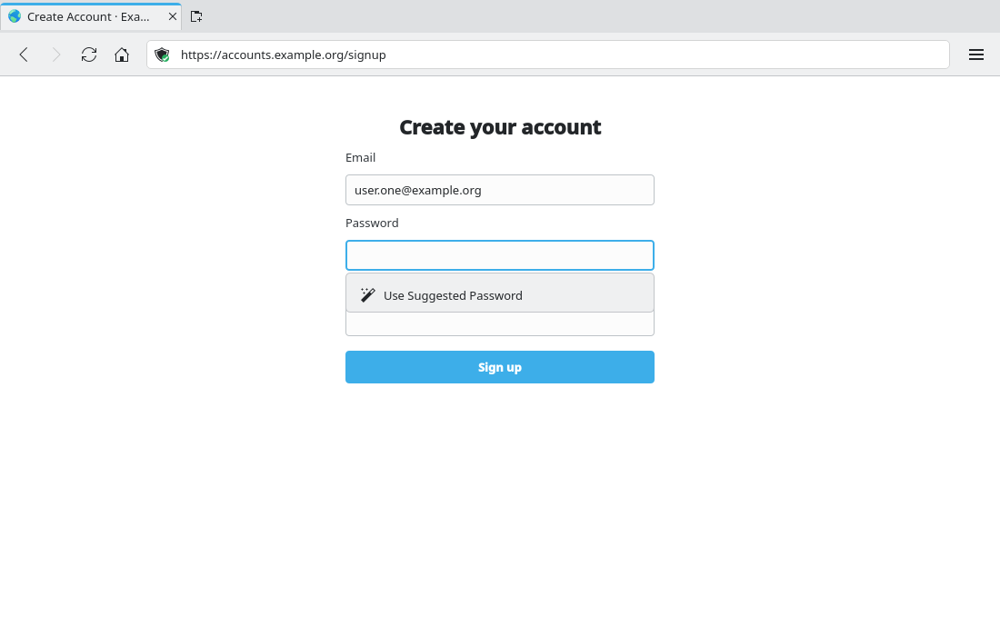
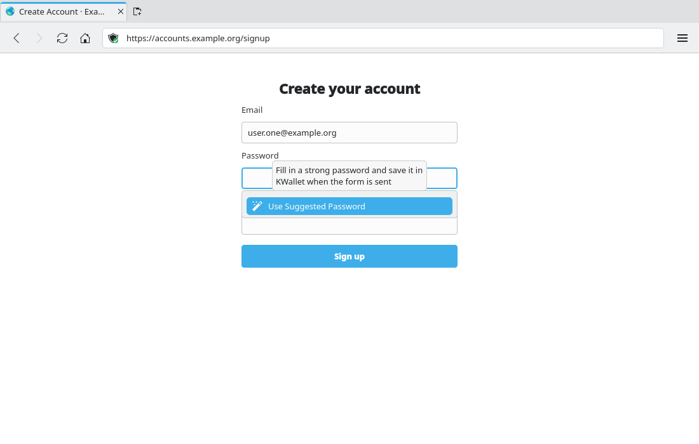
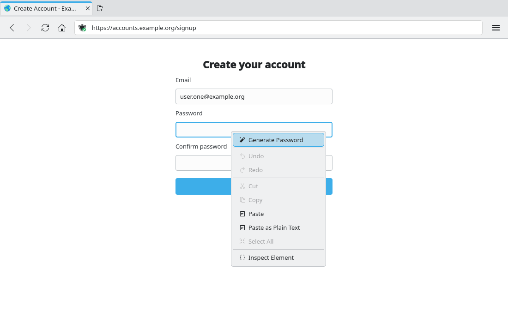

# Passwords: suggest a generated password on sign-up forms (#260)

> **Issue:** [#260](https://github.com/lukasborges/kondor/issues/260) · **Priority:** P2 (medium) · **State:** see the issue's label (`to-spec` / `to-dev` / `in-review`).
> Read `AGENTS.md` first. This file is the source of truth for the issue; only the architect edits it.

## Objective

When the user focuses an empty new-password field (sign-up or change-password form), Kondor shows
a small popup under it, **Use Suggested Password**. One click fills a strong generated password in
the field and its confirmation field. When the form is sent with that password, Kondor saves the
login in KWallet without asking, so the user never invents, types or loses it. A right click on any
password field offers **Generate Password** too, which is also the keyboard path.

## Context

- **App:** Python + PySide6 since #174 (`src/kondor/`); `qml/` is the UI. There is no C++ twin.
- **Password page script:** `src/kondor/passwords/bridge/passwords.js` (199 lines, at the file
  limit) and `usernamefield.js` (which exposes `window.__kondorPickUsernameField`) are joined by
  `install_passwords_script()` in `src/kondor/browser/profile/pagescripts.py` into one
  `ApplicationWorld` script (`kondor-passwords`, `DocumentReady`, also on subframes), installed in
  the **normal profile only**. Resources are listed in `scripts/staging/resources.py` (group
  `/scripts`, `src/kondor/passwords/bridge`). The script reaches Python through
  `window.__kondorChannel` → `objects.kondorPasswords`, which exists **only in the main frame**
  (`qt.webChannelTransport`), so subframe forms never reach Python today.
- **Bridge:** `PasswordBridge` (`src/kondor/passwords/bridge/passwordbridge.py`, 100 lines) owns a
  `PasswordPageApi` (`passwordpageapi.py`) registered as `kondorPasswords` on the tab's
  `WebChannel` in `qml/browser/view/PageScriptBridges.qml`, only for non-private tabs.
  `form_submitted(origin, username, password)` decides whether to offer saving
  (`_may_offer_save`: normal tab, a password, `can_save_for(origin)`, the `offerToSavePasswords`
  setting, the origin not in `passwordNeverSaveSites`) and calls `tab.passwords.offer_save()`,
  which shows the save prompt in `qml/passwords/bar/PasswordBar.qml`.
- **Tab group:** `TabPasswords` (`src/kondor/browser/tabs/features/tabpasswords.py`, ~150 lines)
  is `tab.passwords`; `Tab._on_url_changed` calls `update_usernames_for(url)`.
- **Store:** `PasswordStore.instance()` (`src/kondor/passwords/passwordstore.py`): `ensureOpen()`,
  `is_open()`, `state` (`"unavailable"` when KWallet is off or denied),
  `save(origin, username, password) → bool`, `changed`.
- **Context menu:** `qml/browser/contextmenu/PageMenuEntries.qml` builds blocks of entries
  (`editingBlock(request)` for editable content); `PageMenuActions.qml` maps `action` names to
  functions (`customActions`). `QWebEngineContextMenuRequest` (Qt 6.11) has **no input type**:
  it cannot tell a password field from a text field, so the page script must report it.
- **Popup host:** `qml/browser/view/WebViewTab.qml` (174 lines) holds `PageView` (the
  `WebEngineView`, id `pageView`), `PageScriptBridges` and `PageContextMenu`.
- **Breeze icon:** `password-generate` (actions) exists.

## Design / behavior

### 1. Generator (`src/kondor/passwords/passwordgenerator.py`)

Pure functions, no Qt, no logging:

- `LOWERCASE`, `UPPERCASE`, `DIGITS` from `string`; `SYMBOLS = "!#$%&*+-.=?@_"`.
- `DEFAULT_LENGTH = 20`, `MIN_LENGTH = 8`, `MAX_LENGTH = 64`.
- `PasswordRules` (frozen dataclass): `length: int = DEFAULT_LENGTH`, `use_symbols: bool = True`.
- `rules_from(values: Mapping[str, object]) → PasswordRules`: reads `"length"` (int) and
  `"useSymbols"` (bool) from the page; a missing or non-numeric length gives `DEFAULT_LENGTH`; the
  length is clamped to `MIN_LENGTH…MAX_LENGTH`.
- `generate_password(rules: PasswordRules) → str`: draws every character with
  `secrets.choice()` from lowercase + uppercase + digits (+ symbols when `use_symbols`), and draws
  again until the password holds at least one character of each class in use (rejection sampling,
  so the result stays uniform among valid passwords). Never `random`.

### 2. Field detection in the page (`src/kondor/passwords/bridge/newpasswordfield.js`)

Exposes `window.__kondorNewPasswordFields` (same style as `usernamefield.js`), pure DOM queries:

- `kindOf(field) → "new" | "password" | ""`, in this order:
  1. `""` unless `field` is a visible, enabled `input[type=password]`, or when its `maxlength` is
     between 1 and 7 (too short for a strong password).
  2. `autocomplete` tokens: `new-password` → `"new"`; `current-password` → `"password"`.
  3. Visible password fields in the same scope (`field.form || document`), leaving out the ones
     marked `current-password`: two → both `"new"` (password and confirmation); three or more →
     the first is `"password"` (current password), the others `"new"`.
  4. A single field: `"new"` when `name + " " + id` matches
     `/new|confirm|repeat|retype|sign.?up|regist|create/i` and not `/current|old|login|sign.?in/i`;
     otherwise `"password"`.
- `confirmationOf(field) → element | null`: for a `"new"` field, the other `"new"` field of the
  same scope (the first one that is not `field`), else `null`.
- `rulesOf(field) → { length, useSymbols }`: `length` is 20, raised to `minlength` (up to 64) and
  lowered to `maxlength` when the field has one; `useSymbols` is `true`.
- `matchesPattern(field, value) → bool`: `true` without a `pattern` attribute; otherwise
  `new RegExp("^(?:" + pattern + ")$", "v").test(value)`, and `true` when the pattern itself is
  invalid (the browser ignores invalid patterns too).

### 3. Shared value setter (`src/kondor/passwords/bridge/fieldvalue.js`)

Move `nativeValueDescriptor`, `dispatchValueEvents` and `setValue` out of `passwords.js` into
`window.__kondorSetFieldValue(el, value)`. `passwords.js` calls it (it shrinks below the limit). In
`passwords.js`, `needsAutofill(password)` also returns `false` for a field whose kind is `"new"`,
so saved logins are no longer typed into sign-up forms.

### 4. Offer and fill flow in the page (`src/kondor/passwords/bridge/newpassword.js`)

Started like `passwords.js` (usable origin, `window.__kondorChannel.then(...)`, only when
`objects.kondorPasswords` exists). It keeps a `WeakSet` of dismissed fields and the current field.

- **Focus** (`focusin`, capture, on `document`): when the target's kind is not `""`, remember it
  and call `bridge.passwordFieldFocused({ kind, offer, x, y, width, height })`, where the rect is
  `getBoundingClientRect()` in CSS pixels and `offer` is `kind === "new"`, the field is empty and
  not dismissed. Chromium fires `focusin` on mouse press, before the context menu request, so the
  state is in place when the menu opens.
- **Leave**: `focusout` while `document.hasFocus()` is still true (the window losing focus to the
  popup does not count), an `input` event in the field, `Escape` in the field (`keydown`), and
  `scroll` / `resize` on `window` → add the field to the dismissed set when it was offered, forget
  the current field and call `bridge.passwordFieldLeft()`. `focusout` to another password field is
  followed by that field's `focusin`.
- **Generate** (`bridge.generateRequested` signal): for the current field, ask
  `bridge.generatePassword(rules, callback)` up to three times (first with `rulesOf(field)`, then
  with `useSymbols: false`) until `matchesPattern(field, value)`; fill the field and
  `confirmationOf(field)` with `__kondorSetFieldValue`, add the field to the dismissed set, call
  `bridge.generatedPasswordFilled(origin, value)`, then `bridge.passwordFieldLeft()`. When no
  candidate matches, nothing is filled.
- `pagescripts.py`: `joined_resources` takes a sequence of paths;
  `install_passwords_script()` joins, in order, `usernamefield.js`, `fieldvalue.js`,
  `newpasswordfield.js`, `passwords.js`, `newpassword.js`. Add the three new files to
  `scripts/staging/resources.py`. Still one script, still normal profiles only.

### 5. Page API and bridge

`PasswordPageApi` gains (it only forwards to its owner, like today):

- `@Slot("QVariantMap") passwordFieldFocused(field)`, `@Slot() passwordFieldLeft()`,
- `@Slot("QVariantMap", result=str) generatePassword(rules)`,
- `@Slot(str, str) generatedPasswordFilled(origin, password)`,
- signal `generateRequested()`.

`PageApiOwner` grows the matching methods. `PasswordBridge`:

- `can_generate_for(origin) → bool`: the checks of `_may_offer_save` that do not need a password
  (split them into `_may_save_for(origin)`, used by both), plus
  `PasswordStore.instance().is_open()`. A password the user could not save is never offered.
- `password_field_focused(field)`: the page origin is `origin_of(tab.url)`; when
  `can_generate_for` is false, ignore it; otherwise
  `tab.passwords.suggestion.show_field(kind, offer, rect)` with a `QRectF` built from the map.
- `password_field_left()` → `tab.passwords.suggestion.clear_field()`.
- `generate_password(rules)` → `generate_password(rules_from(rules))` when `can_generate_for` the
  tab's origin, else `""`.
- `generated_password_filled(origin, password)` → `tab.passwords.suggestion.remember_generated()`
  when `can_generate_for(origin)`.
- `form_submitted`: when `tab.passwords.suggestion.take_generated(origin, password)` is true, call
  `PasswordStore.instance().save(origin, username, password)` directly (no prompt), unless
  `_is_already_saved`; otherwise the existing flow, unchanged.
- In `PageScriptBridges.qml`, `Connections { target: root.tab.passwords.suggestion }` forwards
  `onGenerateRequested` to `passwordBridge.requestGenerate()`, which emits the page API's
  `generateRequested`.

### 6. Tab state: `TabPasswordSuggestion` (`src/kondor/browser/tabs/features/tabpasswordsuggestion.py`)

Owned by `TabPasswords`, exposed as `tab.passwords.suggestion` (`CONSTANT`), registered in
`src/kondor/browser/qmltypes.py`. Built with `is_private`; in a private tab every method does
nothing and every property stays empty.

- Properties (read-only, `NOTIFY fieldChanged`): `fieldKind` (`""`, `"password"`, `"new"`),
  `isOffered` (bool), `fieldRect` (`QRectF`, CSS pixels of the main frame viewport).
- Python methods: `show_field(kind, offer, rect)`, `clear_field()`,
  `remember_generated(origin, password)` (memory only, replaces the previous one),
  `take_generated(origin, password) → bool` (true when both match; then forgets it).
- QML commands: `generate()` → clears `isOffered` and emits `generateRequested()`;
  `dismiss()` → clears `isOffered`.
- `TabPasswords.update_usernames_for(url)` calls `clear_field()` (a new page has no focused field).
  The remembered generated password survives navigation (the submit navigates) and is dropped when
  taken, replaced or when the tab closes. It is never logged and never written anywhere but
  KWallet.

### 7. Popup (`qml/passwords/suggestion/SuggestedPasswordPopup.qml`)

Matches prototypes `260` and `260b`. Placed in `WebViewTab.qml` with `tab: root.tab` and
`webView: pageView`.

- A QQC2 `Popup` parented to the web view: `visible` bound to
  `tab.passwords.suggestion.isOffered` while the tab is current and the view visible;
  `padding: Kirigami.Units.smallSpacing`; **no focus**: `focus: false`, the row
  `focusPolicy: Qt.NoFocus`, so the page keeps keyboard focus and the field stays focused;
  `closePolicy: Popup.CloseOnPressOutside`, and `onClosed` calls `dismiss()`.
- Position: `fieldRect` scaled by `webView.zoomFactor`; `x` = rect x, `width` = rect width (at
  least `Kirigami.Units.gridUnit * 12`), `y` = rect bottom + `Kirigami.Units.smallSpacing`; when
  the popup would pass the view's bottom, it opens above the field instead. Mirrored for
  right-to-left layouts by the field position itself (no extra code).
- One `ItemDelegate`: `icon.name: "password-generate"`, `text: qsTr("Use Suggested Password")`,
  `ToolTip.text: qsTr("Fill in a strong password and save it in KWallet when the form is sent")`,
  `ToolTip.delay: 600`, `Accessible.name` = the text, `Accessible.description` = the tooltip.
  Click → `tab.passwords.suggestion.generate()`.
- The password is **never shown** in the popup.
- After the form is sent, success shows as the address bar's password button appearing (the site
  now has a saved login, existing behavior) and `Accessible.announce(qsTr("Password saved"))`;
  there is no message bar for it.

### 8. Context menu entry

Matches prototype `260c`. In `PageMenuEntries.qml`, `editingBlock(request)` starts with
`{ text: qsTr("Generate Password"), icon: "password-generate", action: "generatePassword" }` and a
separator when `tab.passwords.suggestion.fieldKind !== ""` (any password field, "new" or not: the
menu is the fallback when detection misses a sign-up field). `PageMenuEntries` gets a `tab`
property for it. `PageMenuActions.qml` maps `generatePassword` to
`tab.passwords.suggestion.generate()`. The entry is the keyboard path (Menu key / Shift+F10).

### 9. Edge cases

- **Private tabs:** the password script is not installed and `kondorPasswords` is not registered,
  so there is no popup and no menu entry. Generating a password that cannot be saved would leave
  the user with an account they cannot sign in to (see Decisions).
- **Saving off:** "Offer to save passwords" off, the site in "Never saved", a non-HTTPS origin
  (other than localhost) or KWallet unavailable / not open → no popup, no menu entry.
- **Subframes:** forms inside iframes are not covered (no channel there, as for autofill).
- **Edited password:** when the sent password differs from the generated one, the normal save
  prompt applies.
- **Field already filled:** no popup; the menu entry still replaces the value.

### 10. README and translations

Add one bullet to the passwords group of "Features": **Password generator**: strong passwords
suggested on sign-up forms, saved automatically. Translate the four new strings
(`Use Suggested Password`, its tooltip, `Generate Password`, `Password saved`) in every
`i18n/*.ts`.

## Acceptance criteria

- [ ] `generate_password()` returns the requested length (8–64, default 20), uses `secrets`, holds
      every character class in use, and holds no symbol when `use_symbols` is false (pytest).
- [ ] `kindOf()` gives `"new"` for `autocomplete="new-password"`, for both fields of a
      password + confirmation form, for the last two of a three-field change-password form, and
      `"password"` for a plain login form; `""` for `maxlength="6"` (pytest with a
      `QWebEnginePage`, like `tests/passwords/bridge/test_passwordfill.py`).
- [ ] On a sign-up form over HTTPS (or `http://localhost`) in a normal tab, with the wallet open,
      focusing the empty password field shows the popup under it, matching prototype `260`.
- [ ] Clicking **Use Suggested Password** fills both password fields with the same 20-character
      password and closes the popup; the field keeps keyboard focus.
- [ ] The value respects `maxlength` (for example 16) and `pattern` (for example `[A-Za-z0-9]+`).
- [ ] Sending the form saves the login in KWallet without the save prompt; it appears in
      Settings → Passwords.
- [ ] Changing the generated value before sending shows the usual save prompt instead.
- [ ] Right click on any password field shows **Generate Password** first, matching prototype
      `260c`; it fills the field (and its confirmation) at once. It is absent on other fields.
- [ ] Escape, typing in the field, scrolling or clicking the page closes the popup; it does not
      come back for that field until the page reloads.
- [ ] Private tab, "Offer to save passwords" off, a never-saved site or KWallet disabled: no popup
      and no menu entry.
- [ ] Saved logins are no longer autofilled into new-password fields.
- [ ] The generated password appears in no log, file or setting (grep the test profile).
- [ ] Python checks pass (`ruff check`, `mypy --strict kondor`, `python3 scripts/build.py`,
      `scripts/run-pytests.sh`, `python3 scripts/check-qml-api.py`) and
      `python3 scripts/check-code-quality.py --changed origin/main`; translations complete.

## Manual test

On an isolated profile (`XDG_CONFIG_HOME`, `XDG_DATA_HOME`, `XDG_CACHE_HOME` in a temporary
directory) and a test KWallet folder, serve a page on `http://localhost:8000` with
`<form><input type=email name=email><input type=password name=password>
<input type=password name=confirm><button>Sign up</button></form>`:

1. Focus the first password field → the popup appears under it. Hover it → highlight and tooltip
   (prototype `260b`). Click it → both fields hold the same password; the popup closes.
2. Fill an email, click **Sign up** → no save prompt; the address bar password button appears and
   Settings → Passwords lists the login for `localhost` with that password.
3. Reload, focus the field, press Escape → the popup closes and does not come back on refocus.
4. Right click the password field (or Menu key) → **Generate Password** first; choose it → filled.
   Right click the email field → no entry.
5. Add `maxlength=12 pattern="[a-z0-9]+"` to both fields, reload, use the popup → 12 characters,
   lowercase letters and digits only.
6. Open the page in a private tab → no popup and no menu entry. Turn off "Offer to save
   passwords" → same in a normal tab.

## Out of scope

- Showing, copying or regenerating the password in the popup; a password strength meter.
- Settings for length or character sets, and a separate on/off switch (the feature follows "Offer
  to save passwords").
- Forms in iframes; passkeys; filling the user name.
- Saving at generation time (before the form is sent), and undo of the automatic save.

## Dependencies

None. Reuses the password store, `PasswordBridge`, the password page script and `tab.passwords`
(#21), and the page context menu (#13).

## Prototype

- [`prototypes/260-password-suggestion.qml`](../../prototypes/260-password-suggestion.qml) →
  
- [`prototypes/260b-password-suggestion-hover.qml`](../../prototypes/260b-password-suggestion-hover.qml)
  (row hovered, tooltip) → 
- [`prototypes/260c-password-generate-menu.qml`](../../prototypes/260c-password-generate-menu.qml)
  (context menu on a password field) → 
- Shared mocks: `prototypes/common/SignUpPageMock.qml`, `prototypes/common/SuggestedPasswordPopupMock.qml`.

## Decisions

| Question | Decision |
| --- | --- |
| Offer the generator in private tabs (the issue's first direction)? | No. Nothing from a private tab is saved, so a generated password would be lost after sign-up; and private profiles deliberately run no password script. |
| Show the generated password in the popup (as some browsers do)? | No: "Use Suggested Password" only. Secrets are never shown by default (kde-ux checklist); it is visible later in Settings → Passwords. |
| After sending, show the usual save prompt with the password preselected, or save at once? | Save at once when the sent password is the generated one. "Not Now" on the prompt would lose the only copy of a password the user never saw. Feedback is the address bar password button appearing plus a screen-reader announcement, not a message bar (success is shown on the UI, not with a message). |
| Save at generation time instead of at submit? | No: the existing flow saves on submit and knows the user name only then. A failed sign-up may still save a login; the user can remove it in Settings. |
| Popup takes keyboard focus? | No. The field must keep focus while the user types; the keyboard path is the context menu entry (Menu key). Escape in the field closes the popup. |
| Context menu entry on every password field, or only detected new-password fields? | Every password field, so it works when the heuristic misses a sign-up form. The popup appears only on detected new-password fields. |
| Wording: "Suggest Strong Password" / "Generate Password…" in the menu? | "Generate Password", no ellipsis: it fills at once, without more input. |
| Offer when saving is impossible (setting off, never-saved site, wallet unavailable)? | No popup and no menu entry: a password that cannot be saved must not be generated. |
| Generate in the page with `crypto.getRandomValues`? | No: Python `secrets`, unit-testable and in one place. The page script only enforces the field's `maxlength` / `pattern`. |
